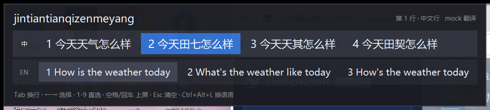
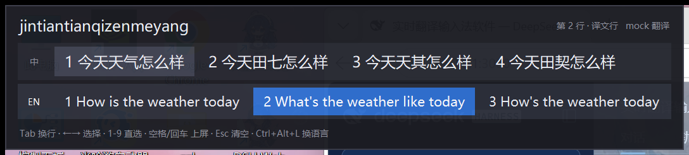
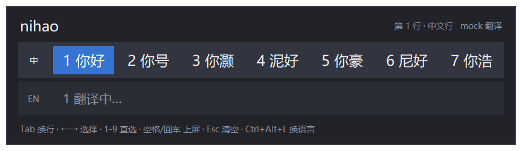
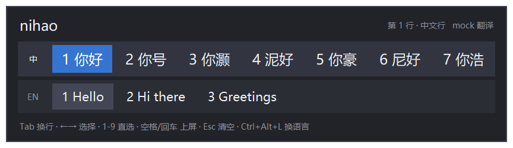
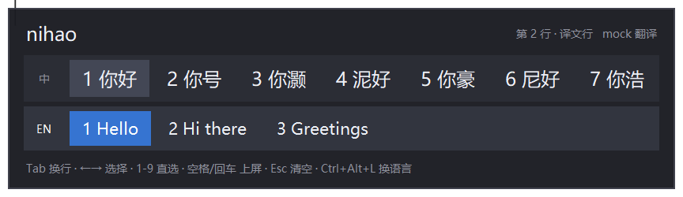
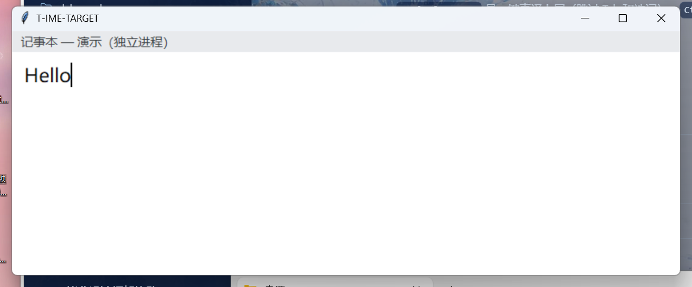

<div align="center">

# translate-ime

**一个把「翻译」做进输入法里的中文拼音输入法。**

打拼音出中文，同时把译文摆在旁边 —— **按一下 Tab，上屏的就是另一种语言。**

[](#环境要求)
[](https://www.python.org/)
[](LICENSE)

[中文](#中文) · [English](docs/README.en.md)

</div>

---

## 中文

### 这是什么

普通输入法只解决「怎么把字打出来」。这个输入法多解决一件事：**打出来的话，能不能同时是另一种语言。**

场景很具体 —— 你在跟一个英文母语的人聊天、写邮件、发 issue，脑子里想的是中文，但你要发出去的是英文。常规做法是「先用中文输入法打完 → 复制 → 丢进翻译网站 → 复制译文 → 粘回来」，四步。

translate-ime 把它压成一步：



```
你打:    nihao
候选窗:  ┌─────────────────────────────────┐
         │ nihao              第 1 行 · 中文行 │
         │ 中  1 你好  2 你号  3 泥好  …      │
         │ EN  1 Hello  2 Hi there  …        │  ← 译文实时生成
         │ Tab 换行 · ←→ 选择 · 空格上屏 …    │
         └─────────────────────────────────┘
你按:    空格 → 上屏「你好」      Tab 再空格 → 上屏「Hello」
```

按 `Tab` 后高亮切到译文行，上屏的就变成英文：



**「上屏语言」是一个粘住的模式**：按一次 Tab 切到译文行，之后每次空格上屏的都是译文，直到你再按一次 Tab 切回来（或者用热键切）。

### 现场演示

下面四张都是**真截图**，不是示意图 —— 真的悬浮窗、真的拼音引擎、真的翻译工人、真的 `SendInput` 注入，靶子「记事本」跑在**另一个进程**里。

**① 打 `nihao`** —— 中文候选立刻出来，译文行先显示「翻译中…」，你不用多按任何一个键



**② 译文自己到了** —— 译文行变成 `Hello` / `Hi there` / `Greetings`



**③ 按 Tab** —— 高亮（蓝底）切到译文行，中文行退成淡色预选



**④ 按空格** —— `Hello` 被注入进另一个进程的记事本，那个 `Hello` 是记事本自己写出来的，不是贴上去的



### 特性

- **并排双语候选** —— 中文一行、译文一行，`Tab` 在两侧切换高亮，`←→` 选词，`1`-`9` 直选，空格/回车上屏。
- **实时翻译，防抖** —— 你还在打字时不会每敲一个字母就发一次请求；停手 250ms 后按**当前最佳中文候选**去翻。
- **译文也有多个候选** —— 译法不是唯一的，译文行同样能横向挑（默认最多 4 条）。
- **一键直译上屏** —— `Ctrl+Alt+Space` 跳过选词，直接把最佳译文注入目标窗口。
- **点一下 `Shift` 切中/英** —— 敲一下左/右 Shift（松手在 600 毫秒以内）就在「拼音→中文」和「英文直通」之间切换；直通模式下所有键原样透传，`Shift+字母` 照样是大写。
- **自学习** —— 用数字键改选了非首选项，那个词会被记住并加权，下次顶到首位。
- **能后台常驻** —— 双击 `run.bat` 就是 `pythonw.exe` 起的无窗口进程，关掉终端也不影响；带单实例锁和开机自启。
- **没配 API key 也能跑** —— 自动退回内置离线短语词典（约 160 条常用词），方便先把界面玩明白。
- **不注册进系统输入法列表** —— 它是一个独立进程 + 全局键盘钩子 + 悬浮窗，不改系统设置，退出就干净了。

### 环境要求

| 项目 | 要求 |
| --- | --- |
| 系统 | **Windows 10 / 11（仅 Windows）**。底层是 Win32 低级键盘钩子（`WH_KEYBOARD_LL`）+ `SendInput`，没有跨平台实现。 |
| Python | 3.10 或更高。 |
| 依赖 | 只有 `pypinyin` 和 `jieba` 两个。 |
| 网络 | 用 DeepSeek 时要能访问 `https://api.deepseek.com`；没有网络也能跑，只是翻译退化成 mock。 |

> 不需要 MSVC，不需要 .NET SDK，不装驱动，不注册输入法。

### 安装

```bat
git clone https://github.com/xuan-ed/translate-ime.git
cd translate-ime

python -m venv .venv
.venv\Scripts\activate

pip install -r requirements.txt
```

### 配置 API key

翻译走 DeepSeek 的 OpenAI 兼容接口。三选一，最省事的是第一条：

**方式零：设置窗口（第一次用推荐）** —— 双击 `run.bat` 会弹出设置窗口，把 key 贴进「翻译模型」的第一个输入框，点「保存并同步」。它会写进 `config.json`，并通知已经在跑的实例热重载，**不用重启**。

**方式一：环境变量（密钥不落盘）**

```bat
setx DEEPSEEK_API_KEY sk-xxxxxxxxxxxxxxxx
```

（`setx` 之后要新开一个终端才生效。也支持 `T_IME_API_KEY`。）

**方式二：配置文件** —— `run.bat --init-config` 会把 `config.example.json` 复制成 `config.json`，你打开它填 `api.api_key`。`config.json` 在 `.gitignore` 里，不会被提交。

### 使用

```bat
run.bat                :: 后台常驻启动，并弹出设置窗口
run.bat --doctor       :: 出任何问题先跑这一条
run.bat --foreground   :: 留在前台看日志
run.bat --web          :: 网页控制板，在浏览器里改快捷键和 API key
```

> 都用 `run.bat` 开头 —— **不要直接敲 `python main.py ...`**：你系统里的 `python` 通常没装
> `jieba` / `pypinyin`，会看到一堆 `[FAIL] 依赖`。`run.bat` 会自己找 `.venv`，没有就先建好。

第一次启动会花约 2 秒从 jieba 词库反向构建拼音索引（约 56,000 个拼音键），之后缓存在 `pinyin_index.pkl` 里，再启动是毫秒级。启动后候选窗会先弹一份 6 行引导，7 秒后缩成一句短提示。

#### 快捷键

| 快捷键 | 作用 |
| --- | --- |
| 字母 / `'` | 打拼音；`'` 当分词符吞掉，候选仍按整串拼音算（`xi'an` 与 `xian` 相同） |
| `Tab` | **在「中文行」和「译文行」之间切换 —— 决定这次上屏哪种语言** |
| `←` `→` / `↑` `↓` | 在当前行里选候选 |
| `1` – `9` | 直接选第 N 个候选上屏（改选会被自学习记住） |
| `空格` / `回车` | 上屏当前高亮行选中的候选 |
| `Esc` | 清空当前拼音缓冲 |
| `Backspace` | 退格；缓冲已空时透传给目标程序 |
| **点一下 `Shift`** | 切「拼音 → 中文」/「英文直通」（松手 600 毫秒以内；直通模式下按键原样透传） |
| **`Ctrl+Alt+Space`** | 一键直译上屏 |
| **`Ctrl+Alt+L`** | 切换默认上屏语言（相当于 Tab） |
| **`Ctrl+Alt+Z`** | 挂起 / 恢复（挂起时按键全部透传） |
| **`Ctrl+Alt+Q`** | 退出 |

几个刻意的设计决定：

- **缓冲为空时 `Tab` 会透传给目标程序**，否则你在编辑器里永远打不出制表符。要切语言用 `Ctrl+Alt+L`。
- **按住 `Ctrl` / `Alt` / `Win` 时完全透传**，`Ctrl+C` 这类快捷键不会被吃掉。
- **上屏是 `SendInput` 注入 Unicode 字符**，不走剪贴板，不会破坏你剪贴板里的内容。
- **切到别的窗口时自动清掉半截拼音**，不会把上一个窗口的缓冲带进新窗口。

### 设置窗口

双击 `run.bat` 除了启动输入法，还会打开一个图形设置面板。它是第一次用最该看的东西：

- **填 API key** —— 控制台里没有能安全输入密钥的地方。
- **看清楚现在到底能不能打字** —— 左边状态卡列出 `权限`、`键盘钩子`（收到过几个真实按键）、`托盘图标`、`候选窗`、`翻译`、`自学习`、`实例 pid`。最上面那条横幅只说**最要紧的一件事**，并带着下一步该点的按钮。
- **一键改热键** —— 每个热键右边有「按一下」按钮，按下你想用的组合就行。
- **权限那一行最值得先看** —— 显示 `Low` 就说明打字不会有任何反应（UIPI 不让低完整性进程看到普通窗口的按键），横幅会给一个「以管理员身份重启」按钮。

「保存并同步」写的是启动时用的那份 `config.json`，写完给实例投一条 `reload`；改快捷键、改翻译开关立刻生效，改**拼音**或**候选窗外观**要重启实例。窗口只允许开一个。不想每次弹：`--no-panel` 或配置 `"ui": {"open_panel_on_start": false}`；只想开窗口不启动输入法：`run.bat --panel`。

### 已知限制

- **只有 Windows。** 换平台要重写 `winapi.py` 整个模块。
- **没有注册进系统 IME 列表。** 这是刻意的，代价是个别用 TSF 深度集成的程序（某些游戏、Electron 富文本框）里可能表现异常；`Win+Space` 里也永远不会出现它。
- **管理员窗口打不进去。** UIPI 会丢掉普通进程注入的按键 —— 那种窗口需要本工具也用管理员身份启动（设置窗口里有一键按钮）。
- **托盘图标在低完整性进程里装不上**（`NIM_ADD` 返回 `ACCESS_DENIED(5)`）。正常双击 `run.bat` 没这个问题；被降权的沙箱里则打不开托盘菜单，但程序不会崩。
- **翻译有网络延迟。** 候选窗先显示中文、译文随后补上；译文没回来时按空格上屏的是中文。
- **光标准确定位依赖目标程序提供 caret 信息**，拿不到时退回鼠标位置。

### 出问题先跑这个

```bat
run.bat --doctor
run.bat --show-config   :: 改了配置却没反应时跑这条
```

`--doctor` 把「你机器上才有的情况」逐项变成一行实测结论（实例状态、完整性级别、钩子装不装得上、候选窗落在哪、配置与热键、日志能不能写），报告同时写进 `translate-ime-doctor.txt`。`--show-config` 会打印**每个选项的生效值和来源**，并点名拼错的键。

### 文档

- [使用流程](docs/使用流程.md) —— 首次配置、怎么确认它真在接管、日常按键、出问题的排查顺序
- [进阶用法与疑难排查](docs/进阶用法.md) —— 语言栏、后台常驻的完整开关、已知限制的细节、`--doctor` 怎么读
- [配置项参考](docs/配置参考.md) —— 完整配置表与取值范围
- [开发与原理](docs/开发与原理.md) —— 内部实现、候选算法、准确率实测、测试
- [English](docs/README.en.md)

### 许可证

[MIT](LICENSE)。
