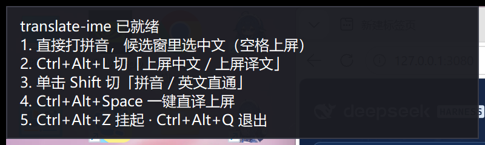

# translate-ime（English）

> 英文版说明，保留原文。返回 [项目主页](../README.md)。


### What it is

Most IMEs answer one question: *how do I type these characters?* This one answers a second one: **can what I typed come out in another language?**

The scenario is concrete. You're chatting, emailing, or filing an issue with an English speaker. You think in Chinese, but you need to send English. The usual flow is four steps: type Chinese → copy → paste into a translation site → copy the translation → paste back.

translate-ime collapses that into one:


```
You type:  nihao
Overlay:   ┌─────────────────────────────────┐
           │ nihao             row 1 · Chinese│
           │ 中  1 你好  2 你号  3 泥好  …      │
           │ EN  1 Hello  2 Hi there  …        │  ← translated live
           │ Tab switch · ←→ pick · Space send │
           └─────────────────────────────────┘
You press: Space → commits 「你好」    Tab then Space → commits "Hello"
```

After `Tab` the highlight moves to the translation row, and commits become English:


**The commit language is a sticky mode.** Once you hit Tab to move to the translation row, every subsequent commit sends the translation until you Tab back (or use the hotkey). That *is* the "pick Chinese or the translation via a shortcut" behaviour.

### Live demo

All four images below are **real screenshots**, not mock-ups: real overlay window, real pinyin engine, real translation worker, real `SendInput` injection. The "notepad" target runs in a **separate process** — a same-process target would be classified as "ours", which would not prove anything.

**① Type `nihao`** — Chinese candidates appear instantly, the translation row says "translating…", and you pressed no extra key


**② The translation arrives on its own** — the translation row now holds `Hello` / `Hi there` / `Greetings`


**③ Press Tab** — the blue highlight moves to the translation row, the Chinese row goes to a soft preselection


**④ Press Space** — `Hello` is injected into the notepad **in another process**. That `Hello` in the screenshot was typed by the notepad itself, not pasted in:


To reproduce it yourself (opens windows and types by itself, ~3 s — don't grab the mouse or keyboard meanwhile): `python tests/demo_frames.py`

### Features

- **Side-by-side bilingual candidates** — Chinese on one row, translation on the other. Tab switches rows, ←→ picks, 1-9 picks directly, Space/Enter commits.
- **Debounced live translation** — it doesn't fire a request per keystroke; 250 ms after you stop, it translates your current best Chinese candidate.
- **Multiple translation variants** — translations aren't unique, so the translation row is horizontally selectable too (4 by default).
- **One-key translate-and-commit** — `Ctrl+Alt+Space` skips selection and injects the best translation straight into the target window.
- **Tap `Shift` to switch Chinese/English** — one tap of either Shift (release within **600 ms**; an unhurried press counts) toggles between "pinyin → Chinese" and "English passthrough". In passthrough every key goes through untouched, except `Shift+letter`, which still types a capital as usual. Why there is a time window at all — and why it is not simply removed — is pitfall 22.
- **Self-learning** — if you pick a non-first candidate with a number key, that word is boosted and rises to the top next time. Weights persist to `user_boosts.json`; an entry you hand-edit into a non-number only drops that entry and is reported in the log — it never stops the IME from starting.
- **Suspendable** — `Ctrl+Alt+Z` passes every key straight through, so it never gets in the way of coding.
- **Runs in the background** — double-clicking `run.bat` gives you a windowless process under `pythonw.exe` that survives closing the terminal; it logs to `translate-ime.log`, holds a single-instance mutex (a second double-click opens the control panel instead of installing a competing hook — see pitfall 23: merely *asking* whether it runs must use the lock-free `is_running()`, or the asker carries the lock away itself), and `--autostart` registers it for login.
- **Tells you how to use it on startup** — a six-line guide appears in the overlay, collapses to a one-line hint after 7 seconds, and stays available from the tray menu's "使用帮助…".
- **Not registered as a system IME** — it's a standalone process with a global keyboard hook and an overlay. It changes no system settings and leaves nothing behind on exit.
- **Runs without an API key** — it falls back to a built-in offline phrase dictionary (~160 common words) so you can explore the UI first.

### Requirements

| | |
| --- | --- |
| OS | **Windows 10 / 11 only.** The core is a Win32 low-level keyboard hook (`WH_KEYBOARD_LL`) plus `SendInput`; there is no cross-platform path. |
| Python | 3.10+ (uses `X \| None` syntax). |
| Dependencies | Just `pypinyin` and `jieba`. |
| Network | Outbound HTTPS to `https://api.deepseek.com` when using DeepSeek. It still runs offline, with translation degraded to mock. |

> No MSVC, no .NET SDK, no admin rights. The hook is installed into the current user session.

### Install

```bat
git clone https://github.com/<you>/translate-ime.git
cd translate-ime

python -m venv .venv
.venv\Scripts\activate

pip install -r requirements.txt
```

### Configure the API key

Translation goes through DeepSeek's OpenAI-compatible endpoint. Three ways; the first one is the least work:

**Option 0: the settings window (recommended for first run)**

Double-click `run.bat` and a "translate-ime 设置" window opens. The left side is live status, the right side has a `翻译模型（AI）` section — paste the key into the first field and press 保存并同步. It writes `config.json` and tells the running instance to reload, **no restart needed**.

**Option 1: environment variable (recommended — the key never touches disk)**

```bat
setx DEEPSEEK_API_KEY sk-xxxxxxxxxxxxxxxx
```

(Open a new terminal after `setx`. `T_IME_API_KEY` works too.)

**Option 2: config file**

```bat
run.bat --init-config
```

This copies `config.example.json` to `config.json`; open it and fill in `api.api_key`. `config.json` is already in `.gitignore` and will never be committed.

### Usage

```bat
run.bat                :: detached and resident; use run.bat --foreground to keep the log on screen
                       :: equivalent manual command: python main.py --background
run.bat --doctor       :: run this first whenever something is wrong; writes a diagnosis report
run.bat --web          :: open the web control panel to edit hotkeys and the API key
```

> Every command above starts with `run.bat` — **do not type `python main.py ...` directly**:
> the `python` on your PATH usually lacks `jieba` / `pypinyin`, so you get a wall of
> `[FAIL] dependencies`. `run.bat` finds (or creates) `.venv\Scripts\python.exe` itself; to run
> it by hand, use `.venv\Scripts\python.exe main.py ...`.

A detailed walkthrough — setup, verifying it really takes over, daily keys, suspending and quitting, autostart, the troubleshooting order, and six hands-on acceptance checks — lives in [docs/使用流程.md](使用流程.md) (Chinese).

The first launch spends ~2 s building a pinyin index from the jieba dictionary (~56,000 keys); it is then cached in `pinyin_index.pkl`, and later launches are instant.

After that it behaves as a global IME: type pinyin in any input field and the candidate overlay pops up under the caret. **The first launch shows a short usage guide in the overlay** — read it and start typing.



#### Hotkeys

| Key | Action |
| --- | --- |
| letters / `'` | Type pinyin; while typing pinyin `'` is swallowed as a syllable separator (it never lands in the document), and candidates are still computed for the whole string (`xi'an` and `xian` give the same candidates) |
| `Tab` | **Switch between the Chinese row and the translation row — this decides which language commits** |
| `←` `→` / `↑` `↓` | Move the selection within the current row |
| `1` – `9` | Commit the Nth candidate directly (a re-pick is remembered by the self-learner) |
| `Space` / `Enter` | Commit the highlighted candidate of the current row |
| `Esc` | Clear the current pinyin buffer |
| `Backspace` | Backspace; passes through when the buffer is already empty |
| **Tap `Shift`** | Toggle "pinyin → Chinese" / "English passthrough". Released within 600 ms, otherwise it counts as a held Shift; in passthrough every key goes through as-is, and `Shift+letter` still types a capital |
| **`Ctrl+Alt+Space`** | Translate and commit in one key (skips Tab and selection) |
| **`Ctrl+Alt+L`** | Toggle the default commit language (Chinese ⇄ translation) |
| **`Ctrl+Alt+Z`** | Suspend / resume the IME (all keys pass through while suspended) |
| **`Ctrl+Alt+Q`** | Quit |

A few deliberate decisions:

- **`Tab` passes through when the buffer is empty** instead of switching modes — otherwise you could never type a tab character in an editor. Use `Ctrl+Alt+L`, or type something first and then Tab.
- **Holding `Ctrl` / `Alt` / `Win` passes everything through**, so `Ctrl+C` and friends are never swallowed. `Shift` is excluded from that rule: `Shift+letter` still goes to pinyin.
- **Committing uses `SendInput` with Unicode characters**, not the clipboard, so it never clobbers your clipboard.
- **Switching to another window discards the half-typed pinyin**, so a stale buffer never leaks into the new window.

#### Editing hotkeys and the API key in a browser (web control panel)

If you would rather not hand-edit JSON:

```bat
run.bat --web                  :: http://127.0.0.1:8765/ by default
run.bat --web --web-port 9000 --no-browser
```

What the page can do:

- **Edit hotkeys**: click "press a key" and type the combination. The capture **swallows that one press** — the foreground app never sees it and the resident instance does not fire it as a real hotkey (so pressing your current `Ctrl+Alt+Q` there will not quit the IME). Bare letters and `Shift`-only combos are rejected with an explanation.
  *(Round 109 fix: it used to swallow nothing **and** unpack the wrong shape, so clicking "press a key" returned HTTP 500; pressing the currently active quit hotkey inside the panel really quit the instance.)*
- **Edit the API key / provider / model / base_url**: the key is sent back to the browser only as `********` (leave it blank = keep it; use "clear" to remove it). **Saving makes the running instance reload the config immediately — no restart** (`config_reloads` in the status file goes up, and the panel shows "config reloaded N times").
- **Trigger instance actions**: reload config / suspend-resume / toggle commit language / quit — all through the same inbox the tray menu uses.
- **See the current state**: is the instance running, is it suspended, why did the last reload fail; and when the instance **refuses** an action you clicked, a line appears at the top — `实例提示：…` ("instance says: …") — with the reason (round 110 fix: the console panel had that line since round 105, but the web page only flashed the 1.6-second candidate-window toast, so clicking a button looked like nothing happened).

It binds `127.0.0.1` only and accepts writes only with the per-process random ticket the page carries (`X-T-IME-Token`), so other websites cannot press its buttons; there is no login (it is a local tool). Options that need a restart (`pinyin.min_freq` / `pinyin.max_word_len` / `pinyin.dict_cache` / `output.log_file` / window appearance) are flagged when saving. If the existing `config.json` cannot be parsed it refuses to save and leaves the file untouched instead of overwriting it with defaults.

### The settings window (read this first)

`run.bat` opens a graphical settings window after starting. It exists because three things used to require a command line or hand-editing JSON:

1. **Entering the API key** — there was no safe place for it in a console menu.
2. **Seeing whether it can actually type right now** — the status card lists `权限` (integrity level: `Low` means no key will ever reach it), `键盘钩子` (real keystrokes seen), `托盘图标`, `候选窗`, `翻译`, `自学习`, and the instance pid. The banner on top names the single most important problem and carries the button for the next step.
3. **Rebinding hotkeys** — press 按一下 next to a field and hit the combination; no need to remember the `ctrl+alt+space` spelling.

Conventions: 保存并同步 writes the config file the instance was started with and sends it a `reload` command (hotkeys and translate switches apply immediately; the `拼音` and `候选窗外观` groups need a restart and the window says so); only one panel may be open at a time; `--no-panel` or `"ui": {"open_panel_on_start": false}` disables the auto-open; `run.bat --panel` opens just the window.

### Why it is missing from the language bar (it is not a system IME)

It registers no TSF text service and installs no keyboard layout, so **it never shows up in Win+Space or the taskbar language bar** — there is no "select it" step. Once started it takes over letters through a global keyboard hook; just type pinyin.

- **How to confirm it is working**: in any window that accepts text, type `nihao` — the candidate overlay pops up under the caret and Space commits 你好. If nothing happens, press `Ctrl+Alt+Q` to quit and run `run.bat --doctor`; the "keyboard hook" and "candidate window" lines in the report point at the layer that is not working.
- **Relation to Microsoft Pinyin**: while this tool runs, the hook takes the letters first and Microsoft Pinyin never sees them; it is still installed, so Win+Space can switch to it at any time. Press `Ctrl+Alt+Z` to suspend this tool (all keys pass through) when you want the system IME back.
- **To get rid of Microsoft Pinyin entirely**: Settings → Time & language → Language & region → "中文(简体，中国)" → remove Microsoft Pinyin; or keep only "英语(美国)" in Win+Space. This tool does not depend on any system IME.
- **The only windows it cannot type into**: windows running elevated — Windows UIPI drops injected keys from a normal-integrity process, so this tool must also run elevated to type there.
- The tray icon is optional: a normal `run.bat` launch shows it; started from a low-integrity process the shell refuses it, `run.bat --tray-check` explains why, and the control panel (double-click `run.bat` again) is then the way to suspend or quit.

### Running in the background

**Double-clicking `run.bat` *is* the resident launch** — it prints the log path and returns immediately, and the process started under `pythonw.exe` has no window. **Closing that black box does not affect the IME.** (This used to be the other way round: in the foreground, closing the console killed the program, which looks exactly like "it just stopped working on its own".)

If this machine is still missing its dependencies (`pypinyin` / `jieba`), or the index has never been built, `run.bat` now **prints the reason and the install command right there** and waits for a keypress — no more "the black window flashes and nothing happens". The extra 1.5 s is spent confirming that the background process really is alive; see pitfall 39.

A directory **with spaces or non-ASCII characters** works just the same: `Program Files`, `Desktop`, `D:\我的软件` can all be double-clicked directly — the index, log, status file and the quoting inside the autostart command all follow that path (`tests\test_path_handling.py` copies the whole program into `…\输入法 路径 xxxx\带 空格 的 程序` and really runs 44 checks: `--check`, `run.bat`, a `--background` resident, real keys committing 「你好」, and a clean `quit`).

The equivalent manual command, plus the related switches:

```bat
run.bat --background
```

`--background` returns immediately; the real process is started under `pythonw.exe`. Related switches:

| Command | Effect |
| --- | --- |
| `run.bat` | Resident launch (same as `python main.py --background`) |
| `run.bat --foreground` | The opposite: stay in the foreground to watch the log (`--foreground` always beats `--background`) |
| `run.bat --background` | Start detached with no console |
| `run.bat --log D:\path\to.log` | Use a specific log file (default `translate-ime.log`, rotated to `.1` past 2 MB); point it at a directory (including `D:\logs\`) and `translate-ime.log` is created inside it |
| `run.bat --autostart` | Register a login autostart entry under HKCU; falls back to a `.cmd` in the Startup folder (no admin needed either way, and both routes have been measured actually launching the instance). `--config` / `--log` given alongside are recorded in the entry too (relative paths become absolute), and the full "what runs at login" command line is printed afterwards |
| `run.bat --no-autostart` | Remove the autostart entry |
| `run.bat --autostart-status` | Just print whether autostart is on |
| `run.bat --check` | Self-check: environment, hotkeys, dictionary, index, translation, window layer (really builds the candidate window once and tears it down; fails when it cannot). With an instance resident it names the config that instance is using, and warns when `--config` points at a different file — so you never assume the file you edited is the one in effect |
| `run.bat --show-config` | Print the **effective value and source of every option** (`[file]`/`[default]`/`[env]`) and name any mistyped keys; exit code 1 when there are mistyped keys |

> The foreground path writes the log too (console *and* file) — once the console closes there is nothing left, and when you report "it stopped working" the log is usually the only clue.

Once resident there are three entry points:

- **Double-click `run.bat` again** — it notices one is already running and instead **opens a small control panel** (no tray required):
  it shows that instance's pid, whether it is suspended, pinyin vs English passthrough, commit language, tray status, **what the login-autostart entry currently is** (on via the registry / on via the Startup folder / off — the system can quietly fall back to the Startup folder, or the install can fail outright, and the user should not have to remember which), **how many words self-learning has remembered and whether they have reached the disk yet**, **whether translation is running against the online DeepSeek API or the offline glossary, how many requests it made, how many hits the cache served, how often it failed and why the last failure happened**, **how many real keystrokes the keyboard hook has seen and how many it swallowed**, **how many times the candidate window has been shown and which monitor it landed on**, and log path,
  **plus an extra line whenever CapsLock is on** — "大写锁定 开（现在敲字母会直接打出英文大写，不弹候选）" — because otherwise the user concludes the input method is broken; see pitfall 20,
  then offers a menu: suspend/resume, toggle English passthrough, switch the default commit language, show help in the candidate window,
  open the log, open the config, quit. After each choice it **re-reads the real status and redraws**, so what you see is that instance's
  actual state rather than a guess. (To make it say nothing and just leave: `python main.py` on a non-interactive console prints a note
  and exits with code 3.)
- **The tray icon** (right-click): enable/suspend, English passthrough, commit translation, current status, help, open log, open config, quit.
- **`Ctrl+Alt+Q`**: quit directly, without needing the tray.

> The panel and the tray speak the **same command set** (`toggle_enabled` / `toggle_direct` / `toggle_default` / `help` / `open_log` /
> `open_config` / `quit`). The running instance writes its state to `translate-ime.status.json` (whenever it changes, and **at least once
> every 5 seconds as a heartbeat** — the outside world reads that file's mtime to tell a live instance from a hung one, so without the
> heartbeat "idle, not typing" was misreported as "hung"; see pitfall 17), and the panel appends a
> line to `translate-ime.ctl`. Files rather than IPC: no server process to keep alive, and it can be tested offline. Both are in `.gitignore`.

> Single-instance guard: if one is already running, a second launch will not install a competing hook
> (two low-level keyboard hooks fight over keys: the symptom is "candidates show up sometimes and not other times").

> The log file is UTF-8. On Windows PowerShell read it with `-Encoding utf8`
> (`Get-Content translate-ime.log -Encoding utf8`), otherwise it defaults to the ANSI code page and the
> Chinese text looks like mojibake.

### Configuration

The full template is [`config.example.json`](../config.example.json). The ones you'll actually touch:

> After editing, run **`run.bat --show-config`**: it prints the **effective value and source** of every option (`[file]` / `[default]` / `[env]`) and names the keys `DEFAULTS` doesn't know about — a mistyped key and a whole file ruined by a BOM both look like "my change did nothing".

> A **wrongly-typed entry** (`"variants": "four"`, `"max_candidates": 0`) neither crashes the program nor breaks it silently: `load()` falls back to that option's default and prints one plain sentence at startup — `translate.variants 应该是整数（1~8），现在是 "four" —— 用默认值 4`. Before this round the first case took `--check` down with a traceback, and the second drew an empty candidate row. Likewise, a **misspelled key** in `config.json` (`font_szie` instead of `font_size`, `hotkey` instead of `hotkeys`) neither errors nor takes effect — `load()` names it at startup too; keys/sections starting with `_` are comments and stay quiet.

| Key | Default | Meaning |
| --- | --- | --- |
| `api.model` | `deepseek-chat` | Model used for translation |
| `api.api_key` | `""` | Empty falls back to the offline mock engine |
| `api.provider` | `deepseek` | `mock` forces the offline glossary (no network / no spend); `deepseek` or empty picks automatically from whether a key is set |
| `translate.debounce_ms` | `250` | How long to wait after typing stops before translating |
| `translate.variants` | `4` | Max distinct translations shown on the translation row |
| `translate.enabled` | `true` | Turn off to get a pure pinyin IME with no network calls |
| `pinyin.max_candidates` | `7` | Max Chinese candidates shown |
| `pinyin.min_freq` | `20` | Words rarer than this are dropped from the index (lowering it grows the index fast) |
| `output.default_language` | `zh` | Which row is highlighted at startup |
| `output.start_enabled` | `true` | `false` = start suspended until you press `Ctrl+Alt+Z` |
| `output.tray` | `true` | Show a tray icon |
| `output.log_file` | `translate-ime.log` | Log file name in background mode (rotated to `.1` past 2 MB) |
| `hotkeys.toggle_direct` | `""` | Bind a combo for "pinyin / English passthrough"; leave empty to use the `Shift` tap only |
| `hotkeys.<action name>` | — | The only valid action names are `compose` / `quit` / `toggle_default` / `toggle_direct` / `toggle_enabled`; a misspelled name is ignored and named in the console / log instead of becoming a hotkey that does nothing. **A combo must carry a modifier** (`ctrl` / `alt` / `win`, at least one); single keys that typing never touches, like F1–F12, are the exception. A typing key such as `"quit": "q"` is refused outright (`--check` fails, the log names it), because otherwise typing that letter fires the action — pitfall 72 |
| `input.shift_tap_ms` | `600` | A Shift press released within this many ms counts as a tap (longer = an ordinary held Shift). Widened from 300 to 600 in round 20: an unhurried "press Shift to switch" routinely takes longer than 300 ms, and back then it did nothing at all. **Set it to 0 to turn the Shift tap off** — a zero-width window never fires, and `--check` will say so |
| `input.toast_ms` | `1600` | How long a short toast stays in the overlay |
| `overlay.*` | — | Colours, font sizes, width, opacity, vertical offset from the caret |

### How it works

```
       ┌──────────────── hook thread ──────────────┐
keyboard → WH_KEYBOARD_LL → core.handle_key() → swallow or pass?
                                 │
                                 ├─ pinyin buffer ─→ PinyinEngine ─→ Chinese candidates
                                 │                        │
                                 │              TranslateWorker (debounced, newest only)
                                 │                        ↓
                                 │              Translator ─→ DeepSeek / mock
                                 ↓
                           emit event into a queue
                                 ↓
       ┌──────────────── main thread (Tk) ─────────┐
       every 16 ms: drain events → collect translations → Overlay.render() near caret
                                 ↓
                    Space/Enter → W.send_text() → SendInput into the target window
```

| File | Responsibility |
| --- | --- |
| [`t_ime/winapi.py`](../t_ime/winapi.py) | Pure `ctypes` Win32 wrapper: global keyboard hook, `SendInput` Unicode injection, `GetGUIThreadInfo` caret lookup, `WS_EX_NOACTIVATE` overlay plumbing. **No business logic.** |
| [`t_ime/pinyin.py`](../t_ime/pinyin.py) | Pinyin → Chinese. Builds an inverted index from the jieba dictionary and searches candidates with K-best Viterbi over a DAG. |
| [`t_ime/translator.py`](../t_ime/translator.py) | Translation layer. `DeepSeekProvider` / `MockProvider` with an LRU cache and multi-variant output. |
| [`t_ime/core.py`](../t_ime/core.py) | The input state machine. **Pure logic, imports no tkinter**, so it is testable headlessly. |
| [`t_ime/overlay.py`](../t_ime/overlay.py) | The Tk candidate overlay: positioned at the caret, never steals focus. |
| [`t_ime/app.py`](../t_ime/app.py) | Glues it together: installs the hook, runs the Tk loop, commits text, shows the startup guide, drives the tray menu. |
| [`t_ime/daemon.py`](../t_ime/daemon.py) | Background residency: `pythonw` spawn, file logging with rotation, single-instance mutex, login autostart, status file and command inbox (including discarding the previous instance's leftover commands at startup). |
| [`t_ime/tray.py`](../t_ime/tray.py) | Tray icon and context menu (pure `ctypes`, no third-party library). |

There are one hundred and nineteen pitfalls worth writing down, because all of them are easy to miss:

1. **`sizeof(INPUT)` must be 40 on x64.** If the `INPUT` union contains only `KEYBDINPUT` and not `MOUSEINPUT`, it computes to 32 and `SendInput` **fails silently**. `winapi.py` fills in the union for exactly this reason.
2. **The overlay steals focus.** Not when it is shown — at the moment `tk.Tk()` is **constructed**, even though the window is immediately withdrawn. Once it holds the foreground, every character `SendInput` injects lands in the overlay itself and the user's target application receives nothing. So `Overlay.__init__` records the current foreground window and hands it straight back, and `show()` uses `ShowWindow(SW_SHOWNOACTIVATE)` instead of Tk's `deiconify()`.
3. **`SetForegroundWindow` fails silently, and intermittently.** Windows has a foreground lock that rejects calls from a process that isn't already foreground — with no error, just no effect (at most a taskbar flash). Pitfall 2's "hand it back" depends entirely on that call, so `winapi.set_foreground()` first `AttachThreadInput`s this thread's queue to the current foreground thread, sets it, detaches, and then **verifies with `GetForegroundWindow()`**, retrying and warning on stderr if it didn't take. This is also why two of the tests used to go red at random.
4. **Without DPI awareness the window is blurry on a scaled display.** A process is DPI-unaware by default and Windows stretches its whole bitmap: on a 2560×1440 @150% display `winfo_screenwidth()` lies and reports `1707`, and glyphs are upscaled. `Overlay` calls `SetProcessDpiAwareness(2)` before `tk.Tk()` and multiplies every pixel dimension by the scale factor itself. **There is an ordering trap here too**: if anything asks `GetSystemMetrics` / `GetDC` before `tk.Tk()` (the first version of `--doctor` did exactly that), Windows **locks the process to UNAWARE** and the later `SetProcessDpiAwareness(2)` fails with `E_ACCESSDENIED` — without raising, so the window quietly goes back to being blurry. `main.py` therefore calls `enable_dpi_awareness()` before running any probe, and that function **re-reads the awareness level that actually took effect** instead of assuming success.
5. **A Tk font size is points when positive, pixels when negative.** With DPI awareness on, `tk scaling` becomes `144/72 = 2.0`; a positive size gets multiplied by that on top of the scale factor from pitfall 4, tripling the text (measured: a candidate chip 410px wide, seven candidates needing 1953px, so the window was always clipped). Every font size in `Overlay` is therefore negative (pixels).
6. **The overlay must avoid the monitor the caret is on, not the primary monitor.** Clamping used to use `winfo_screenwidth()/height()` (the primary size): with the caret on a monitor to the right, `x + w` exceeding the primary width pushed the window back onto the primary monitor — it looked like "the candidate window jumped to another screen", and in the extreme it landed off-screen entirely, with a valid window handle and `IsWindowVisible` still `True` while the user saw nothing. It now clamps against the rect of the monitor under the cursor via `MonitorFromPoint` (`tests/test_overlay_place.py` guards this with a fake secondary monitor). The scale factor is per-monitor too: on a monitor with a different DPI the fonts, paddings and width limits are recomputed for that monitor (see pitfall 44).
7. **A `.bat` file has to be pure ASCII.** cmd.exe reads a batch file using the **console codepage** (936 on a Chinese Windows), so a UTF-8 file gets its Chinese bytes mispaired into other characters — you see mojibake like `閫€鍑虹爜`. Worse: **Chinese text inside a `( ... )` block breaks the parser outright**, the following `echo` gets half-eaten into `'ho' is not recognized as an internal or external command`, the Python inside never runs, and the exit code is garbage. So `run.bat` stays pure ASCII and Chinese output is left to Python — which writes to a Windows console through `WriteConsoleW`, independent of the codepage. For the same reason `main.py`'s `_fix_console_encoding()` deliberately **leaves a real console alone** and only forces UTF-8 when output is redirected to a pipe or file.
8. **An exception inside a Tk `after` callback is never rescheduled, so the main loop dies silently.** This is the nastiest way "typing does nothing" happens: anything inside `_tick()` can raise (placement, merging translations, redrawing), Tk prints one traceback line to stderr and stops — and the line that queues the next heartbeat, `overlay.after(TICK_MS, self._tick)`, used to sit at the very end of the function, so there **is no next time**. At that point the hook is still installed, keys are still being swallowed, the overlay never appears again and nothing is ever committed: exactly "typing does nothing", with one inconspicuous traceback in the log. `_tick()` is now a shell: it runs `_tick_once()` inside `try`, records the failure in `self._tick_errors` and tells the user once, and the reschedule moved into `finally` (`tests/test_tick_guard.py` guards this, including "no more heartbeats after a quit request" and "`_tick_once` must not schedule one itself").
9. **`ShowWindow`'s return value is not "did it succeed" but "was it visible before".** A hidden window being shown for the first time **always returns 0**. `show_no_activate()` used to return that value directly, so every normal first show was reported as a failure — the status file, the control panel and `--doctor` all raised a false "display failed" alarm while the window was showing perfectly well. That kind of false alarm is worse than a crash: it sends you looking in entirely the wrong direction. Both functions now re-read `IsWindowVisible` *after* the operation, which is the semantics we actually wanted (section 9 of `tests/test_winapi_smoke.py` guards it). This is also where the "how many times has the overlay shown" counter added in this round earned its keep — without it the false alarm would never have surfaced.
10. **"Typing does nothing" has to be pinned onto the hook side first, before you look any further.** The hook now keeps books: `real` (keys a human pressed), `foreign` (keys another program forwarded — see pitfall 11), `swallowed` (keys the IME ate so the app underneath never saw them), plus how long ago the last **effective** keystroke was. Those numbers are the **only** facts that separate "the key never got in" from "the key got in but no window appeared", and they are written into the status file, shown in the control panel and reported in section `[0]` of `--doctor` — so **one double-click on `run.bat` shows them**, with no special command to remember. How to read them: `real == 0` means stop looking at pinyin and the overlay, the fault is on the hook side (Windows **silently removes** a low-level hook when the thread stops pumping messages or the callback times out — no error, no notification; security software and an elevated foreground window look the same). `real > 0` means the keys really did arrive, so the fault is downstream in the state machine, the overlay or the commit path. Sections 6b and 6c of `tests/test_winapi_smoke.py` guard that bookkeeping and the `swallowed` counter.
11. **`LLKHF_INJECTED` does not mean "we injected this ourselves", and conflating the two is exactly "typing does absolutely nothing".** Committing text works by injecting it back with `SendInput`, and a low-level hook **hooks our own injected characters too** — fail to recognise them and it self-excites (the injected "你好" is fed back into the state machine as keystrokes). The earliest code took the lazy way out and dropped every `LLKHF_INJECTED` event, and every test on this machine stayed green. But on a machine running **PowerToys Keyboard Manager / AutoHotkey / Logitech or Razer drivers / an OEM hotkey utility / an on-screen keyboard**, *every key a human presses is intercepted and re-sent by that software, and re-sent events all carry `LLKHF_INJECTED`* — so real keystrokes were discarded as self-excitation and typing did **absolutely nothing**, in a way that never reproduces on another computer. The two are now separated: `winapi.py` stamps every key it sends itself with a marker in `dwExtraInfo`, `T_IME_INJECT_TAG` (`0x54494D45`, ASCII `"TIME"`), and the hook treats an event as "ours" **only** when that marker is present; **injected events from anyone else are handled as real keystrokes**. `send_vk()` grew an `extra_info` parameter — passing anything else simulates "a key forwarded by a remapper", which is how the tests build the case (`type_keys_foreign()` in the second phase of `tests/test_hook_chain.py` injects `ni` through the production wiring with no wrapper at all and checks the pinyin buffer really becomes `"ni"`). One more thing to remember when testing by hand: **`SendInput` from a lower-integrity process into a higher-integrity foreground window (Edge, say) is silently dropped by UIPI** — `SendInput` still reports success, but no hook sees anything, so a manual injection check has to bring our own target window to the foreground first.
12. **A `config.json` saved with a UTF-8 BOM makes the entire config silently ignored.** Saving the file with PowerShell's `Set-Content` / `Out-File -Encoding utf8`, or with some editors, puts a UTF-8 BOM (`EF BB BF`) at the start, `json.loads` raises `JSONDecodeError: Unexpected UTF-8 BOM (decode using utf-8-sig): line 1 column 1 (char 0)`, and the earliest `load()` swallowed that exception and **fell back to the built-in defaults for the whole file** — so the user's experience is "I changed the config and nothing happened" (set `output.start_enabled` to `false` and the IME still starts enabled). Every config read now uses `encoding="utf-8-sig"` (`load()` and `read_raw()` in `t_ime/config.py`, plus `load_boosts()` reading `user_boosts.json` at `t_ime/core.py:737`), and the failure message now says outright that the whole file was ignored in favour of the defaults. **After editing the config, run `python main.py --show-config`**: it prints the effective value and source of every option (`[file]` / `[default]` / `[env]`) and names the keys `DEFAULTS` doesn't know about (a mistyped key is silently ignored too, and looks exactly like "my change did nothing"); the exit code is 1 when mistyped keys exist. Two related facts: `init_config()` **never** overwrites an existing `config.json`, so an old config never grows the new keys — `--show-config` tells you which options are running on defaults; and the control panel gained a "config file" line saying where the file is and whether anything is mistyped. All of this is guarded by the new `tests/test_config.py` (81 checks), which also asserts **drift protection**: `config.example.json` must equal `DEFAULTS` key by key, and `write_example()` must reproduce the committed file byte for byte.

13. **The status file a hard-killed instance leaves behind is a will, and the next instance obeys it — so double-clicking `run.bat` makes the IME kill itself on the spot.** A normal exit goes through `App.shutdown()`, which calls `daemon.clear_status()` and deletes the status file *and* the command inbox together; but when the process is taken out by `taskkill /F`, a crash, a logoff or a power cut, nobody cleans up, and **that `quit` line stays on disk in the inbox**. A new instance calls `take_commands()` on every tick, so the very first command it reads is the previous lifecycle's will and it exits within tens of milliseconds — the user sees "I double-clicked `run.bat` and the IME never started", with no error anywhere, and neither the tray nor the console leaves a trace. `App.start()` now begins with `_recover_leftovers()`: `daemon.discard_commands()` **throws the leftover commands away and logs them** (`[app] 丢掉了上一个实例残留的 N 条命令（它多半是被强杀的，没来得及自己清理）：['quit']`), then `clear_status()` removes the residual status file. Section `[0]` of `--doctor` no longer reports an **already dead pid** as alive either — it says outright "the status file is a leftover: process N is gone" and skips the lines that only describe a live instance. `tests/test_crash_recovery.py` (13 checks) stages that exact scene for real (a fake pid plus `toggle_enabled` / `quit` sitting in the inbox) and confirms the new instance survives and that the leftover `toggle_enabled` was **not** executed.

14. **The `.cmd` the autostart fallback writes into the Startup folder is worth nothing if its codepage is wrong — and it doesn't even report the error.** We hit this twice, with two completely different symptoms. **The first time**: the `.cmd` body carried a Chinese comment but was written with `encoding="ascii"` → `UnicodeEncodeError: 'ascii' codec can't encode character '\u7531' in position 15: ordinal not in range(128)`. That is **not** an `OSError`, so `except OSError` never caught it, and the exception travelled all the way out of `--autostart` as a traceback; meanwhile the file had already been created at **0 bytes**, and `autostart_status()` only checks whether the file exists, so from then on it kept claiming "autostart is on" while login did nothing at all. Now: the comments are pure ASCII, the content goes to `translate-ime.cmd.tmp` and is moved in with `os.replace()` (so a failure leaves nothing behind), a failure becomes the one-liner "写 translate-ime.cmd 失败：…", and `_startup_script_ok()` requires the file to be **non-empty** before it counts as enabled (a 0-byte leftover must not read as autostart). **The second time was nastier**: after switching the bytes to the machine codepage (`mbcs`) it was **still broken** — the bytes were right, but cmd.exe parses the file using **its own** codepage, so the Chinese path in it was read as `锟接伙拷`, cmd reported `The system cannot find the file D:\dsh-work\锟接伙拷\translate-ime\.venv\Scripts\pythonw.exe.`, the exit code was 1, no instance ever started — and "autostart is on" still looked correct. The fix is to **encode the file with `_cmd_cp()` (`GetOEMCP()`) and put a `chcp <that same codepage> >nul` line inside it** to align the two (the decisive experiment: the same cp936 bytes are parsed by cmd as UTF-8 replacement characters `\xef\xbf\xbd` without that line, and byte-for-byte correctly with `chcp 936`; a `chcp` line naming a codepage other than the file's own is just as wrong). The lesson is that **"it writes" is not "it reads back correctly"**, which is why `tests/test_autostart.py` contains a real end-to-end check: generate the `.cmd` → run it with `cmd /c` → poll the status file until the instance really is up → send it `quit`; asserting on the file's contents alone would have left this bug lying there forever. One more thing: **login autostart is subject to the same integrity limit** — in a downgraded session like this one (`Low (0x1000)`), `winreg` gets `[WinError 5] Access is denied` even for **creating a brand-new key** under `HKCU`, both routes fail with exit code 1, and the printed reason says outright that the process's integrity level is below the user's logon session and that this command must be run from a normally started terminal (double-clicking `run.bat` is fine); from a normal double-click it works. **Round 24 walked this whole line again, and the answer splits in two — both halves belong here.** Half one: the *installing* step genuinely cannot be done from a downgraded session like mine — `--autostart` is refused on both routes (`注册表：拒绝访问 —— …；启动文件夹：拒绝访问 —— …`), exit code 1, no traceback, so the failure path itself is honest. Half two matters more: **the things it installs really do run.** The registry command line, handed **verbatim** to `CreateProcess` (which is exactly what the system does when it reads the `Run` key), brings up a resident instance **with the keyboard hook installed** and shuts down cleanly from a path containing Chinese characters; the Startup-folder `.cmd` (with its `chcp 936` line) does the same through `cmd /c`. Section 6b of `tests/test_autostart.py` now guards both payloads — until then, "that command line launches a process" was a claim only the documentation made; nothing ever ran it. **And here is a trap that fools the verifier:** when you run such a payload, the command line must be handed to `Popen` **as a string** (the raw `CreateProcess` command line); passing an argv list makes Python add backslash escaping of its own (`\"D:\…`), which cmd does not understand — that is how the first version of the probe misjudged the registry payload as broken and nearly sent me off to "fix" working code. For the same reason, if you want to try that command line by hand in cmd you must wrap it in **one more pair of quotes** (`cmd /c ""…""`); a bare `cmd /c "…" "…"` is rejected by cmd's own `/c` quoting rules with `The filename, directory name, or volume label syntax is incorrect.` and exit code 1 — that is cmd being cmd, not a defect in the autostart entry.

15. **The hook's "self-check" lies, and it fooled two people: the user first, then me.** First, why it has to exist at all: `KeyboardHook.alive` means nothing more than "the handle is non-null and the thread is still pumping messages", while Windows will **silently remove** a low-level hook when a callback runs long (`LowLevelHooksTimeout`) or when the hook has received no system messages for a while — no error, no notification, handle and thread untouched, `alive` still `True`, and from then on none of your keystrokes arrive. The panel then states, with complete confidence, that the hook is fine, while what you see is "typing does nothing" and the only way out is restarting the program. There is hard evidence for "`alive` lies": the test really calls `UnhookWindowsHookEx` to remove the hook, and `alive` still reports `True`. **Then the two lies.** The first version of the self-check injected a harmless key (`0xFF`, unmapped on any keyboard) and watched whether it came back around — and it had two traps. **(a) The injector must own the foreground window.** Measured on this machine (Low integrity): with no foreground window of its own, `SendInput` still returns success while the key **never enters the system at all** — UIPI drops a low-integrity process's injection, and the return value does not reflect that. A resident instance is exactly "no foreground window" (`pythonw` plus a candidate window that deliberately refuses focus), so the self-check **failed forever**; the very same script run with `python.exe` (which owns a console window) passed immediately, run with `pythonw.exe` it failed every time, and it passes as soon as the process gets a foreground window of its own (even a withdrawn Tk window) — the decisive experiment is simply those two runs side by side. **(b) That false alarm really did come out of `--hook-check`**: pointed at a perfectly good hook, it printed "the self-check key **did not come back** — the hook installed but stopped working immediately" and exited `7`, i.e. it handed the user a diagnosis that was flatly wrong. Now `--hook-check` opens a small window of its own to take the foreground before self-checking, and when it **cannot** get the foreground it says "could not run" (`exit 8`) instead of "failed". The resident instance now uses **passive reconciliation** and injects nothing at all: every 50 ms it sweeps `GetAsyncKeyState` over every key (247 of them, measured at 0.2 ms), and when the system says "a key was pressed just now" while the hook's event counter did not move, that is one **suspected missed key**; 250 ms of grace (hook callbacks are occasionally late) and **two in a row** before it reinstalls; if it still cannot reconcile after a reinstall it **gives up on reinstalling** (otherwise it would cut the user's keyboard every thirty seconds). It also fixed an accounting bug: a `0xFF` press and release were both counted, so `probe_seen` was always twice `probe_sent` (only key-downs should count). Finally, **the blind spot, stated honestly**: keystrokes injected by *another process* are not visible across processes (measured: 6 injections, the target process's hook received all 12 events, and `GetAsyncKeyState` saw none of them); hardware keys are documented as globally visible, so this should still catch "the hook got removed" on a normal desktop. That is what `hook_reconciles` (successful reconciliations) in the status file is for — it answers "did this self-healing path ever actually run", and a `0` only means **never reconciled yet**; do not read it as "the hook is fine". **The real-machine regression then caught two false alarms of my own (both in the same log, and one of them really did reinstall the hook for nothing).** First, **the baseline was wrong**: a low-level hook's callback runs *before* the input enters the system, so "the hook already counted this key, the sampler only saw it afterwards" was read as a missed key — the baseline has to be the event total from the **previous** health check, not the current one. Second, a **freshly reinstalled hook** has an empty `_down_before` on its first sample, so a key that is being *held* right then looks like a brand-new press that will never produce another event — a guaranteed mismatch. So the first sample now only builds the baseline and reports nothing.

16. **Bad news that arrives after the startup guide has finished was invisible to the user.** `App._add_warning` collects messages that mean "the user will think this program is broken", but it was flushed in exactly **one** place: the moment the startup guide ended (`_welcome_tip`). Almost none of the messages that actually matter happen at startup — the hook being silently removed by Windows, the program successfully reinstalling it, and the program **giving up** on reinstalling because keys still don't arrive (that one is the worst: typing really is broken by then, so the user needs the reason more than ever). Those are all things that can only happen half an hour into a resident session. And a resident instance **has no console**: those messages went to stderr and the log, nothing appeared on screen, and all the user felt was "typing suddenly does nothing". Measured (probe plus real machine): before the fix, warnings recorded after the guide were never spoken even once across 20 main-loop ticks, and the queue just sat there — for a resident program that notification channel effectively did not exist. The fix turns flushing from a one-shot startup action into a question the main loop asks on every tick (`_flush_warnings()`), with three rules: don't pre-empt the guide (it would get overwritten), don't pop while `core.buffer` is non-empty (an 8-second notice is in the way while you are typing pinyin, so it waits for the next tick), and merge several messages into **one** multi-line notice (otherwise they would flash up one per tick). Real-machine evidence: after the guide finished, `_add_warning("键盘钩子被系统摘掉过，已经自动重装（第 1 次）\n现在应该能正常打字了")` produced a candidate window that Windows really reports as `IsWindowVisible` with `WS_EX_TOPMOST`, whose label text is exactly that notice — and it disappeared by itself 8 seconds later. The lesson is that **"it was recorded" is not "it was said"**: any notification channel that only flushes once, at startup, does not exist for a program meant to stay resident for hours.

17. **The status file had no heartbeat, so "idle" was reported as "hung".** A resident instance recomputes its own status every tick but only writes it to disk when **something changed** (the `sig` comparison inside `App._publish_status` — deliberate, otherwise it would write once a second forever). Meanwhile the outside world decides whether that instance is still alive from the status file's **mtime** (`daemon.status_is_stale`, used by both `--doctor` and the control panel you get from double-clicking `run.bat` a second time). Put those two together and you get this: **ten-odd seconds without typing freeze the mtime, and both the doctor and the panel announce "not updated for over 10 seconds — it may be hung or was force-killed".** Measured: with a resident instance running and nothing happening, the status file was **not rewritten even once in 45 seconds** (`--doctor --doctor-quick` printed `[warn]` on both the pid and the status file; the second double-click printed "the status file has not been updated for over 10 seconds, that instance may be hung or was force-killed") — while `W.process_name(pid)` happily confirmed the process was alive. This is worse than ugly: **a genuinely hung instance and a merely idle one become indistinguishable**, and the user learns to ignore the warnings. The fix is a **heartbeat** for the status file (`daemon.STATUS_HEARTBEAT_SECONDS = 5.0`): even an unchanged status is written at least every 5 seconds, so only "two heartbeats never arrived" (`STATUS_STALE_SECONDS = 10.0`) means it really stopped. `status_is_stale` now defaults to that constant, and the wording no longer just says "10 seconds" — the new `daemon.status_age()` lets it say either "**updated N seconds ago (heartbeat healthy)**" or "**not updated for N seconds, may be hung or force-killed (the heartbeat is every 5 seconds; over 10 seconds without one is what counts)**". Two more silent failures in the same function got fixed along the way: **(a) the return value of the write used to be dropped** — with an unwritable directory (or a security product in the way) the status file stays frozen on old content while the outside world reads a confident, stale snapshot and the program itself says nothing; now a failed write records a warning (`_add_warning`, which really does reach the candidate window), says so on stderr, and **does not mark that revision as published** (otherwise it would lie forever), retrying on the heartbeat instead of hammering once per tick. **(b) A leftover status file does not cause a second instance** — I checked that specifically: single-instance protection is a named mutex (`W.single_instance("translate-ime")`) and the second launch simply `return 3`s, regardless of how old the status file is (otherwise two hooks would fight over the same keys). The real-machine counter-proof lives in the test: start an actual resident instance, do nothing, watch whether the mtime moves on its own, and compare two snapshots to confirm `pid` / `enabled` / `hook_reinstalls` and friends are **all unchanged** — that is what makes it a heartbeat rather than a status change.

18. **A failed injection was completely silent — the text vanished and the screen said nothing; and the whole "permission wall" class of failures never even produced `ok=False`.** This is the most unfair member of the "typing does nothing" family: the program **already knew** it had not delivered the text, it just never said so. `App._handle_event` used to print a line for a commit event only when `verbose and ok` — so with `ok=False` nothing was printed, nothing was shown, nothing was logged, while the candidate window still hid itself and the pinyin buffer was still reset. All the user saw was "I typed, nothing came out". A resident instance has no console either, so stderr was invisible too. The other half is nastier: when `SendInput` is blocked by UIPI it **still returns success** (measured, see pitfall 15), so typing into a window whose integrity is higher than ours **never produces `ok=False` at all** — the program believes it succeeded, the user saw nothing, and both sides are right, so nobody can find it. The fix has two halves. **(a) Ask before sending:** the new `winapi.inject_blocked_reason(pid)` compares the target window's integrity level with ours; anything higher — and anything protected — is **not injected into at all**, and the program says why in plain language, e.g. `msedge.exe 不收模拟按键：拿不到那个窗口的权限信息（本程序是 Low（低），多半它比本程序权限高）`. That rule was **derived from measurement** and is the opposite of the intuition: enumerating every process on this machine showed that **every process whose token we could read was at or below our own level**, and the ones we could not read were exactly the higher-integrity and protected ones — so "cannot read" has to count as **blocked**, not as allowed. **(b) Never type into our own window:** `SendInput` only reaches the foreground window, so if our own candidate window holds the foreground at that moment (and the real window cannot be re-foregrounded because it is higher integrity), the injected text lands in our own window and the user again sees nothing; the two new refusal reasons are "前台窗口还在本程序自己手里，没能还给你正在用的那个窗口" and "找不到可以接收文字的前台窗口". After a failure there **must** be an explanation: a counter (`commit_failures`), the reason stored (`last_commit_error`), one stderr line, **the text placed on the clipboard**, and an 8-second notice on the candidate window ("文字没能打进那个窗口：… 已经把「…」放进剪贴板 —— 直接按 Ctrl+V 就行", plus "想让它直接打进去：用『以管理员身份运行』启动本程序，或者换个窗口打字" the first time); if the startup guide has not finished yet it queues instead of pre-empting it. Both fields are part of the status file's `sig`, so the control panel and `--doctor` immediately gain a line "上屏失败 累计 N 次（最近一次：…）". **Along the way a "restored successfully but reported failure" false alarm got caught:** `winapi.set_foreground()` used to compare raw handles to decide whether the foreground was the window it wanted, but Tk creates extra wrapper windows and Windows may foreground a different handle of the *same* top-level window — measured: the foreground **was** ours, it returned `False` anyway, and the overlay printed "[overlay] 警告：前台窗口还原失败" (a lie) while callers believed the hand-back had failed. It now compares **top-level windows** (`GetAncestor(GA_ROOT)`, `same_window()`). Real-machine evidence (this session is `Low`): with Edge genuinely in the foreground `_commit` refused and explained why, and `send_text` was **never called once**; feeding in the failure event produced the notice and the clipboard read back exactly "你好世界"; the positive control was a real text box **in another process** (same integrity) — after `set_foreground` handed it the foreground, the injected text **really landed in that text box**, proving this guard does not kill normal typing; and with our own window in the foreground it refused honestly. The tests are `tests/test_commit_fallback.py`, 45 of them.

19. **Log rotation only ever ran at startup — and a resident instance is exactly the thing that goes weeks without restarting.** The README has always said "`translate-ime.log` … **automatically rotated to `.1` past 2 MB**", but the implementation called `daemon._rotate()` **only once, from `setup_file_logging()`** — i.e. only in the instant the process starts. For an input method meant to sit there for weeks, that sentence **has never once come true**: the log grows past 2 MB, 20 MB, 200 MB, quietly eating the disk — and when something actually goes wrong and you want to read it, a file that size freezes whatever editor you open it in. It fails precisely when it is needed. The fix stops depending on "the next startup": the `_LogFile` object that is installed as `sys.stdout`/`sys.stderr` now accounts for itself — after every `write()` it looks at its own size and, once over the threshold, rotates **on the spot** (close → rename to `.1` → reopen) and stamps the new file with a line saying "the log passed X MB and was rotated to translate-ime.log.1". Only one generation is kept (an older `.1` is deleted first), the same "rename, don't accumulate" idea used for the status file. It is completely transparent to callers: `sys.stdout` is still **the same object** and `print()`, `isatty()` and `reconfigure()` all keep working, so `t_ime/console.py`'s habit of calling those unconditionally needs no change. The threshold can be overridden with `T_IME_LOG_MAX_BYTES` (for a very practical reason: verifying "rotation mid-run" should not require actually writing 2 MB), and an invalid value (0, negative, nonsense) falls back to the default. **The test immediately caught a lie I had written myself**: when the rename fails (file held by something else, not enough permission) the old version had already done `rotations += 1` and written "rotated to fail.log.1" — the log claimed eight successful rotations while not a single byte had been rotated on disk. Which is the same theme as everything else in this list: **when it fails, say so.** Now a failed rename leaves `rotations` alone, writes one honest line ("log rotation failed (reason), continuing to write this file"), records the reason in `rotate_failures`/`last_rotate_error`, and **retries a minute later** (otherwise every single write would hammer the rename, turning logging into a busy I/O loop); once the file is free again, rotation resumes normally. The last section of the tests is a **real end-to-end run**: a genuine resident instance started with `T_IME_LOG_MAX_BYTES=1KB`, fed 40 commands, observed rotating to `.1` **while running**, still alive afterwards, its status-file heartbeat unbroken, and exiting cleanly on `quit`. **The same theme hid one more small lie, fixed along the way**: the `log` field in the status file (which the control panel and `--doctor` both read aloud) used to be recomputed by `App` from **the configured name**, while the command-line `--log` outranks the config — so when started with `--log`, the panel text, the doctor report and the tray's "open log file" all pointed at **a different file** (very likely one that does not exist, i.e. pointing the user at empty ground). `main.py` now hands `App` the path it already resolved, so all three name the same real file; `--doctor --log X` reports X as well, and when it notices a running instance writing somewhere else it adds "（this is where the instance that is actually running writes）". The tests are `tests/test_log_rotation.py`, 55 of them.

20. **"CapsLock is on and the IME still cannot type capital English" — nobody had ever read CapsLock at all.** That was the first thing the user reported, and the root cause is embarrassingly simple: `t_ime/winapi.py:97` had declared `VK_CAPITAL = 0x14` all along, and `t_ime/core.py` **never referenced it once** (measured: the number of lines in `core.py` containing CAPITAL/caps was **0**). So with CapsLock on, letters were still swallowed by the hook and still fed into the pinyin buffer — pressing `A` handed the user candidates for "啊" instead of a capital `A`. Asking the system about that state takes care with two things, both measured: `GetKeyState(VK_CAPITAL) & 0x01` *is* the toggle state, and it reads correctly **even in a process with no window at all** (measured with a child process that creates no window: it read 0 while CapsLock was off, and read 1 after the parent genuinely flipped the switch the other way). But **while the screen is locked it necessarily lies** — with the lock screen up, LockApp owns the desktop, every reading is 0, and injections are dropped on the floor. (The first real-machine run of this round's probe walked straight into that: it printed `前台窗口是我们的吗：False pid=11140`, and 11140 is `C:\Windows\SystemApps\Microsoft.LockApp_cw5n1h2txyewy\LockApp.exe`.) One detour is worth recording: **do not** switch to `GetAsyncKeyState(VK_CAPITAL) & 0x01` for convenience — its low bit is a one-shot "pressed since the previous call" latch rather than the toggle state (measured: with CapsLock on, the first call answered 1 and the next five in a row answered 0), while the `0x8000` bit is the "physically down right now" one. So the only authority is **the `VK_CAPITAL` key-down in the hook's event stream**: the user pressed that key themselves; it is visible and countable, and it does not depend on the timing of any single reading. The fix therefore has two sources: at startup and after reinstalling the hook it reconciles once against the system through `caps_lock_on()` (which returns `None` only when the call itself fails — it does not guess, and does not make something up), and from then on the event stream wins — the moment the user presses CapsLock, `self._caps` flips and is marked "known", and the system's "it is off" is **not allowed** to wipe that out. Letter case follows the real Windows rule, an **XOR**: `upper = shift_now != caps` (with Shift and CapsLock both down the letter comes out lowercase). The panel and `--doctor` therefore gain a line "大写锁定   开（现在敲字母会直接打出英文大写，不弹候选；关掉 CapsLock 就回到拼音）", and `caps` also joins the status file's change detection, so flipping it rewrites the file immediately. The tests are `tests/test_capslock.py`, 44 of them. The same thing had a second edition, and it only surfaced during this round's real-machine wrap-up: the "reconcile against the system on startup" call in `App.start()` originally sat **inside** `if self.install_hook:`, so starting the resident with `--no-hook` never reconciled at all and the status file wrote down "CapsLock off" from the default — one more lie (CapsLock was genuinely on; measured `caps=False` while `raw=1`). That `sync_caps()` now sits outside the `if` (`t_ime/app.py:490`), so both the hook build and the `--no-hook` build reconcile; the probe runs both modes and passes 12/12.

21. **When the foreground window stops answering, the resident instance freezes on its way up — and what the user sees is "I double-clicked and nothing happened".** The symptom is confusing: the instance really did start (memory taken, pinyin index loaded), yet the status file **never appears** and the log stops mid-sentence at `[overlay] 已对 2 层窗口加 NOACTIVATE: [...]`; the next line, the one that reports the foreground handed back, never comes. Reproduce it by making the foreground window unresponsive: a Tk window grabs the foreground and then **stops pumping messages** — starting the resident then hangs (25 s, no status file), while the same window that keeps pumping (`--pump`) brings it up in 0.6 s, so the problem is not "it holds the foreground" but "it does not answer". Where it hangs came out of a stack dump (`faulthandler.dump_traceback_later` plus a small wrapper calling `main.main()` directly, because `--detached` already runs in the same process): `t_ime/winapi.py:1238 in set_foreground` at `BringWindowToTop` ← `t_ime/overlay.py:378 in _restore_real_foreground` ← `overlay.py:134` ← `app.py:107` (`Overlay.__init__`) ← `main.py:205`. **The first fix was wrong, and that is the part worth remembering:** `IsHungAppWindow` is cheap and works cross-process, but it only changes its mind **after the system's ~5 second timeout** (measured: False at +0 s and +4 s, True only from +8 s) — exactly the five seconds we are stuck inside, so the guard was useless and the freeze reproduced identically. What replaces it is knocking on the door ourselves: `winapi.responds_within(hwnd, 300)` uses `SendMessageTimeoutW(WM_NULL, SMTO_ABORTIFHUNG | SMTO_BLOCK, 300)`, so an unresponsive window makes it answer after 300 ms; together with `is_hung` it forms `is_responsive()`, the only thing callers should use to decide "may I touch this window". `set_foreground()` now asks about both the **current foreground** and the **target** before attaching, and honestly returns `False` if either one is unresponsive — measured on the real machine: the frozen window burns the full 312 ms on the first knock and answers no, after which the system has marked it and the same call returns in 0 ms. **The other half was blaming the wrong window:** the restore path used to look only at `cur`, but Tk steals the foreground from the frozen user window while building the overlay, so `cur` is *us* (perfectly responsive) while the window that really does not answer is `_real_fg`, the user's window the foreground must go back to — hence a log line claiming the restore failed, which was a lie. It now works out who is not answering first and says `[overlay] 要还回去的窗口没响应（22020140），跳过还原 —— 不碰卡住的窗口`. After the fix `--freeze` comes up in 1.2 s, `--pump` in 0.6 s, and nothing is left behind; the regression test is `tests/test_foreground_guard.py` with 36 checks — two child processes that deliberately stop pumping cover the target branch and the foreground branch, and record that five-second `IsHungAppWindow` lag on the spot. Two side notes: `.venv\Scripts\pythonw.exe` is only a **launcher** whose real interpreter is a child process, so cleaning up a test instance needs `taskkill /PID <launcher> /T /F` (terminating just the launcher leaves an orphan that still holds the hook); and the reported "the pinyin buffer and the candidate window are not cleared when you switch windows" turned out **not to be broken at all** (ten checks with a real hook and two real windows: the candidate window is gone 0.55 s after the switch, half-typed pinyin never lands in the other window, and typing works normally when you come back).

22. **"Shift doesn't switch to English" — the feature was there all along; an unhurried tap simply never reached the time window.** That was the second thing the user reported. Reading the code, the machinery is complete: `t_ime/core.py` has the Shift-tap rule (key-down to key-up within `input.shift_tap_ms`, with no other key in between), the config default is on, and the control panel, the tray tooltip and the first-run guide all advertise it. So this round did not guess — it went to the real machine: a real hook, a real foreground window, and injections with `extra_info=0` (pretending to be a keystroke forwarded by another program). Fifteen checks, **all green** — the hook really does see Shift go down and up; once switched, letters land in the window verbatim and **not a single key is swallowed**; a second tap switches back; after switching back, `nihao` + space still commits 你好; a real resident instance flips `direct` in its status file; even the candidate-window toast ("switched to English passthrough") is actually visible. So "Shift doesn't switch to English" was never a missing feature. **But the real-machine probe did catch one genuine friction point**: hold Shift for 500 ms and let go, and **nothing happens and nothing is said** — because the window was 300 ms wide (`held_ms <= shift_tap_ms`), so only a lightning-fast flick qualified. The user's intent is "press Shift to switch the mode", which takes much longer than a flick, so the only conclusion available to them was "this feature does not exist". The fix widens the window to **600 ms** and writes "a tap" into the guide, the help text and the panel copy (`t_ime/app.py` interpolates the current window into the guide instead of hard-coding a second number). **Why not simply drop the time limit**: Shift is also a modifier, and during `Shift+click` (selecting a range in Explorer or an editor) **no key event occurs at all** — judging by "no other key was pressed" alone would treat that as a tap and silently flip the Chinese/English mode. Keeping a few-hundred-millisecond window lets "a quick press" through while keeping "hold Shift and click" out; that is the only story that covers both (measured: 500 ms switches, 900 ms does not, `Shift+A` still types a capital A without switching). The regression is the new 10-check section in `tests/test_core.py`, which shifts the monotonic clock the core sees so "how long was it held" is a controllable input instead of `sleep` slowing the test down, plus 6 checks in `tests/test_warnings.py` watching the **copy**: the seconds printed in the guide must equal the current time window instead of being written out in several places. **One note to ourselves**: what changed is the *default* — if your own `config.json` spells out `"shift_tap_ms": 300`, it will not follow (a value in the config always beats the default), so either delete that line or set it to 600 yourself.

23. **"Closing the console kills the program" — it does not, and chasing that claim turned up a bug that really does stop the program from starting.** That was the fourth thing the user reported, so this round did not guess either: it reproduced the gesture — open a **brand-new console** (`CREATE_NEW_CONSOLE`), run `run.bat` inside it, then send that console window a `WM_CLOSE` (identical to clicking the X). The default path turns out not to care at all: `run.bat` passes `--background`, and `daemon.spawn_background` starts `pythonw.exe main.py --background --detached` with `DETACHED_PROCESS | CREATE_NEW_PROCESS_GROUP` (`0x00000008 | 0x00000200`), so the resident **has no console whatsoever** — from outside, `FreeConsole()` followed by `AttachConsole(pid)` fails with **6** (`ERROR_INVALID_HANDLE`: the target has no console), and with no console there is nothing for a console close to take down. After the close it keeps breathing and keeps working: status-file heartbeat 1.4 s, same pid, and a `toggle_enabled` command still flips it `True -> False`. As a control, `run.bat --foreground` attaches successfully (err=0, it *does* have a console) and that instance **does die** with the console — without that control, "still alive" could just mean our `WM_CLOSE` never landed. Eighteen checks across both cases, all green (`.tmp/r21_console_close.py`). **The valuable part was what the probe tripped over on the way**: the probe itself would not start, and what the control panel printed was `== translate-ime 已经在跑了 ==` / `（读不到状态：可能是旧版本在跑，或者状态文件被删了）` — while the `pythonw` process count was **0** and no status file existed at all. The cause was `daemon.already_running()`, implemented as `not W.single_instance("translate-ime")`, and `single_instance()` **really creates the named mutex and keeps holding it** (the handle lives in `winapi._MUTEX_HANDLES` until the process exits) — so a process that merely **asks the question becomes the instance**: while it lives, every real start sees "already running" and refuses (the panel path returns without ever starting a resident). That is exactly the user-visible "I double-clicked and nothing happened". The irony is that the safe half already existed: `W.instance_exists()` borrows the handle, asks once, and immediately gives it back, and its docstring even warns that a parent process using it would carry the lock away and the child would never start — but the name people reach for is `daemon.already_running()`. The fix splits the two meanings into two names: `daemon.is_running()` = `W.instance_exists("translate-ime")` (a pure query, safe from anywhere, however long the caller lives) and `daemon.claim_instance()` = `W.single_instance("translate-ime")` (actually takes the lock; **only the resident itself** should call it); `already_running()` stays as the old name with `is_running()`'s semantics (asks without taking), `main.py`'s resident branch now reads `if not daemon.claim_instance():`, and both new names are exported in `daemon.__all__`. The regression is the new `tests/test_single_instance.py`, **25 checks**: asking 50 times in-process and via `already_running()` leaves the lock untouched; a child process that only queries keeps it untouched while a child that claims it is visible to everyone else and gives the lock back when it dies; source shape (the resident uses `claim_instance`, the panel uses `instance_exists`, nothing calls `already_running()`); and the real-machine cell (the resident has no console, `run.bat` passes `--background`, `background_command` contains `--detached`, the spawn flags contain `0x00000008`). If you write your own tooling against this IME, use `is_running()` to ask and `claim_instance()` to take — never the other way round.

24. **When the tray icon cannot be installed, the three things that matter (quit / suspend / switch language) must all still work — and "the hotkey baked into the copy" is the second disease in the same family.** This round set out to verify the tray, and found that in this session the tray **cannot be installed at all**: the process integrity level is `Low` (`0x1000`) on `WinSta0\Default`, explorer runs at `Medium`, so `Shell_NotifyIconW(NIM_ADD)` is blocked by UIPI and returns 0 with `GetLastError=5` (`ERROR_ACCESS_DENIED`). That is not the program's fault — a low-integrity launch, or explorer not being up yet, gives the user exactly the same picture. Two laundering routes are worth recording so nobody tries them again: `explorer.exe <bat>` to obtain a higher-integrity child **does nothing at all** (not even a cmd window appears), and `ShellExecuteW` *does* start the child (returns 42) but the child reports `Low` as well — a low-integrity process cannot promote its children to `Medium` without elevation. So the tray itself is left to the user's double-click, and the code path is exercised with a fake tray. **The fallback path itself passed 23 checks on the real machine** (`.tmp/r22_no_tray.py`): the resident's status file says `tray=False`, the log spells out "托盘图标没能装上", "不影响打字" and **the configured** quit key, and two tips landed on the candidate window (the startup guide plus the tray warning); a second double-click (non-interactive console) still opens the panel, printing `托盘图标   没装上（不影响打字）` and "连鼠标入口都没有 —— 不过键盘热键照常有效" with exit code 3; and all three abilities work through the command file: `toggle_enabled` flips `enabled` `True -> False -> True`, `toggle_default` flips `active` `zh -> en`, and `quit` makes the status file and the process disappear and returns the mutex. **The second disease is "the hotkey baked into the copy"**: the shortcut table at the end of `--help`, the daemon's post-spawn "or press Ctrl+Alt+Q to quit", the `--doctor` advice for "typing does nothing", and the two toasts for suspended / English-passthrough mode all hardcoded `Ctrl+Alt+Q` / `Ctrl+Alt+Z` inside string literals — so the moment the user edits `hotkeys`, every one of those hints becomes a lie. The fix is a new **tkinter-free** module `t_ime/hotkey.py` (`pretty("ctrl+alt+q") -> "Ctrl+Alt+Q"`): that function used to live in `overlay.py`, and since importing `overlay` drags in tkinter, every place that wanted to display a hotkey preferred to copy the string instead; `overlay._pretty_hotkey` is now just a re-export (old call sites untouched), plus `daemon.quit_hotkey_text()` (honours `--config`) and `main._hotkey_epilog()` (`--help` computes it live, and falls back to "see the hotkeys section of config.json" when the config cannot be read). The regression is the new `tests/test_no_tray_fallback.py` with **49 checks**, whose source scan strips comments and docstrings before looking for baked-in shortcuts (a comment *should* cite `Ctrl+Alt+Q` as the counter-example; without stripping, that check could never go green). **That test also caught a genuine crash**: the non-interactive branch's `if not st.get("tray"):` hits `st is None` when the status file is unreadable → `AttributeError: 'NoneType' object has no attribute 'get'`, i.e. the user's "second double-click" would raise instead of telling them how to quit; it is now `st is not None and not st.get("tray")`. One test-environment trap is worth writing down too: on Windows `stdin=subprocess.DEVNULL` is seen as a **terminal** by `isatty()` (the panel then takes the interactive menu and returns 0 on EOF), so exercising the non-interactive branch requires `stdin=subprocess.PIPE`.

25. **The docs promise "←→ picks a candidate, space/Enter commits it", yet not a single test in the repo had ever touched those keys — and when the real-machine check was written, the *system* IME on the target window ate the injected letters.** The audit method is crude: take the feature list a few lines above, line by line, and check it against the code and the tests. That list plainly says "Tab switches the highlighted row, **←→ picks a candidate**, 1-9 selects directly, **space/Enter commits**", while a `grep` across `tests/` for `VK_LEFT`/`VK_RIGHT`/`VK_UP`/`VK_DOWN`/`VK_RETURN` finds **nothing at all** (only Tab, the digit keys and space) — even though the implementation has been sitting in `t_ime/core.py` all along (arrows are swallowed only `if self.buffer:`, `_move` clamps with `max(0, min(len(lst) - 1, cur + delta))` and never wraps, `↑↓` mean the same as `←→`, space and Enter both go through `_commit(self.active, None)`, and an empty buffer always passes through). The fix has two halves. **Unit**: three new sections, 24 checks, in `tests/test_core.py` (pressing `←` at the head clamps at 0, pressing `→` past the end clamps at the last item, `↑↓` are synonyms of `←→`, after Tab the **translation row** can be picked while `sel[ROW_ZH]` stays put, Enter really commits the first candidate, and with an empty buffer arrows and Enter must pass through). **Real machine**: it needs a new target, `tests/caret_target.py`, because arrows **do not change the text at all**, so the old `tests/target_window.py` (text-only dumps) cannot produce evidence — "the text didn't change" is weak evidence while **"the caret didn't move" is hard evidence**, and this target dumps `txt.index("insert")` every 100 ms alongside the text. `tests/test_candidate_keys.py` runs 35 checks in three phases: phase A uses the empty buffer as the positive control (space/digit/Enter/arrows land in the target verbatim and the caret really moves), phase B fills the buffer (`nihao` — all five letters go into the pinyin buffer while **not one character appears in the target**, `→` selects the 2nd candidate, the caret **does not budge**, and Enter commits **the selected 2nd** candidate rather than the top candidate 「你好」), and phase C suspends the IME (letters land verbatim, and `←` moves the caret from 1.2 to 1.1); at the end it also checks `hook.stats()["swallowed"]` and that all 76 foreground samples went to the target (the candidate window never stole one). Three traps were hit this round, the first two in the test itself. ① **An exception raised inside a Tk callback does not make `mainloop` exit** — the first version called `press(W.VK_1)`, but `winapi` has **no `VK_1`** at all (0x30..0x39 were never given names; only `VK_SPACE`/`VK_RETURN`/`VK_LEFT` and friends exist), so the `AttributeError` was raised inside a Tk callback → later steps stopped being scheduled, `mainloop()` spun forever, and the test hung until the tool turned it into a background job. Now the digits use a bare `0x31`, every step runs inside `try/except` that prints a traceback and records a FAIL, and there is a `root.after(90000, root.destroy)` watchdog — **a Tk test script must ship its own watchdog**. ② **The system Chinese IME on the target window eats injected letters**, and that one is the most valuable find here: with no hook of ours installed, injecting a letter leaves the target's text **empty forever**; injecting an Enter afterwards makes `'anan'` (the **raw pinyin string**) drop in all at once; injecting an ASCII comma yields a **full-width `'，'`**. In other words the letters go into the **system IME's composition string** first and are only committed on a terminating key — so the check "after suspension the letters must land in the target verbatim" **does not hold in this environment at all**, and those 3 FAILs were **a trap in the test environment, not a product bug** (phase B was green precisely because those keys were swallowed by **our own** hook before the system IME ever saw them). The fix is to have the target process detach the system IME from its own window: `ImmAssociateContext(hwnd, None)` — note that Tk's `winfo_id()` is only the inner TkChild, so the real top level has to be found by walking up through `GetParent` (keep going while the window style still has `WS_CHILD`) and both should be detached; after that the same letter immediately becomes `'a'`, the comma is ASCII `','`, and Enter is an ordinary newline. **The lesson: when an injected key "doesn't arrive", suspect another IME sitting in the environment first.** ③ The third trap was my own design mistake: in the suspension phase I pressed `→` first and then asserted "the caret moved from 1.0 to 1.1" — but **on an empty text the caret is already at the end**, so `→` of course does nothing (`←` neither); that positive control now runs after the letters have landed (1.2 → 1.1).

26. **Actually pressing the four hotkey combos uncovered three traps: holding the keys repeats the action, "Alt released" lets the system menu eat the user's next key, and text injected *while Alt is still held* never reaches the window — and that third one makes one-key translate-and-commit impossible on a real machine.** The topic came from the usual question: the feature list promises "one-key translate-and-commit — `Ctrl+Alt+Space` skips candidate picking and injects the best translation straight into the target window", yet a `grep` across `tests/` finds `VK_CONTROL`/`VK_MENU` only in unit tests that call `core.handle_key` directly, and `compose` only in config and unit tests — meaning `Ctrl+Alt+Space` / `Ctrl+Alt+Z` / `Ctrl+Alt+L` / `Ctrl+Alt+Q` had **never actually been pressed** (round 22 verified suspend and language switching by dropping commands into the command file; round 20 verified a Shift tap). The new `tests/test_hotkeys_live.py`, 68 checks, presses all four for real: a real hook, a real target window, and injection with `extra_info=0` (imitating a key forwarded by another program — indistinguishable from real hardware to the hook; **this belongs in the docs**, because an early version injected through `W.send_vk`'s default tag, which production treats as its own echo and passes through, so every check was falsely green). The three traps:
   - **Auto-repeat**: a real keyboard held down sends repeated **key-downs** with no key-up in between, so holding `Ctrl+Alt+L` for a second flips the row back and forth several times. The fix computes `repeated = is_down and vk in self._down` at the top of `handle_key` (it must be computed **before** `self._down.add(vk)`), and a repeat merely records the key-up in `_consumed` without firing again; the unit regression lives in `tests/test_core.py` (three repeats fire once, the repeated down still returns `True`, and pressing again after release flips back).
   - **The system menu**: with the main key swallowed, all the system sees is "Alt was released on its own", so the foreground window's system menu is activated (`GetGUIThreadInfo().hwndMenuOwner` is that window) and the very next key the user types goes into the menu. Measured: with nothing added, 3 of 6 attempts lost the key; adding one harmless Shift **carrying our own tag** fixed 6 of 6. The tag matters because an untagged Shift is read by our own hook as "Shift tapped", which switches to English passthrough. One more thing is easy to miss: the menu appears **after** Alt comes up, so the helper must not return immediately — `winapi.defuse_system_menu()` now polls `menu_owner_hwnd()` every 20 ms for 500 ms and calls `PostMessageW(WM_CANCELMODE)` when it sees a non-zero owner. The hook callback only has a 300 ms budget, so the whole thing runs on a daemon thread (`t-ime-defuse-menu`).
   - **Text injected while Alt is held never reaches the window (the subtlest and the worst)**: with no hook installed at all, plain injection shows it (`.tmp/r26_compose_delay.py`) — injecting `'Direct'` with nothing held gives `'Direct'` in the target; injecting `'Held'` **while Ctrl+Alt are held** leaves the target empty **and nothing arrives after release either**; injecting `'After'` after the release gives `'fter'` (**the first character is still eaten** — there is an aftershock after Alt comes up); and adding the harmless Shift above changes nothing (defusing stops the menu from opening, it does not stop the injection from being swallowed). But `Ctrl+Alt+Space` translate-and-commit injects **at the instant the hotkey is pressed**, so on a real machine that feature can never deliver its translation. The fix defers every commit until the modifiers are up: `core._deliver()` queues the text in `_out_queue` whenever `_mods_held()` is true (the union of `_down` and `real_mods()` still contains a modifier), and a daemon thread `t-ime-commit-out` waits for the modifiers to come up, waits another 0.12 s for the aftershock, then delivers the whole batch; if the key-up event is lost there is a 3 s deadline, because delivering late beats swallowing the user's sentence. Unit regression: while Ctrl+Alt are held `commits` must still be empty, exactly one lands after release, and two queued sentences arrive in order.
   - **One trap belonged to the probe itself, and the section would be worthless without it**: this flake cost hours, and its real cause turned out to be that the target `tests/caret_target.py` **wrote its dump before executing the command** — the test read the dump and injected, the pending `clear` landed afterwards and wiped the injected key, which looks exactly like "this window no longer accepts any injection". The target now **executes the command first and then writes the dump**, including "the last command it executed" (the `cmd` field), and `clear_target()` on the test side waits for that echo before continuing. **The lesson: a target must be able to prove that the state you just read comes after your command** — waiting only for "the text is empty" is not enough, since that may be the stale state from before the command landed.
27. **The README promises "the weights live in `user_boosts.json` and the word is promoted to the top next time", yet not a single test in the repo had ever touched the save path — and following that thread showed the weights were only written on a *clean exit*.** Same method as before: take the feature list line by line against the code and the tests. Line 76 promises self-learning, and a `grep` across `tests/` for `save_boosts`/`load_boosts`/`boost_path` finds **nothing** (the section in `tests/test_core.py` only proves "promoted in memory inside the same engine", with an escape hatch for the case where `上传` already sits first). A probe (`.tmp/r27_boost_probe.py`) proved the file layer itself is sound: the candidates for `shangchuan` are `['上船', '商船', '上传', …]`, digit 3 commits `上传` and `user_boosts()` records `{'上传': 1.0}`; calling `save_boosts()` **right away** returns `False` and no file is written (the throttle window `BOOST_SAVE_INTERVAL = 5.0` holds it back), calling it again after 5.2 s returns `True` and writes `{"上传": 1.0}`, and a fresh engine that calls `load_boosts()` reorders the candidates to `['上传', '上船', '商船', '上穿']`. **The problem was who calls it**: `save_boosts` appears exactly twice in the whole repo — the `def` and `shutdown()`. So the weights are written **only on a clean exit**: quitting from the tray, `Ctrl+Alt+Q`, or dropping a `quit` command is fine, but `taskkill /F`, a crash, a logoff or a power cut throws the whole session's learning away — and a user who runs this thing resident almost never quits, so the feature effectively never persisted in the most common mode, and that five-second throttle was moot. The fix saves from the heartbeat: `App._tick_once()` calls `core.save_boosts()` right after `_drain_commands()` (a no-op when nothing is dirty, and still throttled when it is), bumping `self._boost_saves` on every successful write; the status file gained `boosts`/`boost_saves`, and the control panel gained a line `自学习 已记住 N 个词，已写入 user_boosts.json` (or "最多 5 秒后落盘"), while the old `force=True` path in `shutdown()` is untouched. Two new regression files: `tests/test_boosts.py`, **33 checks** (learning in memory → nothing may be written inside the throttle window → the right content after it passes → a fresh engine promotes the word to the top after loading → BOM / garbage JSON / `[]` / a missing file must all fail soft → **a real `App` driven by hand with `_tick()` persists the weights without ever exiting**), and `tests/test_boosts_live.py`, **21 checks** (a real `pythonw` resident plus real injection: the digit pick sends `上传` into **another process's** text box; **without quitting**, the heartbeat writes the file; after `taskkill /F` both the file and the word survive; a restarted instance commits it with space). Writing those two turned up two harness traps:
   - **`Popen(...).pid` is not the instance's pid**: the venv's `pythonw.exe` is only a launcher whose real interpreter is a child process, so `taskkill`ing Popen's pid kills the launcher and leaves the instance behind. Claim the instance by matching the `log` path in the status file instead.
   - **To take the foreground, the test process must own a window itself**: with no window, `winapi.set_foreground()` failed 6 times out of 6 (`GetForegroundWindow()` stayed on somebody else), and after creating a 1×1 Tk window the *same* call succeeded on the first try — which also explains why the round 25/26 live tests never hit this: they build an `Overlay` anyway. Failing to take the foreground is nasty: `send_text` delivers the translation to whatever *is* in front instead of the target.
   - One smaller note: the status file is a snapshot of the heartbeat moment, and the save happens **after** `_publish_status()`, so `boost_saves` only shows up one heartbeat later (the panel lags by at most one tick; tests have to poll).
   Also worth recording: `main.py --check` must be run with `.venv\Scripts\python.exe`. My first attempt used the ambient `python` (which has no jieba) and produced `[FAIL] jieba dict.txt None`; with the venv interpreter it immediately printed "全部通过 ✅" — the interpreter was wrong, not the repo.

28. **The translation layer's own gates — cache, truncation, debounce, variant count — had never been tested at all, and the first test walked straight into a `TypeError`: the background translator thread was shadowing `Thread._stop()`.** Lines 72/73/81 of the feature list promise "translate after 250 ms of not typing", "at most four translations by default" and "about 160 offline glossary entries without an API key", yet a `grep` across `tests/` for `cache_hits` / `LRUCache` / `max_length` / `translate_many` / `stats[` hits exactly one place — `tests/test_core.py:434-440` (the "don't pad with fake `xxx (2)` variants" check). So whether a request hits the cache, whether an over-long string is ever sent as-is, whether `enabled: false` still fires requests, whether a provider blow-up gets cached as a result, and which keystrokes the debounce actually swallows were all "verified" by reading the code. The new `tests/test_translate.py` — **80 checks**, five sections, every one against a fake provider (no network, no tokens) — pins them down: LRU eviction order and copy-on-read, direction and variant count inside the cache key, surrounding whitespace stripped before the key is built, `max_length` truncating **before** the key is computed (so a truncated half-sentence shares the key of an input that was only half a sentence to begin with), empty text and `enabled: false` firing no requests, failures and empty results *never* cached, a provider returning six items clamped to four rows, stale `seq` results dropped, a second identical typing pass asking the provider zero times (all cache hits), an empty provider flipping the state to `failed` with "翻译失败" in the status, and the debounce (three submits translate only the last one, eight rapid ones still only the last, `debounce=0` answers almost immediately, and a provider exception leaves the thread alive with an empty result). Three real problems surfaced:
   - **`TranslateWorker` stored its own flag in `_stop`**, and `threading.Thread` already has a private method of that name — the attribute shadows it, so `worker.join(2.0)` raises `TypeError: 'bool' object is not callable` (and `is_alive()` does too in some timings). Nothing in the product ever joined the worker (`core.shutdown()` only calls `stop()`, and a daemon thread ends on its own anyway), so the bug had simply never been stepped on; renaming it to `_stopping` makes `join()` work — without that rename the test's "the thread really exited after `stop()`" check could never pass.
   - **The offline mock repeated the same placeholder `n` times when a word wasn't in the glossary**: `if not hit_any: return [f"⟦mock…⟧{text}" for _ in range(n)]` — with no API key, users saw four **identical** candidate chips, as if there were four translations to choose from. It now returns exactly one, in keeping with "as many variants as really exist, never fake ones".
   - The README's number was **actually counted** for once: `_GLOSS_ZH_EN` holds **160** entries (so "about 160" is right) and `_GLOSS_EN_ZH` holds 236.
   Lesson: numbers in the docs deserve to be counted, and any path where `grep` shows zero tests is usually hiding something.

29. **The real-network path (`DeepSeekProvider`) had never been executed even once — and the panel said nothing at all about the translation layer.** A `grep` across `tests/` for `DeepSeekProvider` / `base_url` returned zero hits: the code that actually issues HTTP and parses `choices[0].message.content` once an API key is configured had only ever been *read*. The new `tests/test_provider_http.py` — **67 checks** — stands up a fake API on `127.0.0.1:0` (`ThreadingHTTPServer`, replies queued from a plan: 401/500/broken JSON/delays) and pins down: request shape (POST, path, `Authorization: Bearer`, model/temperature/stream and the two messages, how the system prompt differs between `n=1` and `n>1`), response cleanup (multi-line numbered output split into rows, "want two, keep the first two", paired quotes stripped), **which error codes are not retried** (401/403/400/402/422 get exactly one request), 500 and broken JSON retried once about 0.4 s apart, the `timeout` setting really honoured (with `timeout=0.25` it fails inside 1.6 s), a refused connection retried once, and — through `Translator` — `errors` / `last_error` recording `HTTP 500` plus the response body. Result: 67/67, behaviour matches the design. No bug — but untested is untested.
    - The audit did turn up a spot where a user really can get stuck: the control panel said nothing about translation. Configure a key, type pinyin, get no translation, and the only clue is the overlay line "翻译失败（检查 API key / 网络）" that disappears after a second or two — while the panel you open by double-clicking `run.bat` again (the thing that is supposed to show "current state") only mentions the hook, the tray, autostart and self-learning. The status file now carries a `translate` block (`mock` / `provider` / `variants` / `requests` / `cache_hits` / `errors` / `last_error`) and the panel grew a line:
      ```
      翻译       在线 deepseek · 请求 9 次，命中缓存 4 次 · 失败 2 次（最近：HTTP 401 Unauthorized {"error":"bad key"}）
      ```
      Without a key it reads "离线词表（没配 API key）", and the "失败 N 次（最近：…）" tail only appears once something actually failed. An older instance that doesn't publish the block gets "（这个实例没报翻译状态，可能是旧版本在跑）" instead of a crash. `tests/test_status_heartbeat.py` gained 4 checks on the status block and `tests/test_no_tray_fallback.py` gained 6 on the panel line (offline / online / failure reason / old instance).
    - Tooling lesson: piping test output through `... | Select-Object -Last 60` closes stdout early and **flips a fully-passing run to exit code 1**. Judge the run with `> file 2>&1; $LASTEXITCODE`, never with the exit code after a pipe.

30. **The six lines that say "here is how to use this" had never been verified — and when a hotkey is set to the empty string, the guide leaves a blank slot where the key should be.** Feature line 79 promises "on startup the candidate window shows a six-line guide, which shrinks to a one-line tip after 7 seconds", yet a `grep` across `tests/` for `show_help` / `已就绪` / `_welcome_tip` finds only `tests/test_warnings.py:196-197`, which touches the *return value* of `show_help(0.01)` (the content was never looked at). So "is it really six lines", "does step 3 still track `input.shift_tap_ms`", "do all four hotkeys come from `config.json`", "does it really shrink after seven seconds", "is the 0.6 s startup delay still there" were all verified by reading code — and the program's most alarming user report was exactly "I double-clicked and nothing happened", for which the guide is the only evidence. The new `tests/test_welcome.py` — **47 checks** — pins it down: six lines / five numbered steps / step 1 spelling out space-to-commit / step 2 naming the commit language it toggles / step 3's "1.2 秒" following `shift_tap_ms=1200` / all four hotkeys rendered verbatim after being switched to `Ctrl+Shift+F7..F10`, with no default allowed to appear / `_welcome()` scheduling exactly `7000+300` ms with `_welcome_tip` as the callback / `start()` scheduling 600 ms before the guide / the three cases for the short tip (enabled, suspended, user already typing) / the tip yielding to a pending warning.
    - The real problem it turned up: `hotkeys.compose` set to `""` is a **legitimate** way to turn a hotkey off (`IMECore._parse_hotkeys` explicitly skips empty specs), but the guide called `pretty("")` directly, so that line became `4.  一键直译上屏` — a blank where the key belongs, leaving the user to wonder whether it broke. It now goes through `App._hotkey_spec(name)`, which says "（没设热键）" instead; the quit key is handled the same way (the short tip becomes "… · （没设热键） 退出").
    - Lesson: numbers and key names in user-facing text are the first things to drift away from the code, and "turn a hotkey off" is a legitimate configuration that every place rendering it has to think about.

31. **Follow the README's wording and type `--doctor-quick`, and what you get is not a diagnosis report but a running input method — and the other three modifier flags are swallowed just as quietly.** README line ~817 says adding `--doctor-quick` skips the tray probe, the real hook install and the end-to-end chain, answering in about two seconds. Type it literally as `python main.py --doctor-quick`: `argparse` parses it as a standalone switch while `main()` only claims it inside `if args.doctor:` — so **no branch matches**, execution falls all the way through, `claim_instance()` takes the mutex, `App(...).start()` really comes up, it tries to install the tray icon (guaranteed to fail at Low integrity in this session), prints "不影响打字，Ctrl+Alt+Q 仍可退出", and then **sits on the console forever** (measured: after 120 seconds the log was still emitting `[app]` lines). The user wanted a diagnosis and got a resident instance instead — one that now fights the genuinely running instance over the keyboard hook. The same family includes `--hook-check-seconds`, `--demo-seconds` and `--doctor-seconds` used alone: all silently ignored, and then it "starts normally". The fix: `--doctor-quick` / `--doctor-seconds N` alone also enter `run_doctor` (`probe_tray/probe_hook/pipeline` still switched off by `--doctor-quick`), while `--hook-check-seconds` / `--demo-seconds` without their parent flag exit with code 2 and say which flag they belong to. The new `tests/test_diagnostics.py` — **40 checks** — covers it: `--doctor-quick` alone (0.4 s, exit 0, report written, no `[app]` line allowed in the output), all three modifier flags reaching `run_doctor` (by stubbing it and inspecting the arguments), the two orphan flags exiting 2, `--tray-check` exiting 2 under Low integrity with UIPI spelled out, `--hook-check` honestly exiting 6 when nobody types, and the verdict lines from `--autostart-status` / `--show-config` / `--check`.
    - Lesson: a "modifier flag" in `argparse` is an **independent switch**; it will not guess that the user meant the main command. And when a flag has no main command, the worst outcome is not an error — it is being **ignored while execution carries on doing something else**, which for a resident program means starting itself.
32. **`run.bat` is the file users actually double-click, and not one of the thousand-odd checks ever executed it — they only read its source.** The only `run.bat` assertion in `tests/test_single_instance.py:188-189` is `check("--background" in source_of("run.bat"), ...)`, i.e. the batch file is treated as text. So this round ran it for real with `cmd /c run.bat ...`: `--check` exits 0 in 0.3 s and starts nothing; running it with `C:\` as the working directory behaves identically (`cd /d "%~dp0"` really works); with no arguments it brings up a windowless `pythonw` resident, the launcher exits in 0.2 s, and the resident is still alive after the black box is closed (that is what "double-click run.bat" actually promises); `--foreground` really overrides the `--background` baked into the batch file; and a bad flag lets argparse's exit code 2 travel through the batch file, which prints `[run.bat] exit code 2` and then `pause`s — while with stdin closed, `pause` does not hang an unattended run. It also cleared up a counter-intuitive observation: the venv's `pythonw.exe` is the Python 3.11+ **venvlauncher stub**, which hands its arguments to the base interpreter and starts a new process — so the resident's path lands in the base install and looks like "the venv was bypassed" when in fact `sys.prefix` is still the venv. The new `tests/test_launcher.py` — **45 checks** — pins down every item above.
    - Lesson: **the path users take most often is the one a source-reading assertion is most likely to fool you about**. As long as the assertion reads text, it cannot prove that a double-click works.

33. **Idling burned 5.9% of a core: waking every 16 ms and `stat`-ing the command inbox on every single tick while nothing at all was happening on screen.** The feature list only said "runs in the background"; nobody had ever measured what the background actually costs. Measured on the real machine (`cmd /c run.bat` starting the pythonw resident, no typing, candidate window closed, sampling `TotalProcessorTime`): **5.86%** of one core with the hook, 3.83% with `--no-hook`, all of it on the main thread; memory sat flat at 65 MB (unchanged over 60 s) and the log grew **0 bytes in 20 s** — memory and logging were fine, it was purely CPU. Attribution: an idle `_tick_once` costs 106.9 µs, of which `_drain_commands` alone is **59.6 µs** (a `stat` plus an `open` of the command file every tick); a bare Tk main loop at `after(16)` already costs 1.41%, `after(50)` 0.47%, `after(250)` 0.00%. The fix: `App._busy()` decides whether anything is going on (pinyin buffer non-empty / translation pending / event queue non-empty / any event in the last two seconds) — 16 ms per tick while busy, `IDLE_TICK_MS = 50` when idle; the command inbox drops from every tick to once per `CMD_POLL_MS = 200`. 50 rather than 250 is the compromise: after two quiet seconds the first tick is at most 50 ms late, still frame-scale. The new `tests/test_idle_cost.py` — **31 checks** — pins the constant floors, six `_busy()` cases, `_tick()` scheduling and the inbox throttle (a direct `_drain_commands()` call still answers immediately), and finally starts a real instance to measure 10 s of CPU, requiring **≤ 4.5%** (measured 2.66%).
    - The first attempt was wrong: `_busy()` counted `overlay.visible` as busy, but the startup guide's short tip stays on screen, so 601 consecutive ticks were all 16 ms and CPU was 4.69% — the change looked like it did nothing at all. Only counting "the user is actually typing" brought it down to 2.66%.
    - Lesson: **a resident program's defaults have to be costed over a whole day.** The price of a 16 ms tick is invisible in a five-second test and is over an hour of CPU in twenty-four; and "the window is visible" is not "the user is typing".

34. **The autostart registry write had never actually been executed once; the first test written for it died on "access denied".** Autostart had 56 checks, but the registry was an in-memory fake (`sys.modules["winreg"]` swapped for a `FakeWinreg`, complete with a `deny` mode) — good logical coverage that had never touched the real `HKCU\Software\Microsoft\Windows\CurrentVersion\Run`. This round actually tried to write: this session runs at **low integrity** (the same reason `--tray-check` exits 2), so `set_autostart(True)` returned `(False, "Registry: access denied — this process's integrity level is below the user's logon session… run it from a normally opened terminal (double-clicking run.bat is that kind of environment)…; Startup folder: access denied — …")`; `--autostart` exits **1**, `--no-autostart` on a clean machine exits 0 and says "already off", `--autostart-status` exits 0 and says "off", and neither the registry nor the Startup folder ends up with half a value. So **the real write cannot be verified from this session on this machine** (like the tray, it is left to the user's own terminal), but "what it says when it is refused" can be pinned down. The new `tests/test_autostart_live.py` — **35 checks** (17 marked `[SKIP]` for low integrity and kept out of the denominator): the command line's shape (each of the four arguments quoted, eight quotes total, `CommandLineToArgvW` splitting it back into four, the first being the project venv's `pythonw.exe`, `--background --detached`, and running that argv's own `--check` to exit 0); the `.cmd` fallback's content (encoded in the machine code page cp936, `chcp 936` on line two, CRLF throughout, ASCII-only comments before `start`, `start "" <that command line>` verbatim); what it says when refused (contains "access denied" and "integrity level", both paths' reasons, tells the user to use a normal terminal, no Python traceback, exit code 1 and never a fake success); and a `finally` that restores the registry to exactly how it found it.
    - The first version of the test simply FAILed and crashed on `PermissionError` from `reg_delete()` — it had never considered "it cannot be deleted". Writing it is what made the point: **a permission denial is a normal path, not an exception**, and it needs its own assertions and its own `SKIP`.
    - Lesson: **untested ≈ you do not know what it says right now**. An error message shown to users is only known to be human when it has actually been run once; otherwise it may be "failed", or half a traceback.

35. **Pressing the quote key on an empty buffer got the quote eaten into the pinyin buffer: nothing appeared in the window, yet the candidate window popped up; then space made the IME spit a bare `'` into the document out of nowhere.** `'` (`VK_OEM_7`) is the pinyin separator (`xi'an`), so the state machine used to swallow it **unconditionally** (`self._swallow_up.add(vk); self._input("'"); return True`) — but when the user is not typing pinyin they genuinely want a quote (English contractions like `it's`, quoting someone). Reproduced with a real-machine probe: `'` on an empty buffer → the buffer became `'`, the candidate list was empty (`zh == []`), and the candidate window still appeared; then space committed a lone `'`. The fix narrows swallowing to `not shift_now and self.buffer` (mid-pinyin and not `Shift+'` for a double quote) in `t_ime/core.py`, and returns `False` in every other case; `ni` + `'` is still the separator (buffer `ni'`, candidates intact, space commits 「你」).
    - This one can only be pinned down with real keystrokes: once the state machine returns `False`, whether the key actually reaches **another process's** text box depends on how the system keeps dispatching it. The new `tests/test_quote_live.py` (**15 checks**) starts a real `pythonw` instance through `run.bat` (so the product's own hook is installed), starts `tests/caret_target.py` as the target, and injects real keys with `SendInput`: `'` on an empty buffer → the target text shows `'` and no pinyin buffer; `n i ' h a o` + space → the target text is 「你好」; teardown sends `quit` through the command file and confirms the status file is gone too.
    - Also noted as a known trade-off: `xi'an` and `xian` normalise to the same index key (`_canon_word_pinyin` just concatenates), so 「西安」 cannot outrank 先/县/现. Fixing it needs syllable boundaries in the index (`INDEX_VERSION` bump + rebuild), which is not worth it now.
    - Lesson: **"this key is a special key" is a conditional judgement, and conditions are what gets left out** — swallowing it unconditionally cost the user the ability to type a single quote in an ordinary text box.

36. **The README said "top-1 ≈ 90.8% across 76 common inputs", but those 76 examples had never been in the repository — the number was unreproducible, and nobody would have noticed it drifting.** That "honest note on pinyin accuracy" is the only **quantitative promise** in the whole README (even the frequency comparisons are measured), yet it lived only in the document: the corpus sat in a long-deleted scratch script and not one test ever touched "accuracy". So "90.8%" effectively meant "pick a number": swap the jieba frequency table, change `USER_BOOST_WEIGHT`, touch a beam parameter, and the figure could move while the docs kept saying 90.8%. The fix turns the promise into a **re-runnable measurement**: `tests/test_accuracy.py` pins the 76 inputs in the file (`("nihao","你好")` … `("xitong","系统")`, covering greetings, time, work, study, devices, accounts, media, places, transport, seasons, wishes) and runs them against a fresh engine (**no `user_boosts.json`**, or the number would vary by machine). This corpus measures **top-1 = 68/76 = 89.5%, top-3 = 75/76 = 98.7%**: of the eight top-1 misses, `zaijian`→在建, `denglu`→登陆, `shangchuan`→上船 and `xinnian`→信念 are exactly the "frequency inversion" rows the README table names, and the other four (`youxiang`→有向, `shipin`→食品, `yiyuan`→亿元, `lvxing`→履行) are the same class of homophone — the table itself is still accurate; only the percentage in prose needed to become the measured one. **39 checks** in six sections: corpus self-check (76 inputs, no duplicates, lowercase ASCII, engine has no self-learning weights); overall floors (top-1 ≥ 88%, top-3 ≥ 98%, at most one top-3 miss, within 1.5 points of the documented 90.8%); the **failure set** (no new un-documented top-1 misses, and none of the documented ones may be silently "fixed", plus one assertion per documented miss); candidate-window promises (at most 7, `nihao` exactly 7, empty/garbage/single-quote → `[]`, repeated calls agree); self-learning (`boost("邮箱",1.0)` moves top-1 for `youxiang` from 有向 to 邮箱, `load_boosts` from disk does the same, and a fresh engine stays clean).
    - Lesson: **a percentage in the docs that cannot be re-run with one command will eventually become a lie** — a promise a test can recompute is a promise; everything else is a comment.

37. **The "just show me the UI" entry in `main.py`'s header had no test that ever ran it — if it breaks, only the user finds out.** `main.py:8` says `python main.py --demo  # just show the candidate window, no hook, to check the UI` — **and the README's usage list never mentioned the command at all**: the feature lived only in a module docstring. It is the only way for someone who does not want to install a hook to see what the thing looks like, and it is what produced the screenshots in `docs/`; yet grepping `--demo` across `tests/` finds only `tests/test_diagnostics.py` using it as evidence that "`--demo-seconds` on its own gets ignored" — **nothing ever runs the demo**. So "does it still show up", "does it really skip the hook", "does `--demo-seconds` really close it" were all answered by reading code, and `Overlay` is exactly the kind of UI code that breaks easily and gets tested least. The new `tests/test_demo_mode.py` — **34 checks**: `demo_snapshot()`'s shape (four Chinese rows, three English rows, Chinese row active, `tr_state="done"`, marked `mock`, no real hotkeys needed); the fake state **really renders** (window appears, measured 1072×230, sane coordinates, re-rendering the same state does not throw, switching to `failed` with an empty English row does not throw, and a fresh window can be built after `destroy()`); `run_demo()` **installs no hook** (swap `W.KeyboardHook` for a "raise on construction" class and it still completes), claims no instance mutex (`daemon.is_running()` stays false), writes neither the status file nor `user_boosts.json`, and a 0.4 s demo closes after a measured 0.52 s; the subprocess `main.py --demo --demo-seconds 1` exits 0 after 1.3 s with no traceback; `--demo` defaults to 30 s, `--demo-seconds 2` parses as 2.0, and `run_demo(seconds=)`'s default matches argparse.
    - The command is now documented in the README usage block too (it used to live only in a module docstring, where no user would look).
- Lesson: **the entry point deserves a test too.** A "display only" switch looks like it needs none, yet it is the user's first impression — a broken demo is another version of "I double-clicked and nothing happened".

38. **Nobody had ever measured whether the resident process creeps up after a full day of use — and the first "soak" measured the wrong thing.**
    Earlier rounds covered the static side of residency (idle CPU, status heartbeat, startup / exit / hard-kill). What had never run is **hundreds of consecutive commits** — the candidate window showing and hiding, the log writing, handles being created. The first probe blasted 200 cycles at 26 cycles/s and finished in 7.8 s looking great — except only 316 characters landed in the target, 42 cycles' text vanished, and the candidate window was drawn 17 times. Not a leak and not a dropped key: the main loop ticks every 16 ms, so five letters followed immediately by Space leave no tick in between for the window to render; the commits also end up crowded together. **Nobody types at that speed**, so those numbers cannot answer "will it get slower if I use it like this".
    Add one tick before Space and all 200 cycles land (exactly 400 extra characters), with `shows=201`. Those numbers can carry the claim "a full day is fine": **handles 275 → 276 (+1), working set +360 KB, log +20 KB for 200 commits (about 100 B each)**; the burst injection never made the hook think it had missed keys and reinstall itself (a reinstall drops keys for a moment), the tick loop never errored, no commit failed, the buffer ends empty, and `quit` takes down both the process and the status file.
    New test `tests/test_soak.py` — **23 checks**: a temporary-config background instance plus `caret_target.py` as the target, foreground grabbed, counting **200 successful commits** (a tick after each burst of letters; on a busy machine the odd cycle misses the main-loop rhythm, so it retries up to 280 cycles, and because the target dumps its text only every 100 ms the end point may overshoot by up to 4 characters), sampling handles / working set / log size / candidate-window show count at the midpoint and the end; thresholds are handles within `+8`, working set within `+4 MB`, log within `40 KB`, `shows ≥ 190`, `hook_reinstalls == 0`, `tick_errors == 0`, `commit_failures == 0`, an empty buffer at the end, and a clean `quit` that takes the status file with it; **the whole group is skipped when you are already using the IME** (exit 0, nothing interrupted).
    - Lesson: **measure "runs all day" at a human tempo.** Flooding it is not a stress test but a different usage pattern — it can only tell you "it did not crash", never "will it be slower tomorrow".
    - Bonus find: after the full regression the repo root had grown a `translate-ime-doctor.txt` and a `user_boosts.json` — `test_doctor.py`, `test_log_rotation.py`, `test_status_heartbeat.py` and `test_commit_fallback.py` all run `--doctor` but never deleted the checkup report it writes; `test_quote_live.py` launches a real instance (with the repo's own config), which learned the test-typed "你好" into the self-learning file on exit; and `test_soak.py` was subtler still — it tried to point the self-learning file at a temp directory but wrote the key `learn.boosts_path` (the real key is `output.boost_file`), so 200 cycles of learned "你好" landed in the repo root. All five tests now clean up: the report is removed, and the self-learning file is either redirected to a temp directory or restored to exactly what it was before the run, so running the tests never pollutes your own usage data.

39. **On a fresh machine the first double-click of `run.bat` shows a black window that flashes and nothing else — the missing dependency crashes before the log exists, and the parent still reports "started".**
    This is the worst moment of "should stay resident all day": a machine with no dependencies installed, no index built, no `.venv`, and a user double-clicking `run.bat`. The real repro copied only `main.py` / `run.bat` / `requirements.txt` / `t_ime/` into a temp directory and ran `cmd /c run.bat`: the parent printed 「已在后台启动」 and 「已在后台常驻」 and **exited 0**; the child had already died of `ModuleNotFoundError: No module named 'pypinyin'` and **never even created the log file**. The user sees a black window flash and not even a "why".
    Two root causes stacked: (1) `main()` started with `from t_ime.app import App`, and constructing `App` needs pypinyin / jieba, so the `ModuleNotFoundError` fired **before** `setup_file_logging`, while the child's stderr went to DEVNULL — nobody caught the error; (2) `daemon.spawn_background()` reported success and returned 0 **immediately** after `Popen`, never checking whether the child was still alive.
    The fix: move `from t_ime.app import App` after the log is set up and wrap it in `try/except` → `_fail_startup()` (the traceback stays, plus one plain-language sentence: missing dependency `'pypinyin'`, the pip command, and what to do without a `.venv`); `spawn_background` now **waits 1.5 s** after handing off, and if the child died it prints 「后台进程启动后立刻退出（退出码 N）」, quotes the last 12 log lines, points at `run.bat --foreground`, and returns 1 (so `run.bat`'s `pause` holds the window open); the two FAIL lines of `--check` also gained 「多半是没装依赖」 and the pip command. New test `tests/test_first_run.py` — **35 checks**: it builds a clean directory (no `.venv`, no index, no `config.json`) and runs the child with `python -S` (skips site-packages, i.e. genuinely missing dependencies, without touching the local ones) — `--check` must print the human FAIL lines with no traceback, `--foreground` must show both the traceback and the sentence, and the log must carry it too; a stubbed `spawn_background` whose child exits 7 must return 1, quote the log tail and never claim 「已在后台常驻」, while a healthy child returns 0; a real `cmd /c run.bat --foreground` returns exit code 1 with the hint.
    - Lesson: **before a parent process says "started", it must confirm the child is still alive** — especially when handing off to the background, where errors are otherwise swallowed entirely. Waiting 1.5 s extra is cheap.

40. **`pinyin_index.pkl` is the whole secret of "the second start is fast", yet it had never been tested itself — and after swapping in a different dictionary, the old cache keeps winning silently.**
    Every test, `--check` and every startup calls `load_or_build_index`, so it has been *called* plenty of times; but its own three paths — hit, expired, unreadable — were never asserted. The sharper problem: the cache tag contained only `INDEX_VERSION` and three parameters (`min_freq` / `max_word_len` / internal constants) — **the dictionary was not part of it**. So after `pip install -U jieba` (word frequencies changed), replacing `data/dict.txt`, or upgrading pypinyin (the pinyin derivation changed), the old cache still counted as a hit and the engine kept ranking with the old frequencies — while the 89.5% in this README was measured against the new dependencies. The user sees no warning, only "why does it feel dumber".
    The fix: a new `_dep_signature()` puts the jieba dictionary's path / size / mtime (already available from `_jieba_dict_path()`, which deliberately avoids `import jieba`) plus the pypinyin version into the tag; the expiry message became 「缓存已过期（词库或参数变了）」. The cost is one index rebuild after a dependency upgrade (2.0 s here, 56,413 keys), then hits as before (0 s). New test `tests/test_index_cache.py` — **31 checks**: tag stability and parameter sensitivity; the dependency signature really carries the dictionary file name / size and the pypinyin version; first call builds, second hits (the hit must be much faster and return an identical index); five kinds of damage — garbage bytes, empty file, a pickled non-dict, a wrong tag, a missing `index` key — all rebuild instead of crashing; **a cache written while the dependency signature is stubbed out is declared expired once the real signature returns** (proof that the dependencies really are inside the tag); an unwritable cache directory only warns and still returns a usable index; a leftover `.tmp` is not mistaken for the cache, missing parents are created, and `verbose=False` is genuinely quiet.
    - Lesson: **a cache's validity check must include the external data it depends on.** A version number covers code, not a word-frequency table — and that data is what the ranking actually is.

41. **"Candidates that don't fit get hidden" was computed in code and never said on screen — and this documented UI behaviour had zero tests.**
    Candidate rows are trimmed to the real pixel width: candidates that don't fit are hidden rather than sliced off by the window edge (a slice looks like a lost candidate). The logic lives in `Overlay._fit_row()`, together with three `*_MAX_CHARS` constants (Chinese 10 / translation 30 / buffer 40) and a `_clip()`. But `grep tests/` for `_fit_row`, `_clip`, `max_width`: **zero hits** — the row of candidates the user stares at all day was trusted on faith: how many get hidden, how, and whether the hidden ones are still selectable.
    Following that thread turned up a **silent** spot: `render()` already computes how many are actually shown (`self.n_zh_shown` / `self.n_en_shown`), yet nothing in the repo ever reads those two numbers. So when candidates are hidden there is no trace on screen — the user just assumes the list ends there, then wonders why `←→` keeps revealing new ones.
    The fix: when the active row has hidden candidates the top bar now says 「还有 N 个没显示（←→ 仍可选）」; when none are hidden it says nothing extra (wide window, everything fits → not one word added); the top bar text also gets a `MODE_MAX_CHARS = 56` cap so it cannot widen the window and push out the very candidates that were just measured to fit. New test `tests/test_overlay_fit.py` — **45 checks**: `_clip()` with all three limits and the ellipsis rule; `_fit_row()` verified exactly with fake chips (drops from the right only, `need <= avail` so one pixel short already drops one, returns 0 when nothing fits, the row tag takes width too, the kept chips keep their order); real window rendering (narrow → candidates really hidden, the top bar states the count, packed count equals the reported count, window width stays within `max_width`; wide → nothing hidden and no extra word); and the other half of the promise — **hidden candidates remain selectable with the number keys** (candidate 7 of `nihao` is really committed by pressing `7`; pressing a non-existent 9th only says 「没有第 9 个候选」 and does not throw away the half-typed buffer).
    - Lesson: **computing "how many I hid" and not telling the user is worse than not hiding at all** — they think the list ended. Anything dropped for layout or performance needs one honest sentence.

42. **One wrongly-typed entry in `config.json` can stop the whole program from starting — or break it silently — and this README keeps telling users to edit that file by hand.**
    The template writes numbers without quotes, so a slip of the hand produces `"variants": "four"` (or a copy-paste that drags quotes around `4`), and `load()` only merges "defaults + file values" — it **never looked at types**. `App` then calls `int("four")` and raises `ValueError`; even `main.py --check` crashes into a traceback that never names the guilty line. The quieter failure is worse: `"max_candidates": 0` makes the candidate window lay out `range(0)` blocks — not a single candidate is drawn, the user concludes "the IME is broken", and the program says nothing.
    The fix: `t_ime/config.py` gains `sanitize()` and three whitelists (integer entries / float entries / boolean entries, each with a loose range). A section written as a non-object is restored wholesale; a numeric entry holding `true`, a string, an out-of-range value or a non-integral float falls back to its default; a boolean entry only accepts `true` / `false`. Every fallback comes with one plain sentence (`translate.variants 应该是整数（1~8），现在是 "four" —— 用默认值 4`), printed once by `load()` (two loads in the same run do not repeat it) and kept in `LAST_PROBLEMS`. New test `tests/test_config_types.py` — **54 checks**: every whitelist's wrong type / out-of-range / `true` posing as an integer / `4.0` accepted and normalised to int / negative / a whole section written as a number; messages must carry the dotted key, the user's value and the default used; `DEFAULTS` stays intact and sanitising twice is a no-op; `load()` warns once, fills `LAST_PROBLEMS`, and a second load of the same file stays quiet; in a real copy, `--check` exits 0, still says 「全部通过」, prints no traceback, and `--show-config` shows `translate.variants = 4` / `pinyin.max_candidates = 7`; in background mode the same warnings also land in `translate-ime.log` (`main.py` re-emits `LAST_PROBLEMS` once the log file is open, because the child stdout is DEVNULL).
    - Lesson: **any file a user can hand-edit must be assumed to contain every possible wrong type.** Between "crash" and "silently broken", choose "still works" first — then say what happened. Falling back to a default is not shameful; making the user guess is.

43. **The candidate window loses a strip under the taskbar: it clamps against the whole monitor instead of the work area.**
    When the caret sits near the bottom of the screen (a chat box at the bottom, an input line at the bottom of a maximised app), `place_near_caret()` asks `W.monitor_rect(x=..., y=...)` for the **whole monitor** height, taskbar included. If the window doesn't fit below the caret it only brings the bottom edge up to "monitor bottom minus 8 px" — but the taskbar is drawn on top, so the lower strip of the candidate window simply disappears behind it. Measured on this machine (2560x1440, 150%, 72 px taskbar): with the caret at `y=1150` the window is placed at `y=1192`, its bottom edge at **1422** — **54 px** past the work-area bottom of **1368**. Any caret between 1096 and 1160 reproduces it, up to 64 px swallowed. The window handle is valid, `IsWindowVisible` is true and `on_monitor` is true, so both the status file and the doctor reported "all good".
    The fix: clamp against `monitor_rect(..., work=True)` (the work area, taskbar excluded); after flipping above the caret, if the window still crosses the work-area bottom (it is taller than the space above the caret), pin it to the work-area bottom — overlapping the caret is better than being eaten by the taskbar. `tests/test_overlay_place.py` grew from 14 to **24 checks**: section 4 puts the caret 200–240 px above the work-area bottom (the band the old code placed "just fine"), asserting the bottom edge stays within the work area and the whole window is inside it; section 1 now uses the work-area bottom-right corner, and the fake-secondary-monitor section checks the work area too.
    - Lesson: **"monitor size" is not "usable area"**. Any question of the form "does it fit on screen" has to ask the work area — the taskbar is transparent to us and a wall to the user.

44. **The candidate window always laid itself out at the *primary monitor's* scale, so its text was the wrong size on a monitor with a different scale.**
    `Overlay.__init__` called `W.enable_dpi_awareness()` once (behind it, `GetDpiForSystem()`), which always reports the **primary** monitor's DPI — and fonts, paddings, `min_width` / `max_width`, `offset_y` were all derived from it. With two monitors at different scales (laptop at 150% plus an external at 100%, or the other way round), moving the caret to the secondary monitor made the candidate text too large or too small, and the width limits were off by the same factor. The handle stays valid, `IsWindowVisible` is true and the window is still on screen, so neither the status file nor the doctor could see it — this README used to list it as a "known limitation", which was just an admission that it wasn't done.
    The fix: `winapi.monitor_dpi(x, y)` asks `MonitorFromPoint` + `shcore.GetDpiForMonitor(MDT_EFFECTIVE_DPI)` for the **currently effective** DPI of the monitor under the cursor (so a scale change mid-session is picked up too), falling back to `GetDpiForSystem()`. `Overlay` keeps the configured values in `_base`, and `_sync_scale(x, y)` compares on every placement: if it differs by more than 0.02 it destroys the widgets, re-runs `_apply_metrics()` at the new ratio, `_build()`s, and repaints the state that is currently showing; if the rebuild fails it falls back to the old ratio, so the window never just disappears.
    Verified two ways because this machine has a single monitor: (1) real API — once an `Overlay` exists (DPI awareness on), `monitor_dpi(0, 0)` must equal `round(scale*96)` (`144 = 1.50 × 96` here); (2) stub — reporting 192 (200%) for a fake secondary monitor, real Tk widgets must move `-24 → -32` px font, `min_width 780 → 1040`, `offset_y 42 → 56`, keep the candidate text, and stay inside that monitor's work area; moving back to the primary restores every value. `tests/test_overlay_place.py` grew from 24 to **34 checks** (section 5), and the "known limitation" line now states what the code actually does.
    - Lesson: **the scale factor sampled at startup does not represent every monitor.** Any screen-dependent quantity has to ask "on which monitor"; writing something into the README as a "known limitation" does not remove the bug — it only renames it a disclaimer.

45. **After 48 pinyin letters, further keystrokes were silently swallowed — nothing at all happened on screen.** `MAX_BUFFER = 48` in `t_ime/core.py:35` is the buffer cap, and hitting it was handled by a single line, `if len(self.buffer) >= MAX_BUFFER: return`: the hook swallowed the key (returning `True`) while the letter was neither appended nor committed, so the user saw "the keyboard dies halfway through a sentence" and only Backspace or space could rescue them. A single-sentence pinyin run without spaces easily passes 48 letters (`jintiantianqihenhaowomenyiqiqugongyuanwanba` is already 45), so this is not a theoretical corner. A probe typed 60 letters and showed the buffer pinned at 48, zero commits, and keys 49–60 gone. The fix treats "at the cap" as a press of space: `_input` now calls `_commit(ROW_ZH, None)` to commit the current run (invalid pinyin falls through to committing the raw string, so the buffer is guaranteed to clear) and lets that very keystroke start a new composition, with the status line saying "pinyin too long (over 48 letters), committed the previous run first". Verification has two halves: 9 new checks in `tests/test_core.py` (nothing committed at the cap; the 49th key commits the previous run and starts the buffer from the new letter; the status says why; the next 11 keys are all accepted; only one extra commit in total; letters keep growing afterwards; Backspace still works), and a real-machine probe running a real resident instance with real injection: after 52 letters **without pressing space**, 48 characters are already in the target (the old code left it empty), and one more space commits the remaining 4. Lesson: **"it does not respond" and "it responds but nothing happens" are the same thing to the user**. When an internal cap is hit, do the sensible thing first and then say so in plain words, instead of returning quietly.


46. **One non-numeric value in a hand-edited `user_boosts.json` stopped the IME from starting — in background mode that is "double-clicking `run.bat` does nothing".** `PinyinEngine.load_boosts()` (`t_ime/pinyin.py:381`) was `{str(k): float(v) for k, v in boosts.items()}`, and the `try` in `core.load_boosts()` only covered "read the file + `json.loads`" — `self.engine.load_boosts(data)` sat outside it. A single entry written as `"abc"` let `float()`'s `ValueError` escape all the way into the `App` constructor at `t_ime/app.py:129`, so startup failed; under pythonw there is no console, and all the user sees is a double-click that does nothing. `null` / array values raise `TypeError`, while `NaN` / `Infinity` convert happily and then poison candidate ranking. Probe: `{"你好": "abc", "世界": 1.5}` → `ValueError("could not convert string to float: 'abc'")`.
    The fix converts each entry on its own: anything that will not convert, or is not finite, is skipped and counted while the good entries still apply; `core.load_boosts()` logs how many were dropped and which file (in background mode that line lands in `translate-ime.log`), returns the number actually loaded, and says so when the root is not an object. The next save quietly rewrites the file without the bad entries. `tests/test_boosts.py` grew from 33 to **46 checks** (new section 4b: string / array / null / NaN / inf values, roots that are lists / numbers / strings, bad entries skipped while a good one still boosts, the rewritten file holding only valid entries, and the message naming the file and the count); a real-machine probe put a corrupt file in a copy under a directory with spaces and started a real `--background` instance: 10/10 passed, the warning was in the log, and no traceback.
    - Lesson: **when reading a file the user can hand-edit, assume every entry may be broken.** `float()` / `int()` conversions belong where the error can be reported and skipped, not outside the `try` on the startup path.


47. **A misspelled hotkey action name is swallowed and does nothing at all — without saying a word.** `_parse_hotkeys()` (`t_ime/core.py:261`) used to ignore the action name completely: `{"quit_typo": "ctrl+alt+q"}` was still registered as `("ctrl+alt+q") -> "quit_typo"`, so Ctrl+Alt+Q got swallowed by the hook (`handle_key` returned `True`) while `_fire()` only printed "unknown hotkey action" under `--verbose` — by default the user sees "the hotkey I configured does nothing" and never guesses "I misspelled it". In the same code, a duplicate combo such as `{"quit": "ctrl+alt+q", "toggle_enabled": "ctrl+alt+q"}` was **silently overwritten by whatever came last**, killing `quit`. The fix gives action names a whitelist, `HOTKEY_ACTIONS` (`compose` / `quit` / `toggle_default` / `toggle_direct` / `toggle_enabled` — exactly the five `_fire()` knows); an unknown name is not registered and is named on the spot ("`'quit_typo'` 不认识，已忽略（支持的是 …）"), while a duplicate combo keeps the first action in the merged config order and says who won. The new `tests/test_hotkey_config.py` covers it in **36 checks** (a typo is not registered and no longer swallows the key, the message names the valid actions, duplicate combos keep the first action in both orders, an empty spec stays silent, an invalid spec is still reported, the five valid actions all land, and the default config is warning-free); a probe against a real `IMECore` confirmed the misspelled case returns `False` (passthrough) with an empty buffer, and the duplicate case fires `quit_requested=True`.
    - Lesson: **a name the user can hand-edit is user input and must be validated too.** An unknown key name must not be registered as a "placeholder hotkey" — that is pressing a mute button on the user's behalf and staying silent about it.

48. **A misspelled key in `config.json` neither errors nor takes effect — the user edits, restarts, and sees "nothing happened".** `--show-config`, `--doctor` and the second-launch control panel already list "keys DEFAULTS does not recognise", but nobody runs those three on a normal day: the user double-clicks `run.bat`, types pinyin, sees the same old candidates, and concludes "this thing ignores my config". `load()` used to report **wrongly-typed** entries only and stayed silent about misspelled ones; in background mode stdout is DEVNULL, so the log had no trace either.
    Fix: `load()` now names `unknown_keys(raw)` too (`config.json 里有 2 个选项我不认识（多半是拼写错），它们不会生效：`, one dotted key per line, plus a pointer to `config.example.json`), printed once per run like the type warnings and kept in `LAST_UNKNOWN`; `main.py` re-emits it into `translate-ime.log` once the log file is open. Three exemptions: keys/sections starting with `_` are treated as user comments (`_comment`, `_notes`) and stay quiet; `hotkeys.<action>` is left to `_parse_hotkeys()` (it names the valid actions — no double reporting); a whole section written as a scalar (`"output": 5`) was already reported by the type warning. `tests/test_config_types.py` grows from 54 to **69 checks**: the misspelled keys are named, `LAST_UNKNOWN` records them, a correctly spelled `font_size` still applies, a second load stays quiet, `_` comments stay quiet, `hotkeys.` is not double-reported, a scalar section is reported only as a type error, a clean config says nothing; in a real copy `--check` still exits 0 and names `font_szie`, `--show-config` returns 1 for the misspelled key, and the background log carries the same lines.
    - Lesson: **"I changed it and nothing happened" has a second cause besides a crash: the line was never recognised.** An error at least leaves a trace; a misspelled key is pure silent failure — so a file the user can hand-edit needs guarding against wrong names, not just wrong types.

49. **When `config.json` itself is not valid JSON, the whole file is silently ignored; when its top level is an array, startup does not even get off the ground.** The two hand-editing mistakes people actually make. First: a trailing comma, `{"overlay": {"font_size": 20,}}` — `load()` prints "read failed, whole config ignored" and carries on with the defaults, but that line goes to stdout only; `LAST_PROBLEMS` / `LAST_UNKNOWN` are both empty, and in background mode stdout is DEVNULL, so the log says nothing at all. Second: the top level is not an object (`[1, 2, 3]`, `"hello"`, `null`) — `_merge()` calls `.items()` on a list, and `AttributeError("'list' object has no attribute 'items'")` stops startup outright, before the log file even exists. What the user sees is "I double-clicked and nothing happened".
    Fix: `load()` records both "read failed" and "top level is not an object" in a new `LAST_LOAD_ERROR` (one plain sentence with the file name and the type actually found), prints it once per run, and `main.py` copies it into `translate-ime.log` once the log file exists; a non-object top level is now treated as a whole-file ignore instead of crashing in `_merge()`. `tests/test_config_types.py` grew from 69 to **93 checks**: a trailing comma, an array, a string and `null` all start with a sentence; a second `load()` in the same run does not repeat it; a clean file afterwards clears `LAST_LOAD_ERROR`; a missing file does not count as a failure (a first run must not warn); in a real app copy `--check` still exits 0 with that sentence in its output, and the resident instance's log carries it too.
    - Lesson: **"the whole config is broken" and "one entry in the config is broken" are two different failures; guarding only the latter is not enough.** Every `except` on the startup path deserves the reverse question: could the path that *doesn't* raise actually be the worse one?

50. **The "window layer" item in `--check` was never actually verified — `[ok ] 候选窗可构造 (未显示)` was a hardcoded success.** When "double-click does nothing / no candidates show up", `main.py --check` is the first command a user runs; yet it only created a blank `tk.Tk()`, looked up the fonts, and then unconditionally printed `line("候选窗可构造", True, "(未显示)")`. What `App` actually builds at startup is `Overlay(cfg, verbose=verbose)` (`t_ime/app.py:123`): when the overlay genuinely cannot come up (Tk window cannot be created, overlay module broken), `--check` still said **"全部通过 ✅" with exit code 0** — the user takes that green light and goes hunting through the environment and dependencies for a problem the report never checked.
    Fix: `run_check()` now really constructs `Overlay(cfg, verbose=False)` (not shown, `destroy()`ed immediately) and reports its `winfo_reqwidth() x winfo_reqheight()` and scale factor in the result; a construction failure is `[FAIL] 候选窗构造` plus the real exception and a plain "the candidate window will not appear while typing" sentence, exit code 1. The "font missing" item was downgraded from FAIL to `[info]`: the overlay already falls back to another family, that is not "broken".
    Verified by `tests/test_check.py` (27 checks): a stubbed `Overlay` that raises on construction → rc 1, `[FAIL] 候选窗构造` named, both the raw exception and the plain sentence printed; a real run → rc 0 with `534x230 像素 @1.50x` in that line; a malformed hotkey is caught too (rc 1); a missing font still exits 0; after the run there is no leftover Tk root, no status file and no resident instance.
    - Lesson: **a "check" whose failure path nobody ever exercises is decoration.** A self-check report is a conclusion the user acts on, so the check itself needs failure tests — testing only "all green" tests the printing function.

51. **`config.example.json` shipped two options that no code ever read: `input.commit_method` and `input.commit_delay_ms`.** The template described them as "unicode = SendInput injection; clipboard = clipboard paste" and "wait a few milliseconds before injecting into the target window" — both sounded implemented. In reality a search for those names finds only `DEFAULTS`, the template, and the `sanitize()` whitelist: **no line of code ever reads them**. A user who follows the template, flips `commit_method` to `"clipboard"` and sets `commit_delay_ms` to `50`, restarts, and gets exactly the same SendInput-per-character injection: no error, no warning, no behavioural change at all. It is the same family as the two "edited the config but nothing happened" cases from rounds 51/52 — except those were the user writing something wrong, and this one was us.
    Fix: both options were deleted from `DEFAULTS` and `config.example.json` (the template is still regenerated byte-for-byte by `write_example()`, so it can never drift again); configs that still carry them get a startup line naming each one — "an option left over from an old template, it never took effect, removed from the template" with the reason (`RETIRED_KEYS`) — it is **not** reported as a typo, never enters `LAST_UNKNOWN`, and the keys are stripped from the effective config; in background mode the same line is appended to `translate-ime.log` (otherwise all the user sees is "nothing happened").
    Verified by `tests/test_config_types.py` section 10, 26 checks (old config is named / not accused of a typo / recorded in `LAST_RETIRED` but not `LAST_UNKNOWN` / stripped from the effective config / other real settings in the same file still apply / `DEFAULTS` not mutated / a second load stays quiet / a clean config says nothing / a real `--check` exits 0 and names it / `--show-config` no longer calls it an unknown key / the background log carries the line too), total 93 → 119.
    - Lesson: **an option in the template is a promise.** An option that was never wired up should either be wired up, or removed with an explanation — leaving it there as decoration makes the user remember for us that "this one does nothing".

52. **A text-valued option in `config.json` written as a number — a path, a colour, a language — kills the program at startup, and `--check` just dumps a traceback.** `"pinyin": {"dict_cache": 5}` raises `TypeError: unsupported operand type(s) for /: 'WindowsPath' and 'int'` at `t_ime/app.py:104` (`self.root_dir / cfg["pinyin"]["dict_cache"]`), exit code 1; `"overlay": {"bg": 5}` blows up later, when Tk builds the overlay: `_tkinter.TclError: unknown color name "5"`. `default_language` written as `"jp"` is the opposite — no crash, it silently runs `zh` and the user believes the setting took effect. `sanitize()` used to validate only numbers and booleans; text, colour and enum values had never been checked at all. The reason is structural: a number mistake explodes right at `int()`, close to the mistake, while a text mistake explodes only when the value is finally used to join a path or build a widget — far from its source and far harder to trace back to the line that caused it.
    Fix: `sanitize()` gained three tables — `_STR_SPECS` (`pinyin.dict_cache`, `output.boost_file`, `output.log_file`, `overlay.font_family`, `api.base_url` / `path` / `model`: must be non-empty strings), `_COLOR_KEYS` (the nine overlay colours: `#rgb` / `#rrggbb` must be self-consistent, anything else is let through as a Tk colour name), and `_ENUM_SPECS` (`output.default_language` only `zh` / `en`, `api.provider` only `deepseek` / `mock`, case-insensitive and normalised to lower case); `api.api_key` may be empty (no key = offline). A bad value falls back to its default with one plain sentence, e.g. `pinyin.dict_cache 应该是缓存文件路径（一段非空文字），现在是 5 —— 用默认值 "pinyin_index.pkl"`.
    While in there, `api.provider` was turned from decoration into a real switch: the code used to look only at whether `api_key` existed, and the template's `"provider": "deepseek"` was read by nobody. Now `"mock"` forces the offline glossary (no network / no spend), while `"deepseek"` or an empty value still picks automatically from whether a key is set.
    Verified by `tests/test_config_types.py` section 11, 32 checks (all seven bad values named / every value reset to its default / `DEFAULTS` untouched / `api_key=""` valid / `"EN"` normalised to `en` / `#FFF` and `black` accepted while `"#12"` is rejected / a real copy exits 0 from `--check` with no traceback and names the culprit / `--show-config` shows the repaired default), total 119 → 151; `tests/test_translate.py` section 6, 7 checks, 80 → 87. The two copies that used to crash (`dict_cache=5`, `bg=5`) now start for real and are still alive after five seconds.
    - Lesson: **"it parses" is not "it works".** Validation has to cover how a value is *used* — a number mistake surfaces at conversion time, a text mistake only surfaces once it is joined into a path or pushed into a widget; testing only that parsing survives leaves the farthest and hardest-to-trace segment to the user.

53. **The status file says "the candidate window is up" with a single boolean — and during real-machine verification that boolean turned a wrong test assumption into a phantom "the overlay was never cleaned up".** While adding real-machine coverage for the three user-reported bugs (a real `pythonw` resident + the real hook + real injection), the check "type half a pinyin word, switch away, and the candidate window must go" failed reliably: three seconds later `overlay.visible` in the status file was still `true` with `rect` unchanged. Temporary probes showed what actually happened: `_poll_foreground()` had recognised the new foreground window, `core.on_foreground_changed()` had returned `True`, and `overlay.hide()` had really run — the candidate window *was* gone; right after it, the queued-at-startup toast "托盘图标没装上" was shown by `_render_toast()`, and **the toast and the candidate window share one `visible` flag**, so the status file said "visible" while no candidates were on screen. Fix: `Overlay` gained a read-only `mode` attribute (`hidden` / `toast` / `candidates`), published as `overlay.mode` in the status file and included in the panel-refresh `sig`; the tests now judge by `mode`, not by `visible`.
    Verified by `tests/test_user_bugs_live.py`, 29 checks (Shift+letter and CapsLock produce uppercase English with no candidate popup / a Shift tap switches to English passthrough and back / half-typed pinyin is dropped on a window switch with the overlay hidden and no letters leaking into the new window / typing still commits normally after switching back), `tests/test_overlay_fit.py` section 5, 5 checks (the three modes), and `tests/test_control.py` one extra check (the status file can tell a candidate window from a mere tip), 40 → 45 / 48 → 49.
    - Lesson: **two different things behind one boolean make the observation lie.** "Visible" must at least be able to answer "visible *what*" — especially when that boolean is what the user and the diagnostic scripts are told to trust.

54. **`--doctor` and the control panel treat "the candidate window never showed once" as a fault — but suspended, English passthrough, and a fresh instance nobody has typed on yet all legitimately show no candidates.** The self-contradiction was already visible in `--doctor`: the line above ("keyboard hook") knows "a fresh instance with no typing yet also reports 0, so it cannot be a FAIL" (`real <= 0` is only a `warn`), while the very next candidate-window line turned `shows <= 0` straight into `fail`. Measured: a status file describing a live instance (`hook_info.real = 0`, `overlay.shows = 0`, `enabled = true`, `direct = false`) followed by `main.py --doctor --doctor-quick` printed `[FAIL] 候选窗 启动至今一次都没显示过 —— 这是「候选窗根本不出现」的直接证据`, concluded "有 1 项 [FAIL]", and exited 1 — a just-started instance condemned by its own checkup. The control panel was the same on the second double-click: for no typing yet / suspended / English passthrough / a real fault, it said the identical "这里为 0 说明它就是故障点".
    Fix: both the panel's `describe()` and the doctor's candidate section now share one triage (`overlay.error` → 显示失败; `shows <= 0` while suspended → info "挂起时字母直通、本来就不弹候选"; English passthrough → info "字母原样透传、本来就不弹候选"; `hook_info.real <= 0` → warn "还没敲过键，敲几个拼音字母再看这一行" (round 71 switched to the effective count `real + foreign_injected`, see pitfall 68); otherwise FAIL "启动至今一次都没显示过，而你确实敲过键 —— 这是『候选窗根本不出现』的直接证据").
    Verified by `tests/test_control.py` section 5, 49 → 52 checks (one sentence per state; a real fault still points straight at itself), and `tests/test_doctor.py`, 21 → 29 checks (four synthetic states each run through `--doctor-quick`: the three legitimate ones exit 0 with no `[FAIL]`, the real fault keeps `[FAIL]` and exit code 1).
    - Lesson: **"the counter is 0" is not evidence of a fault; first ask whether it should have been non-zero at all.** A verdict needs its precondition (suspended / passthrough / no typing yet), otherwise the more confidently it reports, the harder it sends the user in the wrong direction — making someone repair something that never broke costs more time than a missed report.

55. **"Autostart: on" only verified that a non-empty string sits in the registry — it never checked whether that string still points at something that exists.** Measured: after rewriting `translate-ime` under `HKCU\...\Run` to `"C:\definitely-not-here\pythonw.exe" "C:\definitely-not-here\main.py"`, `python main.py --autostart-status` still printed `[main] 开机自启：已开启（注册表）`, and `--doctor` had no autostart line at all, so nowhere could the user see that nothing would happen at login. Moving the folder, rebuilding `.venv`, or keeping a second copy all leave exactly such a command pointing at nothing.
    Fix: `daemon.autostart_problem(root_dir)` splits that command into arguments and asks about each — is `pythonw.exe` still there, is `main.py` still there, and does it point at the program in **this** directory rather than another copy. The Startup-folder fallback decodes the file by its own `chcp` line first, then scrapes the quoted paths. `--autostart-status`, the control panel's "开机自启" row, and the new "开机自启" item in `--doctor`'s `[1]` section all append "but it will not take effect: …" when there is a problem and tell the user that re-running `python main.py --autostart` rewrites it for the current path.
    Verified by `tests/test_autostart.py`, 57 → 62 checks (off → silent / missing exe / no `.py` in the command line / points at another directory / a valid path is not flagged), `tests/test_doctor.py`, 29 → 30 checks (the checkup has the autostart row), and `tests/test_control.py`, 52 → 54 checks (the panel says "but it will not take effect" when the exe is gone). Reproduced live: `before=[]`, the fabricated value produced the old single "on" sentence, the fixed code produced the sentence with the reason, and the registry was restored to empty afterwards.
    - Lesson: **"the setting exists" is not "the thing it points at still exists".** Any "on / installed" verdict should check the entity it depends on as well — an existence check that skips the "points at" step starts lying in unison the moment someone moves a directory or rebuilds an environment.

56. **The instance was started with `--config` pointing at another file, yet `--doctor` and the control panel described it using the `config.json` in this directory.** Reproduced: copy the config, set `output.start_enabled` to `false` and `hotkeys.quit` to `ctrl+alt+f9`, start an instance with it, then run `python main.py --doctor --doctor-quick` — `[3] 配置、词库与翻译` reported `[ok] output.start_enabled True` and `[ok] 热键 quit ctrl+alt+q`, all taken from the **repo-root** config, and the report never mentioned that the instance used a different file. The control panel was worse: on a non-interactive console it still printed `[main] 想关掉它：按 Ctrl+Alt+Q。`, but that instance never bound that key, so pressing it did nothing and the user could not even tell how to quit.
    Fix: the status file now carries `config` (the absolute path the instance was started with, `App(..., config_path=...)`) and `quit_hotkey` (that instance's real quit key, spoken via `_quit_spec()`). The panel's `describe()` gained an "实例配置" row after the log row (printed only when the resolved path differs from this directory's `config.json`, saying "hotkeys and commit language follow that one"), the non-interactive hint uses the status file's `quit_hotkey` (empty → fall back to the panel's config; `（没设热键）` → point at the tray / Task Manager instead), and `--doctor` reports the instance's config path in `[0]` ("the instance did not report one, possibly an old version" when absent) and, in `[3]`, prints `[warn] 实例配置 … the running instance uses this one; the rows below describe …, not it` when the paths differ.
    Verified on the same live scenario: after the fix `--doctor` printed `[warn] 实例配置 D:\...\.tmp\r60\alt_config.json —— 正在跑的实例用的是这一份；[3] 下面这些行描述的是 D:\...\config.json，不是它`, the panel showed the "实例配置" row and changed the quit hint to `按 Ctrl+Alt+F9。`, and the exit code stayed 3; `tests/test_control.py` 54 → 63 checks and `tests/test_doctor.py` 30 → 34 checks (including "do not guess when the instance reports no config path").
    - Lesson: **"the config I read" is not "the config the instance uses".** Whenever a program lets you choose its config file, every cross-process diagnostic must first ask which file the other side actually loaded; hard-coding a key combo into a hint just lets the same bug return in the shape of "I pressed it and nothing happened". A Windows footnote from the same round: with `stdin=DEVNULL`, `sys.stdin.isatty()` is `True` (NUL is a character device), so testing the non-interactive branch needs `subprocess.PIPE`.

57. **When the instance ran with `--config` pointing at another file, the tray / control panel's "open config file" still opened this directory's `config.json`; `--init-config` ignored `--config` too.** Reproduced: start an instance with `python main.py --config .tmp\r61\alt.json --background`, then send it `open_config` (what the tray menu's "open config file" sends) — the log says `[app] 打开配置文件：D:\...\translate-ime\config.json`. The file the user edits is not the file the instance reads, so the edit never takes effect. Initialisation had the same shape: `python main.py --init-config --config D:\my\ime.json` only wrote `config.json` in the project root, never `D:\my\ime.json`, so a user who filled the key into the generated file and started the instance with `--config D:\my\ime.json` never got it.
    Fix: `App._fire("open_config")` now uses `self._config_path or (self.root_dir / "config.json")` (that path is exactly what `App(..., config_path=...)` recorded for the status file in round 60): if the file exists it prints `[app] 打开配置文件：{path}` and opens it; if it does not, it toasts "启动用的配置文件还不存在：X（正在用默认值），已打开模板 config.example.json", opens the template, and logs "changed to the template …". `main.py`'s `--init-config` branch now passes `args.config` to `init_config(asked)`, distinguishes "already there" / "already exists, left untouched", and prints the absolute path.
    Verified live: `python main.py --init-config --config .tmp\r61\custom.json` printed `[main] 配置文件已就绪：D:\...\.tmp\r61\custom.json`, the repo `config.json`'s SHA256 did not change, and a second run printed "already exists, left untouched"; a background instance started with `--config .tmp\r61\alt.json` received `open_config` and logged `[app] 打开配置文件：D:\...\.tmp\r61\alt.json` (no longer the repo copy). `tests/test_tray_menu.py` 44 → 48 checks and `tests/test_config.py` 73 → 81 checks.
    - Lesson: **"the config file the user means" and "the config file the program reads" have to be the same path.** Anything that opens or creates a config file on the user's behalf must use the path the instance itself reports (`config_path` / the status file's `config`), never this directory's copy by assumption — otherwise the user edits and edits and nothing happens, with no way to see why.

58. **Offline translation has two completely different causes, yet all three diagnostics blamed "no API key" — a user who configured a key and deliberately chose `mock` was told "no API key detected".** Since round 55 made `api.provider` real, "offline" can be **passive** (no key configured) or **active** (`api.provider="mock"`, the user wants offline and no cost). Reproduced: copy the config, set `"provider": "mock"` plus a fake key, run `python main.py --check --config .tmp\r62\forced_mock.json` — you get `[info] provider=mock（未配置 API key）` and `[warn] 未检测到 API key，当前是离线 mock 引擎。`, i.e. a configured key is reported as missing. The control panel hard-coded "离线词表（没配 API key）" too, and `--doctor`'s `[3]` only said `[ok] API key 已配置` without ever mentioning that the engine actually in use is the offline glossary.
    Fix: let the reason speak — `Translator.mock_reason` (`api.provider=mock，你主动选的离线词表` / `没配 API key`), carried into `describe()`'s `mock（…）`; the status file's `translate` block gained `mock_reason` (panels still work against older instances without it); the control panel distinguishes "chosen" from "missing"; `--check` prints `[warn] 翻译走离线词表：{reason}。` and only suggests `DEEPSEEK_API_KEY` when the key is genuinely missing (otherwise "switch api.provider back to deepseek"); an empty round-trip now also carries `tr.stats["last_error"]` (first 160 chars) after `[FAIL] 翻译往返 你好 -> []（…）`; `--doctor`'s `[3]` gained an `api.provider` row plus "实际引擎" (`api.provider=mock` → info + "this takes precedence over the API key: a configured key will still not go online and will not cost anything"; key present → online deepseek; otherwise warn "offline glossary (no API key)").
    Verified live: with the same `forced_mock` config, `--check` now prints `[info] provider=mock（api.provider=mock，你主动选的离线词表）` + `[warn] 翻译走离线词表：api.provider=mock，你主动选的离线词表。`, the panel row reads `离线词表（api.provider=mock，你主动选的离线词表）`, and the doctor shows `[ok ] api.provider mock`, `[ok ] API key 已配置`, `[info] 实际引擎 离线词表（api.provider=mock，你主动选的离线模式）` plus the precedence sentence. Env-only `DEEPSEEK_API_KEY` still goes online (`config.load()` folds it into `api.api_key` — not a bug). With `provider=deepseek` and an invalid key, `--check` now reports `[FAIL] 翻译往返 你好 -> []（翻译请求失败：HTTP 401 … api key: ****-key is invalid …）` and rc 1. `tests/test_translate.py` 87 → 92 checks, `tests/test_control.py` 63 → 66, `tests/test_doctor.py` 34 → 39, `tests/test_check.py` 27 → 33, `tests/test_status_heartbeat.py` 50 → 51.
    - Lesson: **diagnostics must distinguish "the user's choice" from "missing configuration".** The same "offline" state can have entirely different causes; collapsing them into "you did not configure X" makes users second-guess a perfectly correct config. Carrying the reason in the status data (`mock_reason`) is far more reliable than guessing at each output site.

59. **A hotkey that parses into mods+vk is not a hotkey that works — the checkup said `[ok]` to misspelled action names and to two actions sharing one combination.** The hotkey row in `--check` and `--doctor` only called `W.parse_hotkey(spec)`, so two very common bad configs both "passed": `hotkeys.quitt` (a typo, so the action name does not exist) and `toggle_enabled` bound to the exact same combination as `quit`. Reproduced with `hotkeys.quitt="ctrl+alt+f8"` + `hotkeys.toggle_enabled=hotkeys.quit`: `--check` exited 0 with "全部通过 ✅" and `--doctor --doctor-quick` printed `[ok ] 热键 quitt ctrl+alt+f8 -> mods=[17, 18] vk=119`, while the real instance's log said `[core] 热键动作名 'quitt' 不认识，已忽略（支持的是 compose, quit, toggle_default, toggle_direct, toggle_enabled）` and `[core] 热键 'ctrl+alt+q' 同时配给了 toggle_enabled 和 quit，toggle_enabled 生效、quit 已忽略` — so a user who trusted "all clear" and pressed the quit key actually got "suspend".
    Fix: `t_ime/hotkey.py` now owns the shared `HOTKEY_ACTIONS` whitelist and `check_hotkeys(hotkeys, parse) -> [(action, spec, problem)]` (empty spec is legal / unknown action name / parse failure / a collision that names which one really wins); `core.py` and both `--check` and `--doctor` use it, and a bad hotkey is `[FAIL]` with rc 1. Verified live: with the same config the checkup now prints `[FAIL] quit ctrl+alt+q -> 和 toggle_enabled 绑了同一个组合键 —— 实际生效的是 toggle_enabled，这个动作用不了` and `[FAIL] quitt … -> 动作名 'quitt' 不认识（支持的是 …）—— 这个组合键按了不会有任何反应`, `--doctor` exits 1, and the repo's default config still exits 0 with "全部通过 ✅". `tests/test_hotkey_config.py` 36 → 46 checks, `test_check.py` 33 → 39, `test_doctor.py` 39 → 42.
    - Lesson: **validation has to cover "does this name exist" and "will two entries cancel each other out".** Verifying only that a string parses into key codes is like checking that a house number is well-formed — it never notices that the address does not exist, or that two departments share one door.
60. **The translation fallback said one sentence to everybody: whether you had turned translation off or were simply running the offline glossary, it told you to check your API key / network.** When Tab has the translation row highlighted and space commits, an empty translation row makes `t_ime/core.py` fall back to Chinese with `note = "翻译不可用（检查 API key / 网络），已改为上屏中文"`. That sentence is identical across four very different causes: ① `translate.enabled=false` (the user turned it off) ② the offline glossary with no key ③ the user deliberately set `api.provider="mock"` ④ an online request that really failed. Reproduced live: with `translate.enabled=false`, a resident instance, and real injection into the target window, typing `nihao` → `Tab` → space logged `[app] 注意：翻译不可用（检查 API key / 网络），已改为上屏中文` — the user turned translation off themselves, yet was told to check keys and network. Fix: `t_ime/core.py` gained `_translation_fallback_note()`, which branches on `translator.enabled` / `is_mock` + `mock_reason` / `stats["last_error"]` — disabled → `翻译开关是关的（translate.enabled=false）—— 已改为上屏中文`; offline glossary → `翻译走的是离线词表（没配 api.api_key），这个词不在词表里 —— …`; deliberate mock → `翻译你把 api.provider 设成了 mock，走的是离线词表…` (this one names the user's own choice rather than a missing setting); online failure → `翻译没回来（HTTP 401 …）—— …`. Verified live: with the same config the log now says `[app] 注意：翻译开关是关的（translate.enabled=false）—— 已改为上屏中文`, and the target still receives 「你好」. `tests/test_core.py` 160 → 166 (a new six-check section drives `_commit`'s fallback branch directly with a stub translator).
    - Lesson: **a fallback message must name the cause of the branch it is actually in, not paper over every case with one generic line.** Sending someone to check keys and network when they turned the switch off themselves is worse than saying nothing.
61. **The command inbox's "read, then delete" had a race: if the instance picks the file up in the instant you are writing it, that command simply disappears.** `send_command()` appends (`open(..., "a")`), and `open()` makes the file exist before its contents are flushed; `take_commands()` used to "read the text, then delete the file", so the instance could read an empty string, delete the file, and the writer's bytes would land in a file that no longer has a name — the command vanishes. The user-visible form is "I clicked quit, the IME is still running"; the full regression really did hit it once in `tests/test_quote_live.py`'s "the instance is really gone after quit (status file removed)" check: 15 seconds of polling with the status file still updating, then the instance exited on its own (the quit finally landed during cleanup). Fix: `take_commands()` now **claims the file atomically with `os.replace()`** and then reads the renamed copy; while the writer still holds the handle, Windows fails that rename with a sharing violation, so the tick does nothing and the command stays where it is until the next tick — neither lost nor duplicated. `tests/test_control.py` 66 → 68 (taking the inbox once while the file is being written and is still zero bytes must come back empty, and the next take after the writer finishes must return `quit`).
    - Lesson: **"read once, then delete" is not an atomic operation.** If anyone else can be writing that file, claim it atomically first, then read it.
62. **The diagnostics analysed `root/config.json` even when you had just pointed `--config` at another file — so they argued with themselves.** Section `[3]` of `--doctor` and the control panel's "config file" row both hard-coded `<root>/config.json`, while the command line had loaded a different file. Reproduce: copy the config, add a key DEFAULTS does not know (`"log": {"path": "alt.log"}` — the real key is `log.file`), run `python main.py --doctor --doctor-quick --config .tmp\r65\alt.json`; the same output first says `[config] alt.json 里有 1 个选项我不认识 … log.path` and then `[ok ] config.json  D:\...\config.json  存在` with `[ok ] 配置拼写  没有 DEFAULTS 不认识的键`: the file it just called misspelled is reported spotless, and the user thought they were looking at `alt.json`. The control panel did the same: `[main] 配置来自 …\alt.json` on one line, `配置文件  …\config.json（另有 6 个选项没写）` below it, with the missing-option count taken from the file nothing was using. Fix: `run_doctor(..., cfg_path=...)` and `run_control_panel(..., cfg_path=...)` now receive the config path the command line actually loaded; `[3]`'s label uses the file name (`item(cfgp.name, …)`), and the spelling / missing-key checks and the "instance config" comparison all use it; both call sites in `main.py` pass `cfg_path`. Verified on the machine: after the fix the same command prints `[ok ] alt.json  D:\...\alt.json  存在` and `[warn] 配置拼写  1 个键 DEFAULTS 不认识：log.path`; the panel's "config file" row points at that file and no longer adds "not this directory's config.json", while without `--config` it still points at `config.json`. `tests/test_control.py` 68 → 72 (the row honours `cfg_path`, no warning when the instance uses the same file, the missing-option count comes from that file) and `tests/test_doctor.py` 42 → 45 (`[3]` describes the `--config` file, the spelling check names `log.path`, and without `--config` it is still `config.json`).
    - Lesson: **a diagnostic must read the file the user believes it is reading.** However detailed the report, if it describes the wrong file it is vouching for another configuration — and it will contradict itself inside a single output.
63. **The checkup created the very log file it was supposed to check — and, having already resolved the real path, hard-coded `translate-ime.log` in its closing hint.** Section `[4]` of `--doctor` tested writability with `log.parent.mkdir(parents=True, exist_ok=True)` + `log.open("a")`, so the first run left a 0-byte `translate-ime.log` in the project root (and created the directory too when `--log` pointed at one that did not exist yet), which reads as "the instance ran and wrote nothing"; the `--hook-check` trailer "另外看一眼日志 translate-ime.log" hard-coded the same name, so with `--log X` it sent people to a file that does not exist. Fix: `[4]` only checks — a missing directory is reported as "目录还不存在（实例第一次启动时会自动建）", a missing log file gets a temporary probe written into the same directory and immediately deleted (reporting "目录可写，日志还没生成"), an existing log is only opened for append to report its real size (contents untouched); the closing "日志：…" uses the path `[4]` already resolved, and `run_hook_check(..., log_path=...)` now receives `daemon.resolve_log_path(ROOT, args.log, cfg)` from `main.py`. Verified on the machine: with a missing directory it prints `[info] 日志文件  …\probe.log  目录还不存在（实例第一次启动时会自动建）` and does **not** create the directory; with the directory present and no log it prints `[ok ] … 目录可写，日志还没生成`, leaves no `probe.log` and no probe leftovers; an existing 6-byte log is reported as "可写，当前 6 B" with its contents unchanged; without `--log`, the root `translate-ime.log` is no longer created by the checkup. `tests/test_doctor.py` 45 → 53 and `tests/test_hook_check_live.py` 23 → 24 (the latter a static assertion: no hard-coded log hint remains in `main.py`).
    - Lesson: **"checking" and "preparing" are different verbs; an action named "check" must not leave side effects.** And once you have resolved a path, pass it all the way down — hard-coding a default name quietly reroutes the advice you give the user.
64. **Point `--log` at a directory and the background instance dies on the spot, while the launcher blames "dependencies not installed".** Reproduce: `python main.py --background --log .tmp\logsdir` (`logsdir` is an existing directory). The child raises `PermissionError: [Errno 13] …` in `_LogFile.__init__`'s `open(path, "a")`, but its stdout/stderr are `DEVNULL`, so all the parent knows is "it exited within 1.5 s" and prints `[daemon] 它连日志都没写出来 —— 最常见的原因是依赖没装（pypinyin / jieba），或者拼音索引建不出来`, sending the user off to reinstall dependencies. A sibling bug: the success line `[daemon] 已在后台常驻（无窗口）。日志见项目目录下的 translate-ime.log` was hard-coded too, so with `--log X` it pointed at the wrong file (the same disease as the previous round's checkup hint). Fix: `resolve_log_path()` now reads a directory as "directory + default file name" — for an existing directory and for a trailing-separator spelling (`logs\`) even when it does not exist yet, which is why it inspects the **raw string**: `Path` swallows the trailing separator; both `--log` and `output.log_file` go through it; the success line uses the resolved path; the failure hint adds the more likely cause "① --log / output.log_file points somewhere unwritable". Verified on the machine: before the fix the same command gave `rc=1` and blamed dependencies; after it gives `rc=0`, prints `[daemon] 已在后台常驻（无窗口）。日志见 D:\...\.tmp\r67\logsdir\translate-ime.log`, that `translate-ime.log` really appears, the status file carries a live pid, and `daemon.send_command(root, "quit")` shuts it down and removes the status file. `tests/test_daemon.py` 54 → 59 (three resolver cases plus two static assertions: the success line is no longer hard-coded, and the failure hint mentions `--log`).
    - Lesson: **a path is not only a file.** When a user hands you a directory, they usually mean "put it in here", not "open this directory as a file"; and do not guess a child process's cause of death as the one you are most familiar with.
65. **`--autostart` remembered only "run main.py", not the `--config` / `--log` you typed — so login started a different configuration while the status kept saying "on".** Reproduce: `python main.py --autostart --config D:\my\ime.json`; the instance started at login carries no `--config`, loads `<root>/config.json` instead (different hotkeys, output language and log path), and yet `--autostart-status` and the control panel's autostart row keep reporting "on". Root cause: `autostart_command()` built its command line with `background_command(root, [])`, and `main.py` called `set_autostart(want, ROOT)` — the user's arguments were dropped at the door. Fix: `daemon.autostart_extra(argv)` keeps only `--config` / `--log` (one-shot switches such as `--check` / `--demo` must **not** go into an autostart entry, or the instance would start and immediately exit) and resolves relative paths to absolute ones right there (the working directory at login is not the one the user typed the command in); `autostart_command(root, argv)` and `set_autostart(enable, root, argv)` thread it through; `main()` first records `run_argv = list(sys.argv[1:] if argv is None else argv)` (when a test or driver calls `main(argv)`, `sys.argv` is not it); after installing it prints `开机时执行：<full command line>` so the user can check it on the spot. Verified: this session's integrity level is low, so the real registry is still refused (`--autostart` still exits 1 and states the refusal honestly), so the product code was driven with the same fake registry the tests use — both the value written to the registry and the Startup-folder `.cmd` carry `"--config" "D:\...\alt.json"` (absolute); with no arguments nothing is stuffed in, `--config=PATH` works too, and the malformed `--config --log x.log` does not swallow `--log` as a path. `tests/test_autostart.py` 62 → 72 (ten new checks, including an end-to-end `main.main(["--autostart","--config",…])`).
    - Lesson: **"on" answers "that entry got written", not "login runs what you are running now".** Arguments are part of the state too: whatever goes into an autostart entry should either be carried verbatim or called out in the UI as not carried.
66. **A relative `--config` changes its meaning when the background instance is re-spawned — the instance silently uses the defaults while the parent keeps quoting your configuration's hotkey.** Reproduce: `cd .tmp\r69`, then `python D:\...\main.py --background --config alt.json`. The parent resolves `.tmp\r69\alt.json` against the user's cwd, prints `[main] 配置来自 alt.json` and `[daemon] 退出：… 或按 Ctrl+Alt+F9`; but the child's cwd is pinned to the project root, so it looks for `D:\...\translate-ime\alt.json` (missing) and **silently falls back to the default config**. The status file then carries `config: 'D:\\...\\translate-ime\\alt.json'` and `quit_hotkey: 'Ctrl+Alt+Q'` — two processes, two different files, two different stories. Worse, the "config not found" line had nowhere to go: the log is created right about then, and the background stdout is `DEVNULL`. A sibling bug: only half the parsers understood the `--opt=PATH` equals form — `daemon.quit_hotkey_text(['--config=.tmp/r69/alt.json'])` returned the default `Ctrl+Alt+Q`, and `_log_arg(['--log=x.log'])` returned `None`. Fix: `main._pin_cli_paths(argv, cfg_path, log_path)` rewrites the `--config` / `--log` values (both spellings) to absolute paths before re-spawning, and leaves options absent from the command line alone; `daemon.cli_value(argv, name)` parses both spellings, and `quit_hotkey_text()` / `_log_arg()` now go through it; when the config is missing at startup, `[config] 没找到配置文件 <absolute path>，这次用的是内置默认配置` is written into the log. Verified on the machine: before the fix the status file showed the defaults and `Ctrl+Alt+Q`; after it shows `D:\\...\\.tmp\\r69\\alt.json` and `Ctrl+Alt+F9`, matching the parent's hint; the `--config nope.json` run really logged that line; `quit_hotkey_text` with the equals form returns `Ctrl+Alt+F9`. `tests/test_daemon.py` 59 → 72 (both equals spellings, `_pin_cli_paths` never stuffing in absent options, and an end-to-end `main.main(["--background","--config","alt.json"])` with `spawn_background` stubbed, asserting the absolute path handed over).
67. **The parent resolves the config's `output.log_file`, then the spawn message resolves it again on its own — and reports a log file nothing is writing to.** Reproduce: the config says `"output": {"log_file": ".tmp/r70/alt.log"}`; run `python main.py --background --config alt.json` from somewhere else. The parent computes `.tmp\r70\alt.log` (and `[main] 日志：…` says so), but `daemon.spawn_background()` calls `resolve_log_path(root_dir, _log_arg(argv), None)` once more — with `None` as the config argument, so it only looks at the command line. There is no `--log` there, so it prints `[daemon] 已在后台常驻（无窗口）。日志见 D:\...\translate-ime\translate-ime.log`, while the instance is really writing `alt.log`. The failure path has the same disease: when the child dies early, the "last lines of the log" it prints come from that non-existent file, so it always ends up on "it didn't even write a log — dependencies missing" and buries the real cause. Fix: `spawn_background(root_dir, argv, log_path=None)` accepts the path the caller already resolved, and both the success line and the failure tail use it; the background branch in `main.py` passes its own `log` in. Verified on the machine: before the fix the two lines named different files and a stray `translate-ime.log` appeared in the project root; after it both name `.tmp\r70\alt.log`, the stray root log no longer appears, and the status file's `log` field agrees. `tests/test_daemon.py` 72 → 79 (the config `output.log_file`, the command-line `--log` override and the default are each handed to spawn; plus one real spawn call asserting the success line uses the path passed in and does not create that file).
    - Lesson: **the same relative path in two working directories is two different files.** Whenever a parent decides the child's cwd, it must pin the paths to absolute first; also, `--foo=VALUE` and `--foo VALUE` are two spellings of the same option — do not support only one.
68. **On a machine with a key remapper, the same panel says the hook received 4 effective keys and the candidate window says you have not typed a key — the diagnosis mistook `real` for everything.** Reproduce: keys forwarded by PowerToys Keyboard Manager / AutoHotkey / an on-screen keyboard (`SendInput` with `LLKHF_INJECTED`, but without our own `T_IME_INJECT_TAG`). The IME correctly treats them as real input, so the status shows `hook_info.foreign_injected = 4` and `real = 0`. Then `main.py --doctor --doctor-quick` section `[0]` prints `[warn] 键盘钩子 收到过 4 个有效按键（…其中 4 个是别的程序转发的…已按真实按键处理）`, immediately followed by `real = 0 是你敲过的键一个都没进钩子；…再回头双击一次 run.bat 看这一行有没有变成「收到过 N 个真实按键」` — two lines of the same screen contradicting each other. The control panel's candidate line has the same disease: it says "you have not typed a key" whenever `real <= 0`, while `shows == 0` with effective keys > 0 should point straight at "the candidate window never appears". Fix: `main._effective_keys(hk)` (= `real + foreign_injected`), used by the panel's candidate line, the doctor's candidate line, `[0]`'s `hook_level` and that hint; the hint now reads "no effective key reached the hook (hardware keys and keys forwarded by other programs both counted)". Verified on the machine: start an instance plus a foreground target, inject two F5s through `send_vk(0x74, extra_info=0)` (they do not pop the candidate window), status reads `real=0 foreign=4`; before the fix `[0]` printed `[warn] 键盘钩子` plus the bogus `real = 0 …` line, after it the same scenario prints `[ok ] 键盘钩子` and the line is gone. `tests/test_control.py` 72 → 74, `tests/test_doctor.py` 53 → 57 (forwarded keys alone must not be reported as "you have not typed"; `shows=0` still fails with "有效按键 18 个"; effective keys > 0 keeps the hook row ok).
    - Lesson: **the name of a counter (`real`) is not a criterion — its meaning is.** "Keys from the keyboard hardware" and "keys handled as input" are two different numbers; whenever a downstream reader picks the wrong one, the same screen tells two contradictory stories and the user can only follow one of them.
69. **The tips for "how to switch pinyin / English passthrough" and "how to resume after suspending" all hard-coded Shift — yet Shift-tap is a config option, and while suspended it does not respond at all.** `input.shift_tap_toggles=false` is legal (some people only want Shift for capitals); then a tap switches nothing. And while suspended even Shift is ignored (`t_ime/core.py:360` is `tapped and self.shift_tap_toggles and self.enabled`), so only `hotkeys.toggle_enabled` resumes. Five places treated them all the same: `--check` wrote "（未绑定，靠点一下 Shift）" for **every** empty hotkey — pure fiction for `quit` / `compose` / `toggle_enabled`; the foreground banner and guide step 3 taught "点一下 Shift" unconditionally; the short tip said "点一下 Shift 切英文" even while suspended; the panel's suspended branch said "按 Shift 或菜单恢复拼音"; and `--hook-check`'s trailer said "点一下 Shift 会切到英文直通". Reproduce (`.tmp/r72/alt.json`: `input.shift_tap_toggles=false`, empty `quit`/`compose`, `toggle_direct=ctrl+alt+m`, `output.start_enabled=false`): `--check` printed `[ok ] compose （未绑定，靠点一下 Shift）` and `[ok ] quit （未绑定，靠点一下 Shift）`; the foreground banner still said "点一下 Shift …（别按住超过 0.6 秒）". Fix: `t_ime/hotkey.py` gained `tap_switch_hint(cfg)` (an empty string when off, its window following `shift_tap_ms`), `direct_switch_hint(cfg)` (Shift-tap or `toggle_direct`), and `resume_hint(cfg)` (only `toggle_enabled`); the short tip / guide step 3 / banner in `app.py`, `_unbound_note()` / the panel's suspended and passthrough branches / the `--hook-check` trailer in `main.py` now all speak through them, and when both ways are unavailable they say "no switch key" outright. Verified live: after the fix the same config's banner has no Shift line, and `--check` says "（未绑定 —— 只能用面板 / 托盘菜单）" and "（未绑定 —— 这个动作没有快捷键了）"; `tests/test_welcome.py` 47 → 58, `test_check.py` 39 → 46, `test_control.py` 74 → 78, `test_hook_check_live.py` 24 → 26 (the last two are static assertions).
    - Lesson: **every "press X" in a tip needs the question "can X actually do that right now?"**
70. **`--tray-check`'s "`start()` returned True" was a hard-coded literal — and `start()` itself returned "the thread is alive", not "the icon got installed".** `main.py`'s `[3]` section literally did `item("start() 返回", "True")`, printing True no matter what; and `t_ime/tray.py`'s `start()` docstring said "True means success" while the code was `return self._started and self._thread.is_alive()`: when the tray thread comes up but `Shell_NotifyIconW(NIM_ADD)` is refused by UIPI, the thread is still alive, so it returns True anyway. Together they send the user to check "is the message format wrong?", while the real cause (`GetLastError=5 ACCESS_DENIED` in `last_error`) sits on the next line. Reproduce (any low-integrity session): stub `start()` to return False with no thread, and the pre-fix output still says `start() 返回 True` next to `图标真的装上了 否`. Fix: `start()` now returns `bool(self._tray_added)`, and its docstring says "False only means the icon was not installed (reason in `last_error`); it does not mean the tray thread is dead — it reinstalls itself when explorer comes back". `[3]` now prints measured values ("startup of the tray thread / `start()` returned True (the icon really got installed) or False (it did not) / icon really installed / last_error / hwnd"), and `[4]`'s verdict branches in order: thread never came up → fix the thread (verdict 4), icon refused because integrity is below explorer → 2, no shell → 3 — so "icon refused" is never misdiagnosed as "thread never came up". Verified live (Low integrity): after the fix `--tray-check` prints `启动托盘线程 已启动` / `start() 返回 False（图标没装上）` / `图标真的装上了 否` / `last_error … ACCESS_DENIED`, the verdict still explains "Low below explorer's Medium, UIPI refuses", rc=2. `tests/test_diagnostics.py` 40 → 44 (a new section: when the thread never came up, `[3]` must not say True and `[4]` must not blame UIPI / integrity).
    - Lesson: **every "it returned X" in a diagnostic has to be the X you actually got.** A hard-coded return value is worse than printing nothing — the user troubleshoots against a fake conclusion. And when a function returns `bool`, its docstring and its implementation must agree on what True means.
71. **`--hook-check` said "not a single key arrived in these 8 seconds" and "the self-test key came back" in the same breath — the word "arrived" meant two different sets of events in those two sentences.** Reproduce: `python main.py --hook-check --hook-check-seconds 8` and type nothing. The self-test key (injected by the program itself, to prove the hook is alive) does come back, so the conclusion line reads `真实按键 0 个 · 别的程序转发的 0 个 · 我们自己注入的 2 个 · 自检 通过` — and right below it printed `这 8 秒里**一个按键都没收到**`, while two lines further down it explained "so the hook is installed and still working (the self-test key came back)". A reader can only conclude the diagnostic is babbling: it did receive 2 events, they just happened to be mine. The progress line had its own wart: `剩余 x.xs 收到 N 个事件（真实 0）` was printed *before* draining the queue, so the number always lagged one tick, and it only reported "real" — you could not tell the self-test keys were coming in. Fix: new `main._hook_nothing_text(seconds, own)` — when `own > 0` it says "no **real** key arrived — only N self-test keys, which I injected myself, so all they prove is that the hook is alive"; only when `own == 0` does it say "not a single key arrived (the self-test key did not come back either)". The progress line now drains first, then prints "real / injected" separately. Verified live: the old screen contradicted itself; the same run now prints "no **real** key arrived in these 6 seconds — only 2 self-test keys…", and the "self-test key came back" line below no longer fights with it. `tests/test_diagnostics.py` 44 → 49, `tests/test_hook_check_live.py` 26 → 29.
    - Lesson: **"nothing arrived" is a sentence with its object left out — say who received nothing, and whose events those were.** Whenever a diagnostic says "not one / all failed", ask first whether the set it is talking about includes the keys it just injected itself.
72. **A modifier-less typing key in the config (`"hotkeys": {"quit": "q"}`) gets registered for real — typing the letter q quits the IME, while `--check` says `[ok]`.** Reproduce: with `{"hotkeys": {"quit": "q"}}`, `--check` prints `[ok ] quit q -> mods=[] vk=81` (the only failure was the unrelated translation round-trip); then start the instance, put the caret in Notepad and type `nihao` — the moment you hit q the instance exits (log tail: `[app] 收到命令：quit` / `[app] 正在退出…`), and the candidate window and the commit are gone. Root cause: `_parse_hotkeys()` in `t_ime/core.py` only checked "the action name is known / it parses / it does not collide with another action" and never whether the combo has a modifier, while `handle_key()` matches hotkeys with `if mods <= down` — an empty modifier set is always true, so the bare letter is intercepted before it can enter the buffer. The reporting side was worse: `t_ime/app.py`'s `_hotkey_spec()` read the raw config value and ran `pretty()` on it, so the banner, guide line 5, tray tooltip, the status file's `quit_hotkey` and `t_ime/daemon.py`'s spawn hint ("or press Q to quit") all advertised a key that destroys typing. Fix: `t_ime/hotkey.py` gained `_TYPING_VKS` (letters/digits/space/Enter/Esc/Backspace/punctuation/the numpad, plus the keys typing brushes against: PrintScreen/Insert/Delete/Apps), `needs_modifier(vk)`, `_combo_problem(combo, spec)` and `spec_problem(spec, parse)` — no modifier and a main key in `_TYPING_VKS` reports "no modifier — typing Q will fire this action (and that key stops typing); add ctrl / alt / win, or pick F1–F12, which typing never touches", while single F1–F12 keys stay legal; `check_hotkeys()` reports it as a config error (without claiming the collision slot, so a same-combo action elsewhere is not collateral damage); `_parse_hotkeys()` refuses the registration through the same `spec_problem()` and prints `[core] 热键 'q' 已忽略：…`, and core now keeps `self.registered_hotkeys` (action → pretty spec of what really registered); `t_ime/app.py`'s `_hotkey_spec()` / `_hotkey_help()` read only that table (an unregistered action shows as `q（没用上）` in the banner, and `_quit_spec()` returns "（没设热键）"); `t_ime/daemon.py` gained `quit_hotkey_problem()`, and `spawn_background()` prints `[daemon] 退出：托盘图标右键 -> 退出（hotkeys.quit 配的写法不能用：<reason>）。` when no usable quit key exists. Verified live: with the same config `--check` is now rc 1 with `[FAIL] quit q -> 没有修饰键 —— 打字时按到 Q …`; after starting an instance and injecting `q` (`extra_info=0`) into Notepad, the instance **no longer exits** (same pid, `hook` still True, a q in the buffer), the log has `[core] 热键 'q' 已忽略：…`, the banner says `退出       : （没设热键）`, the status file's `quit_hotkey` says "（没设热键）", and an F-key single hotkey such as `toggle_enabled: f8` is still rc 0. `tests/test_hotkey_config.py` 46 → 61, `tests/test_welcome.py` 58 → 63, `tests/test_check.py` 46 → 58, `tests/test_daemon.py` 79 → 83.
    - Lesson: **whether a key can be a hotkey depends on "will typing hit it by accident", not on "does it parse as a combo".** Any key that takes part in global interception without a modifier will always compete with ordinary typing for the same keystroke; F-keys are the exception because they never produce text. And **report what actually registered, not what the config file says** — the config is the user's intent, the registration result is the fact; when the two disagree, showing the intent on screen is lying.
73. **`translate.enabled=false` is a legitimate config the user turned off, yet `--check` failed the round-trip with `连失败原因都没记下来，看日志`, and three other diagnostics explained an event that never happened with "no API key".** Reproduce: with `{"translate": {"enabled": false}}`, `--check` is rc 1 with a single `[FAIL] 翻译往返  你好 -> []（连失败原因都没记下来，看日志）`, right under `[warn] 翻译走离线词表：没配 API key。`; the panel on the same machine prints `翻译  离线词表（没配 API key）`, and `--doctor` `[3]` prints `[warn] API key 未配置（翻译退回离线 mock 引擎）` plus `[warn] 实际引擎 离线词表（没配 API key）`. The truth: the first line of `Translator.translate_many()` is `if not text or not self.enabled: return []` — **translation never starts**, so there is neither a "no key" problem nor a "failure reason" to record. Following those hints the user fills in a key that cannot be used and reads a log that says nothing. Fix: `Translator.describe()` now leads with `翻译已关闭（translate.enabled=false）·` when disabled (engine info becomes the footnote); `t_ime/app.py`'s `_translate_info()` reports `enabled`, and the panel prints `翻译  已关闭（translate.enabled=false，不联网也不查词表）`; `--check` prints `[info] 翻译已关闭（translate.enabled=false）· provider=…` and then `[info] 翻译往返  跳过：translate.enabled=false（翻译是你关的，不是坏了）` with the "set it back to true" hint, keeping rc 0; the doctor's `[3]` adds `item("实际引擎", "翻译已关闭（translate.enabled=false）—— 不联网、也不查离线词表", "info")` and downgrades the API-key line from `[warn] 未配置（翻译退回离线 mock 引擎）` to `[info] 未配置（翻译已关闭，这项用不上）`. Verified live (instance + panel + doctor + `--check`): before, `--check` was rc 1, the panel said "离线词表（没配 API key）" and the doctor had two warns; after, `--check` is rc 0 and all three surfaces lead with "翻译已关闭", the status file carries `translate.enabled=false`, and `daemon.send_command(root,"quit")` leaves no status file behind. `tests/test_check.py` 58 → 63, `tests/test_doctor.py` 57 → 61, `tests/test_control.py` 78 → 80, `tests/test_translate.py` 92 → 95.
74. **With `pinyin.min_freq` set too high the index holds 0 keys, yet `--check` prints `[ok ] 索引可用 0 键` and ends with "全部通过 ✅" while all five candidate-word checks silently vanish.** Reproduce (`.tmp/r79/alt.json`: `{"pinyin": {"min_freq": 100000000, "dict_cache": ".tmp/r79/idx.pkl"}}`): `--check` prints `[pinyin] 索引完成：0 个拼音键 / 0 个词条`, then `[ok ] 索引可用 0 键 / 0.5s`, then jumps straight to the translation section and finishes with "全部通过 ✅" and rc 0 — while a real instance started with the same config shows, when you put the caret in Notepad and type `nihao`, `hook_info.total=10 / swallowed=10`, `overlay.shows=1`, `mode=candidates`: the candidate window pops up with not a single word in it. That is worse than an error: the user gets "the self-check says everything is fine" and goes off to blame the keyboard or the permissions. Two root causes: in `main.py --check` the index block is `if idx:` with no else branch, so an empty dict prints **nothing at all** (not only the five candidate checks vanish — there is not even a "skipped" line); and `load_or_build_index` honestly returns an empty dict (`build_index` filters all 349046 words away with `if freq < min_freq: continue`), which `--check` mistook for "loaded fine". Fix: the checkup's index section now fails with `[FAIL] 索引可用 0 键 —— 索引是空的，打字不会有候选；pinyin.min_freq 现在是 <N>（设太大就把所有词都筛掉了），调小它，或删掉 <cache> 重新生成`; the candidate checks no longer vanish but print `[info] 候选词测试  跳过：索引是空的（0 键），没有词可查 —— 原因见上面那条` (and a distinct line when the index never got built); the doctor's `[2]` "拼音索引" row likewise turns `[ok ] 0 键` into `[FAIL]` plus the `min_freq` hint, with `[info] 跳过：索引是空的（0 键）` for `候选 nihao`; and `t_ime/app.py` prints `[app] 拼音索引是空的（0 个键）—— 打字不会有候选。检查 pinyin.min_freq（现在 <N>，设太大就全被筛掉），或删掉 <cache> 重建一次。` at startup (that line lands in the log, the only clue a background instance leaves). Verified live: after the fix the same config's `--check` is rc 1 with `[FAIL] 索引可用 0 键 …`, `[info] 候选词测试 跳过 …` and a closing "有项目未通过 ❌"; the doctor is rc 1 with `[FAIL] 拼音索引 0 键 …` and `[info] 候选 nihao 跳过 …`; an instance started with that config logs `[app] 拼音索引是空的（0 个键）…`, and after injecting `nihao` the status shows `shows=1` with an empty candidate window — the diagnostics finally admit it. `tests/test_check.py` 63 → 68, `tests/test_doctor.py` 61 → 65, `tests/test_welcome.py` 63 → 65.
    - Lesson: **"loaded fine" is not "usable" — an empty collection is a failure that needs its own check.** An index with 0 keys returns success everywhere: the build succeeded, the load succeeded, and 0 is a perfectly legal int. The criterion has to be "does it contain anything", not "did the call raise". Also: every `if data: …` that guards a block of checks needs an else that says "skipped, because …"; one silent skip makes the whole report look greener than it is.
75. **The suspend hotkey (`Ctrl+Alt+Z`) throws away a half-typed pinyin — and those letters had already been swallowed by the hook, so the user never gets a second chance.** Reproduce (real machine, `.tmp/r80/probe.py`): start a resident instance plus a foreground target (`tests/caret_target.py`, window title `T-IME-CARET`) and inject `nihao` — the status shows `overlay.shows=1` and `mode=candidates`, all five letters went into the pinyin buffer, and the target holds not one character; then inject `Ctrl+Alt+Z` (suspend), re-enable the IME and press space — the target receives **a single space**. Clear the target, type `nihao` + space again as a control, and `你好` lands. In other words the product of those five keystrokes never appears anywhere, and the only feedback on screen is the "输入法已挂起" toast. The root cause is one behaviour written two different ways in the same file: `_fire("toggle_enabled")` in `t_ime/core.py` only does `self.enabled = not self.enabled` plus `self._reset(keep_status=True)`, and `_reset()` unconditionally clears `buffer/zh/en/sel`; the neighbouring `toggle_direct()` (Shift tap / tray menu) contains `if self.buffer: self._commit(self.active, None)`. Fix: commit the pending pinyin in the current output language *before* flipping the switch (`_commit` already defers delivery while a modifier is held, so it does not run into the old "injection is eaten by menu mode while Ctrl+Alt is down" trap), then flip, then clear. Verified live with the same script: after the fix the same sequence leaves `你好` in the target, the `nihao` + space control still yields `你好`, and `daemon.send_command(root,"quit")` removes the status file cleanly; `tests/test_core.py` gained 5 checks (buffer non-empty after typing, committed before the switch, buffer empty after switching, letters still pass through while suspended), 166 → 171.
    - Lesson: **an action that "switches" must first finish the work in its hands.** The two mode switches (passthrough, suspend) sit next to each other in the same file, yet one commits the pending pinyin and the other wipes it — that kind of inconsistency usually means nobody decided it; the second author simply forgot to copy that one line. And: keys you have already swallowed are gone for good, so "clear the buffer" must always be preceded by the question "does what is in here have somewhere else to land".
76. **When `output.boost_file` points into a subdirectory that does not exist yet, self-learning never persists, the instance retries on every heartbeat and floods the log — and `--check`, the doctor and the panel all say nothing.** Reproduce (real machine, `.tmp/r81/probe_boost.py`): with `{"output": {"boost_file": ".tmp/r81/missing/boosts.json"}}` (`missing/` absent), start an instance, put the caret in the foreground target and inject `nihao` + space; the status immediately reads `{"boosts": 1, "boost_saves": 0}`, the log grows from 1943 to 3098 bytes in three seconds with `写入自学习权重` appearing **six times**, and `boosts.json` never appears — a hundred thousand log lines a day while self-learning does nothing. Root cause: `save_boosts()` in `t_ime/core.py` calls `self.boost_path.write_text(...)` without creating the parent directory (both `daemon.setup_file_logging()` and the pinyin index's `load_or_build_index()` do `mkdir(parents=True)`; only this one does not), and the `except` branch prints one line and returns `False` without touching `_last_boost_save`, so every tick retries. The diagnostics are silent too: `boost_file` appears in neither `--check`, `--doctor` nor the panel, and the panel only ever says 「最多 5 秒后落盘」, which never comes. Fix: `save_boosts()` now does `self.boost_path.parent.mkdir(parents=True, exist_ok=True)` first; on failure it records the reason in `self._boost_error` (saying "<path> 是个文件，不是目录" when a file occupies the parent), prints a given error only once, and throttles retries to one per `BOOST_SAVE_INTERVAL`; a successful write clears it. The status file gained `boost_file` / `boost_error` (both in the change signature), the panel now says `已记住 N 个词，但写不进 <file>（<reason>）`, and `--check` gained a `== 自学习权重 ==` section (already exists / directory writable but no file yet / directory not there yet — the instance will create it / cannot write → `[FAIL]`) that never creates files itself. Verified live: with the same reproduction the file now appears, `boost_saves: 1`, and the log grows by only 77 bytes in three seconds; pointing the parent at an existing file makes the status carry `boost_error: "…blocker 是个文件，不是目录"`, the panel prints it verbatim, and the log holds exactly **one** line. `tests/test_boosts.py` 46 → 57, `test_check.py` 68 → 76, `test_control.py` 80 → 83.
    - Lesson: **"it cannot be written" is a fact the user has to see — not something to leave in the log, and certainly not something to print on every tick.** Every path that gets written to (log, index cache, self-learning weights) must first ask "is the parent directory there?", and all of them must answer consistently — three create it and one does not is exactly this bug. Updating the throttle timestamp on failure (otherwise every heartbeat retries) and printing only when the error text changes (otherwise every retry adds a line) are two halves of one act; either one alone is broken.

77. **`output.tray=false` is a tray you turned off yourself, yet the panel and the doctor call it "not installed" and blame UIPI — three places, one wrong story.** Reproduce (real machine): with `{"output": {"tray": false}}`, `python main.py --doctor --doctor-quick --config …` prints `[warn] 托盘图标 没装上（不影响打字）`, `[warn] 低完整性的后果 托盘图标会被 UIPI 拦掉`, and the conclusion adds "这里装不上托盘图标是 UIPI 导致的"; the non-interactive panel prints the same "not installed" twice. Root cause: the status file only carried `tray` (the *result*) and nothing about whether the config asked for it, so the panel and the doctor could only guess. Fix: the status gained `tray_enabled` (from `output.tray`, part of the change signature), and six sites — the panel line, the non-interactive hint, the doctor's `[0]` / `[1]` / `[2]`, and the conclusion — now decide on `tray_enabled` first: when it is off they say "已关闭（output.tray=false，你自己关的）", `[2]` skips the probe entirely instead of calling NIM_ADD once and reporting a failure, and the conclusion keeps only the "injection may be refused" half. Verified live: with a resident instance on that config, the panel and the doctor both report "已关闭", `[2]` reads `output.tray=false —— 托盘图标是你自己关的，这一项跳过（不是装不上）`, and `quit` clears the status file. `tests/test_control.py` 83 → 87, `test_doctor.py` 65 → 70, `test_status_heartbeat.py` 51 → 52.
    - Lesson: **a feature the user turned off is not a fault; the first sentence of a diagnosis should be "it is switched off right now".** One boolean answers "what is the result", not "is this what you asked for" — so to tell "the user disabled it" apart, the status needs the *intent* (`tray_enabled`) next to the *result* (`tray`).
78. **When config values are silently dropped, `--check` still ends with "全部通过 ✅".** Reproduce: with `{"hotkeys": 5}` (a whole section written as a number), `config.load()` restores the entire `hotkeys` section to its defaults — taking the user's quit and suspend keys with it — and only prints `[config] … 里有 1 项写错，已按默认值启动` at startup; then `python main.py --check --config …` never mentions the config at all and still ends with "全部通过 ✅", rc 0. Same story for a misspelled key (`{"log": {"path": "alt.log"}}`, which never takes effect): rc 0. And that command is exactly the gate people read, while `--show-config`, the tool that does open the file, returns 1 for a misspelled key — two tools, opposite verdicts on the same file. Root cause: `run_check()` only receives an already merged, already repaired `cfg`; it never looks back at the file, so the gap between "what the file says" and "what actually runs" is invisible to the gate. Fix: `run_check()` gained a `cfg_path` parameter (passed in by `main.py`) and a new `== 配置文件 ==` section right after `== 运行环境 ==`: it re-reads the file (`config.load()` stays quiet on a second load of the same file) and folds `LAST_LOAD_ERROR` (the whole file failed to load) / `LAST_PROBLEMS` (values that were written wrong) / `LAST_UNKNOWN` (misspelled keys) into `ok`; only "options left over from an old template" and "options not written" stay `[info]`, because they do not affect whether *what you wrote* took effect; and a config file you explicitly point at but that does not exist now fails too (otherwise the check inspects the defaults while claiming it read that file). The exit-code contract of `--show-config` is deliberately untouched — it is a dump tool and the existing tests pin its behaviour (misspelled key rc 1, old keys and bad values rc 0). Verified live: `{"hotkeys": 5}` is now rc 1 with `[FAIL] 写错的选项 1 项已按默认值顶上（你写的值没生效）：hotkeys 应该是一整段配置（{...}），现在是 5`; `{"log": {"path": …}}` is rc 1 with `[FAIL] 不认识的键 log.path —— 多半是拼写错，永远不会生效`; a clean config still says "全部通过 ✅"; old-template keys still exit 0. `tests/test_check.py` 76 → 89, `test_config_types.py` stays at 151 (three old assertions moved from "rc 0 + 全部通过" to "rc 1 + 有项目未通过" — the intent, "must not crash", is unchanged, but it may no longer pretend the config is fine).
    - Lesson: **a gate's "pass" has to cover "did what you wrote actually take effect".** Tolerating a broken config is about not crashing, not about declaring it healthy — "it did not crash" and "it runs the way you wrote it" are two different claims.
79. **`"hotkeys": {"quit": "shift+q"}` — one capital Q quits the IME, while `--check` says `[ok]`.** Round 77 rejected modifier-less typing keys, but `shift` *is* a modifier, so `shift+q` passed every gate: in a live instance `_parse_hotkeys()` registered `(Shift, Q) -> quit`, `handle_key()`'s `if mods <= down` held, and that Q was both swallowed and turned into a quit. Who types a capital letter without holding Shift? The same path had a quieter bug: a spec with two main keys such as `"quit": "ctrl+q+w"` — `parse_hotkey()` used to drop the first one silently and register only the last (Ctrl+W), while the banner, the status file and the spawn hint kept quoting the raw config text "Ctrl+Q+W", so pressing Ctrl+Q+W did nothing and pressing Ctrl+W quit by accident. Two-part fix: `_combo_problem()` in `t_ime/hotkey.py` now also treats "Shift is the only modifier" as a misfire risk (Shift+letter *is* how you type capitals) with 「只有 Shift 一个修饰键 —— 打大写字母时按的就是 Shift+这个键 …」; `t_ime/winapi.py` gained `combo_text(mods, main)`, which rebuilds the human-readable spec from the **parse result** (`_MOD_ORDER` plus the shortest key alias, `control+return` → `Ctrl+Enter`), and `core.registered_hotkeys`, the banner table in `t_ime/app.py` and the quit hint in `t_ime/daemon.py` all read it; `parse_hotkey()` now raises "一个热键只能有一个主键" on a second main key. Verified live: with `quit=shift+q`, `--check` moved from rc 0 to rc 1 naming 「只有 Shift 一个修饰键」; after starting an instance and injecting a capital Q, the instance was `alive=True`, the target received `Q`, the log had `[core] 热键 'shift+q' 已忽略：…`, the banner said `Shift+Q（没用上）`, and the status file's `quit_hotkey` said "（没设热键）"; `ctrl+q+w` now reports `[FAIL] … 解析不了：… 两个主键 …`; `shift+f12` and `ctrl+shift+q` still exit 0. `tests/test_hotkey_config.py` 61 → 75, `test_check.py` 89 → 95, `test_welcome.py` 65 → 68, `test_daemon.py` 83 → 87.
    - Lesson: **Shift alone does not count as "a modifier" — Shift+letter is typing a capital.** Whether a key can be a hotkey depends on how it is already used during normal typing, not on whether it happens to be a modifier key.
    - Lesson: **the combo you show the user must be rebuilt from the parse result, not copied from the config.** The parser drops things; the announcement has to drop them too — otherwise the two disagree and every key the user presses is the wrong one.
80. **With a valid pinyin prefix plus extra letters in the buffer, the extra letters were silently swallowed — they never appeared on screen.** Reproduce (in-process, `.tmp/r85/probe_suffix.py`): an `IMECore` types `nihaoz`; the candidates are 「你好 / 你号 / 你灏」 as usual (they are the candidates of `nihao`), space commits `你好`, and the buffer clears — that `z` is neither committed nor kept. `nihaozh` is worse: both `z` and `h` vanish. Root cause in `t_ime/core.py`: `_candidates_for()` computes candidates for the **longest segmentable prefix** (`for cut in range(len(s), 0, -1)`; for `nihaoz` that prefix is `nihao`), while `_commit()` calls `_reset()` unconditionally after committing, wiping the whole `self.buffer` including the part nothing ever consumed. By contrast, when the whole string is not pinyin (`qqq`) the fallback branch of `_commit()` commits the raw buffer, so nothing is lost there. Fix: `_candidates_for()` records which prefix this round's candidates were computed from in `self._cand_prefix`; before `_reset()` `_commit()` slices the tail out with `_leftover_after_prefix()` and, when non-empty, puts it back into `self.buffer` and recomputes candidates (it becomes the start of the next composition), so one more space commits it verbatim. Verified: `nihaoz` → commits `你好`, buffer keeps `z`, another space commits `z`; `nihaozh` → keeps `zh`; `xian` (whole buffer consumed) clears as before; `qqqq` still commits the raw string. `tests/test_core.py` 171 → 181 (a new ten-check section). The same round fixed one documentation lie: the key table claimed "`'` is a manual syllable separator (`xi'an` → 西安)", but both `_candidates_for()` and `PinyinEngine.candidates()` simply delete `'` before searching (cache key included), so `xi'an` and `xian` return identical candidates — and `西安` is not in jieba's dictionary at all (`jieba.dt.FREQ.get("西安") is None`), so that promise could never be kept. The table now says: while typing pinyin `'` is swallowed as a separator (it never lands in the document) and candidates are still computed for the whole string.
    - Lesson: **candidates are computed for a prefix, yet commit clears the whole buffer — the place where the two ranges disagree is where keystrokes disappear.** Any "read part of it, then discard all of it" code needs one question asked: where did the rest go?
    - Lesson: **an example in the docs should either be run or left out.** The `xi'an` → 西安 claim had never been verified and the dictionary does not even contain 「西安」 — a fake example is worse than none, because it makes the user think they typed it wrong.
81. **The startup welcome tip and the "tray icon could not be installed" notice were both counted as "the candidate window showed up" — so the "the candidate window never appears" diagnosis could never fire on a real machine.** Reproduce (real machine, `.tmp/r86/probe_toast.py`): with `{"output": {"tray": false}, "translate": {"enabled": false}}`, start an instance and **type nothing at all**; two seconds later the status has `overlay.shows == 1` with `mode=toast` and `rect=[0,0,691,251]` (the welcome tip), and two seconds after that `shows=2` (the tray-off notice). The whole time `real=0` and `total=0`: not one candidate window ever appeared. Yet the control panel printed `候选窗  显示过 2 次 · 最近 691x251+0+0（在显示器上）` and the doctor's `[0]` printed `[ok ] 候选窗 显示过 1 次` — while the FAIL rule in `main.py` ("the candidate window never appeared + you really did press keys = point straight at the fault") is `shows <= 0`, which those two tips permanently pin above zero. In other words: if the candidate window really broke, the diagnosis would stay silent. Fix: `t_ime/overlay.py` now keeps two counters — `shows` still grows on every `show()`, and a new `cand_shows` grows only when the window is **not** a tip (checked against `_toast_mode` in `show()`, plus one increment in `_restore_rows()` for "the tip was still on screen when typing started"); the status file reports `overlay.cand_shows` (in the change signature; an older status without the field falls back to `shows`, so the old wording stays); the panel's and doctor's candidate triage now key off `cand_shows` and spell out the difference — `还没显示过 …（窗口显示过 2 次，但那 2 条都是提示，不是候选窗）`, and normally `显示过 1 次 · 最近 … · 另有 2 条提示`. Verified live: after six idle seconds the same config's status reads `{'shows': 2, 'cand_shows': 0}`, the panel says "还没显示过（窗口显示过 2 次，但那 2 条都是提示，不是候选窗）" and the doctor reports `[warn]` instead of `[ok ]`; switching back to a config that does pop candidates (index emptied + `nihao` injected) gives `shows=1 cand_shows=1` and both surfaces honestly say "显示过 1 次".
    - Lesson: **one counter must not carry two meanings.** `shows` was only meant to answer "did the candidate window ever appear?", but it silently also counted tips — the name did not change, the meaning did, and the rule built on it quietly stopped working. Keep a separate number per question.
    - Lesson: **the most dangerous thing in a diagnosis is not a wrong number but a rule that can never fire.** A `<= 0` condition that other features keep pinned at `1` is effectively deleted, and nobody notices the check has not been running. Whenever you write such a rule, ask: can this number still get back to zero?
82. **One missing quote in `user_boosts.json` disables self-learning entirely, and the next save overwrites the words you had collected — while `--check` says `[ok ] 已存在，17 B`.** Reproduce (real machine, `.tmp\r87\probe_bad_boost.py`): point `output.boost_file` at a file containing `{"nihao": 3, oops` (one quote missing) and run `--check` — that line reads `[ok ] 自学习权重  …\user_boosts.json  已存在，17 B`, rc 0, ending with "全部通过 ✅". After an instance starts, the whole explanation is one log line, `[core] 读取自学习权重 … 失败：Expecting property name enclosed in double quotes: line 1 column 14 (char 13)`, the file is ignored wholesale, `boosts: 0`, and the panel forever says "还没记住任何词"; then a single candidate pick makes `save_boosts()` rewrite that file **in place** with one fresh entry — the old words (possibly off by a single comma) are gone for good, and the only clue is that log line nobody reads. Root cause: `load_boosts()`'s `except Exception` only printed, never recorded anything and never touched the file, while `--check` only tested `path.exists()` — "the file is there" was taken for "what is in it works". Fix: on a parse failure the file is **renamed as evidence** (`_keep_broken_boosts()`: `.broken`, then `.broken2` / `.broken3`… and never clobbering the previous one), the reason is kept in `boost_load_error` and published in the status file; `--check` now really parses it with `json.loads(..., encoding="utf-8-sig")` and fails with `[FAIL] 自学习权重 … 读不了：<exception> —— 里面的词不会生效；实例会把它留成 .broken 备份，然后从零开始`, while a readable file reports `N 个词`; the panel line becomes `<file> 读不了（<reason>）—— 已留成 .broken 备份，这次自学习从零开始` (prefixed with "已记住 N 个词（新的），但 …" once new words have been learned). Verified live: the same corrupt file makes `--check` rc 1 with that `[FAIL]`; a started instance reports `boost_load_error: 'JSONDecodeError: …'` and `boosts: 0`, the directory holds `bad-boosts.json.broken` (byte-for-byte the original) plus `.broken2`, and `quit` leaves no status file.
    - Lesson: **"the file exists" is not "what is in it takes effect".** Anywhere you read something and then rely on it, a read failure has to become something the user can see (a check, the panel, the status), otherwise "silently used the defaults" looks exactly like "everything is fine".
    - Lesson: **when you cannot parse something, preserve it before moving on.** Overwriting a file you did not understand is the easiest way to cause irreversible loss — a rename or backup costs almost nothing, while the user's collected words can cost months.
83. **The parent announces "started in the background" after 1.5 seconds, but the instance needs another second or two before the keyboard hook is in place — pinyin typed in that window lands as plain English letters.** Reproduce (real machine, `cmd /c run.bat` after deleting `pinyin_index.pkl` to force a cold start): the console only prints `[daemon] 已在后台常驻（无窗口）。日志见 …` and `[main] 已在后台启动（没有窗口，关掉这个黑框不影响它）。`, rc 0, all looking well; yet the log timestamps are `12:47:03` process start, `12:47:04` reverse-pinyin building, `12:47:05` index done, and only at `12:47:06` `[app] 键盘钩子已就绪`. So when the parent exits, the child still has about 1.5 seconds with neither index nor hook: keys typed then are not swallowed, land in the document as raw letters, and no candidate window ever appears — the user sees "I just started it and it is already broken". Root cause: `spawn_background()` only waited 1.5 seconds to confirm the child had not died (the grace period added for the round-41 "dies during import" bug), then printed "resident" and returned 0 — "the process is alive" was taken for "it can type". Fix: new `daemon.wait_ready(root_dir, timeout=READY_TIMEOUT_SECONDS)` that accepts only "fresh status file + `hook=True`" (`status_is_stale()` decides freshness, so a leftover status file does not count), and the parent waits for it before declaring success; on success it prints `[daemon] 已就绪：钩子装上了，现在可以打字了。`, on timeout it says on stderr `6 秒了还没就绪（第一次启动要建拼音索引，通常 2~3 秒）—— 现在就打字不会有候选` instead of pretending. `--no-hook` starts skip the wait (that mode has no hook by design). Verified live on a cold start: the extra "ready" line appears and the whole command takes 2.7 seconds; `--check` is unaffected. `tests/test_daemon.py` 87→94 (the four `wait_ready` states, the ready wording, `--no-hook` not waiting, and "not ready yet" being said honestly).
    - Lesson: **"the process is alive" is not "it can do the job".** Any "started / ready / done" verdict has to hang on the signal that the thing is actually serving, not on the fact that it could be created.
    - Lesson: **announcing success a little later is more believable than announcing it early.** Waiting those two extra seconds costs nothing, but one "it started and cannot type" experience makes people uninstall.
84. **When `pinyin.dict_cache` cannot be written, the index is rebuilt in memory on every start (about 2 seconds), while `--check` and the doctor both report `[ok ]` and the log still says "不影响使用" — and after round 88's readiness wait, that means every double-click waits two extra seconds.** Reproduce: point the cache somewhere it cannot be created (its parent is a plain file) with `{"pinyin": {"dict_cache": ".tmp/r89/blocker/idx.pkl"}}`, where `.tmp\r89\blocker` is a file. `python main.py --check --config …` prints `[pinyin] 索引完成：56413 个拼音键 … 耗时 2.0s`, `[pinyin] 写缓存失败（不影响使用）：[WinError 183] 当文件已存在时，无法创建该文件。…` and `[ok ] 索引可用 56,413 键 / 2.2s`, ending with "全部通过 ✅" and rc 0; `--doctor --doctor-quick` likewise prints `[ok ] 拼音索引 56,413 键 / 2.1s`. The truth is that the cache never lands on disk, so every start recomputes the whole index, and round 88's readiness wait honestly waits those two seconds — every double-click is two seconds slower. The "不影响使用" sentence is simply false. Root cause: on a cache-write failure `load_or_build_index()` in `t_ime/pinyin.py` only `print`s one line and returns the index anyway — the caller is never told, and no verdict changes; `--check` and the doctor only look at "how many keys are in the index". Fix: `t_ime/pinyin.py` gained a module-level `LAST_CACHE_ERROR` (cleared at every call, set to `type: reason` on failure, left empty on success) and a message that names the cost: "索引缓存写不进去（原因）—— 这次索引只在内存里建好（N 秒），下次启动还得再建一遍；把 pinyin.dict_cache 指到可写的位置就能省下这段时间"; `--check` now prints `[FAIL] 索引缓存 … 写不进去 … 每次启动都要重建索引` right after the index section (rc 1), the doctor's `[3]` prints the same `[FAIL] 索引缓存` row, and `--build-index` also returns 1 on a write failure, saying "退出后不会留下缓存" (that command's whole job is rebuilding the cache — it must not report success for a failed one). Verified live: with the bad location both `--check` and `--doctor` are rc 1 naming "写不进去" and "每次启动都要重建"; the normal config still exits 0 (cache hit in 0.1 s); `--build-index` returns 1 for the bad path, 0 for a good one with `idx.pkl` actually appearing. `tests/test_check.py` 100→107, `tests/test_doctor.py` 73→77, `tests/test_index_cache.py` 31→37.
    - Lesson: **you may only say "does not affect usage" after you can price it.** A cache that never lands is not "no impact" — it moves the cost to the next start, and the user pays it as two extra seconds on every double-click.
    - Lesson: **a failed side effect is part of the function's result.** If a write failure only `print`s a line, no caller ever learns that this success was discounted; park the reason in a module-level `LAST_*` (like `config.LAST_PROBLEMS`) so the gate can ask about it.
85. **`input.shift_tap_ms = 0` is a legal value (range 0–2000), but a zero-width window means "a Shift tap never fires" — while the banner, the guide, the panel and the passthrough echo all keep telling the user to press it.** In-process reproduction (`.tmp\r90\probe_shift0.py`): same config, only `shift_tap_ms` changes, simulating "Shift held 60 ms then released" — at `600`, `direct=True` and the hint reads "点一下 Shift（0.6 秒内）"; at `1`, `direct=False` with the hint "点一下 Shift（0.0 秒内）"; at `0`, `direct=False` while the hint still says "点一下 Shift". The passthrough echo has the same problem: with `shift_tap_ms=0` it says "英文直通中，字母原样输入 · **单击 Shift（0.0 秒内）** 切回拼音", yet that Shift press does nothing at all. Root cause: the rule in `t_ime/core.py` is `tapped = (self._shift_at is not None and not self._shift_used and held_ms <= self.shift_tap_ms)`, and `<= 0` can never hold in real time; `tap_switch_hint()` only checked `shift_tap_toggles` and never the window, so all four announcement paths (banner, guide step 3, the empty-hotkey fallback in `--check`, and the passthrough echo) repeated the lie. Fix: `tap_switch_hint()` returns an empty string when `ms <= 0` (and prints milliseconds rather than "0.0 秒" when the window is under 100 ms); new `shift_tap_off_reason()` (telling "toggles off" apart from "shift_tap_ms is 0") and `shift_tap_problem()`; `_nudge_passthrough()` gained `and self.shift_tap_ms > 0`; the banner / guide "no switch key" sentence now names the option actually responsible via `shift_tap_off_reason()`; `--check` prints `[FAIL] Shift 单击 … 时间窗为零，单击 Shift 永远不会触发 …` (rc 1), while `0 < ms < 50` only gets an `[info]` "no human can release that fast". Verified live: with `shift_tap_ms=0`, an instance (`.tmp\r90\live_tap0.py`) logs the banner line "（没有切「拼音 / 英文直通」的键：input.shift_tap_ms 是 0（没有时间窗），hotkeys.toggle_direct 也没设）", `--check` is rc 1 and names both ways out, `shift_tap_ms=30` only warns, and `600` never shows the line at all. `tests/test_hotkey_config.py` 75→84, `test_check.py` 107→116, `test_welcome.py` 68→73, `test_core.py` 181→184.
    - Lesson: **"0 is a legal value" is not the same as "0 is a meaningful value".** A range check only prevents a crash; it cannot make two options agree with each other — `toggles=true` with `ms=0` is self-contradictory, and that combination is what a gate should catch.
    - Lesson: **when a feature's time window is zero, every "press X" announcement must fall silent with it.** The announcement and the decision must read the same condition, otherwise the user gets "it told me to press it, and nothing happened".

86. **`output.default_language = "en"` with `translate.enabled = false`: the default says "译文", but every space falls back to Chinese — the mode is unreachable and nothing says so.** Reproduced live (`.tmp\r91\probe_default_en.py`): start an instance with `{"translate": {"enabled": false}, "output": {"default_language": "en", "tray": false, ...}}`; the banner in the log says `默认上屏   : 译文` and the panel (rc 3) says `上屏语言   译文`. Put the caret in the foreground target (`T-IME-CARET`), inject `nihao` + space, and the target receives `你好`, immediately followed by `[app] 注意：翻译开关是关的（translate.enabled=false）—— 已改为上屏中文`; pressing `Ctrl+Alt+L` still walks into the same dead end and toasts "空格上屏：译文". Root cause: `_commit()` in `t_ime/core.py` contains `if row == ROW_EN and not self.en:`, which falls back to Chinese (with an explanation), but nothing ever checks "default is the translation row" together with "translation is off"; `toggle_default` just flips `active` and announces it. Fix: `IMECore.__init__` prints `[core] 默认上屏设成了「译文」，但翻译是关着的（translate.enabled=false）—— 每次上屏都会退回中文；想用译文就先打开它再重启` at startup when `default_row == ROW_EN and not translator.enabled`; `_fire("toggle_default")` refuses to switch while on the Chinese row with translation off, toasting the reason instead; the banner's `默认上屏` line and the panel's `上屏语言` line append "（翻译关着 —— 实际上屏会退回中文）" when the row is 译文 and translation is off; `--check` gained `[FAIL] 上屏语言 …` (rc 1) naming both ways out. Verified live: same config now has both lines carry the explanation and `--check` is rc 1 ending with "有项目未通过 ❌"; a sane config (translation on + default 译文, or default 中文 + translation off) is rc 0 with no such row; `Ctrl+Alt+L` no longer moves the row when translation is off and the toast says why. `tests/test_core.py` 184→188, `test_check.py` 116→125, `test_control.py` 93→95, `test_welcome.py` 73→75.
    - Lesson: **a mode's reachability must be judged at the moment it is configured.** Explaining it once per failed keystroke just makes the user walk into the same wall over and over.
    - Lesson: **the "current mode" shown on screen must be a mode that can actually happen.** Printing "译文" while it always falls back to Chinese is worse than printing "中文" — the user concludes they mistyped the pinyin.
87. **The two toasts for switching "pinyin / English passthrough" hard-coded Shift, and `--check` told an unbound `toggle_default` that "a Shift tap switches it" — two keys that did not exist.** In-process probe (`.tmp\r92\probe_switch_hint.py`, three configs, two toggles each): the default config → `英文直通：字母原样输入 · 再单击 Shift 回拼音`; with `input.shift_tap_toggles=false` (Shift tap turned off) → **the same sentence**; with `shift_tap_toggles=false` and `hotkeys.toggle_direct=""` (tray menu only) → **still the same sentence**, while a Shift tap does nothing at all and no other key exists. `Ctrl+Alt+M`, which the config did register, was never mentioned. In the same round `--check` told an unbound `toggle_default` "（未绑定，可以点一下 Shift 切换）" — but a Shift tap switches English passthrough, whereas `toggle_default` switches the commit language (Chinese vs. translation); pressing Shift gives passthrough, not the translation row. Root cause: `toggle_direct()` in `t_ime/core.py` built its toast from two hard-coded strings without looking at `shift_tap_toggles` / `shift_tap_ms` / `hotkeys.toggle_direct`, and `_unbound_note()` in `main.py` classified `toggle_default` and `toggle_direct` as one kind. Fix: new `IMECore._switch_ways()` puts only keys that can really fire into the sentence (Shift tap honouring the configured window, `hotkeys.toggle_direct` rendered from its parsed combo), shared by `toggle_direct()` and `_nudge_passthrough()`; when neither exists the toast says "现在没有切回拼音的键（input.shift_tap_toggles 关着，hotkeys.toggle_direct 也没设）"; `_unbound_note()` pulls `toggle_default` out and points at the tray / panel menu. Verified: the same probe now says "点一下 Shift（0.6 秒内）" by default, "Ctrl+Alt+M" with no Shift mention when only the hotkey is configured, and states plainly that no key exists when both are off; live (`.tmp\r92\probe_live_toggle.py`, `shift_tap_toggles=false` + `toggle_direct=ctrl+alt+m`, foreground target) `Ctrl+Alt+M` flips `direct: False→True→False` while a Shift tap does nothing (as configured); `--check --config` (with `toggle_default=""`) prints `[ok ] toggle_default （未绑定 —— 用托盘 / 面板菜单切）` and `[ok ] toggle_direct （未绑定，可以点一下 Shift 切换）`. `tests/test_core.py` 188→194, `test_check.py` 125→128, `test_no_tray_fallback.py` 56 checks (its assertion moved from "单击 Shift" to "点一下 Shift").
    - Lesson: **the X in "press X" must be a key this very line of code can trigger right now.** The same sentence saying three different things across three configs is a hint; the same sentence three times is folklore.
    - Lesson: **two actions that both look like "switching modes" still need to be asked which mode.** `toggle_default` switches the commit language; a Shift tap switches passthrough — lumping them together sends the user to the wrong key.
88. **When a cold start takes longer than 6 seconds, the launcher says "6 seconds and still not ready" and still prints "started in the background" with exit code 0 — at that moment the instance has not even written its status file yet.** Reproduced live (`.tmp\r93\probe_startup.py`): set `pinyin.max_word_len` to 12 and `min_freq` to 0 (both inside their documented ranges) and the index takes **22.9 seconds** to build (265,868 keys). The parent waits out `READY_TIMEOUT_SECONDS = 6`, prints the warning, but `spawn_background()` still `return 0`, so `main.py` goes on to print "已在后台启动（没有窗口…）" — two lines contradicting each other on one screen — and `run.bat` sees 0, does not pause, and the user believes everything is fine. Worse, no status file exists during that window, so a second double-click of run.bat reports "读不到状态：可能是旧版本在跑，或者状态文件被删了", pointing the user at versions and deleted files. Fix: `spawn_background()` gained exit code `SPAWN_NOT_READY = 4` and returns it when `hook=True` never shows up; `main.py` prints "后台进程已经起来，但还没就绪：拼音索引还在建 / 键盘钩子还没装上。这段时间敲的字不会被接管，也不会弹候选窗" and returns 4; the panel, when an instance runs but no status file exists yet, now says "（实例正在启动：还没写出状态文件 —— 多半在建拼音索引 / 装键盘钩子，稍等几秒再双击一次）". Verified: with the same slow config the parent exits with rc **4** and never says "已在后台启动"; double-clicking during startup shows "实例正在启动…"; once ready (12.8 s here) `hook=True` and quit is clean. `tests/test_daemon.py` 94→97, `test_control.py` 95→97, `test_first_run.py` 35 checks (its "healthy child returns 0" assertion now expects 4).
    - Lesson: **"the process is alive" and "it can do its job" are two facts, and the exit code has to carry the second one.** A warning on stderr alone still reads as success to the launcher and to the .bat file.
    - Lesson: **a different reason for "the status is missing" needs a different sentence.** No status file can mean a stale old version or an index still being built — when you cannot tell, ask whether the process is alive instead of guessing a fault.
89. **The usage guide kept teaching "single quote splits syllables by hand: `xi'an` → 西安", but the engine deletes that quote and the dictionary has no 西安 at all — following the guide gives you 「先」.** This round I ran every key claim in sections 3–4 of `docs/使用流程.md` (`.tmp\r94\probe_doc_keys.py`): letters produce candidates, Space commits, Right moves the selection, a digit picks directly, Backspace/Esc, Tab (switches row when there is a buffer, passes through when empty), Shift+q commits an uppercase `Q`, a digit on an empty buffer passes through, and `Ctrl+Alt+L` refuses with a reason while translation is off — all matched. The only mismatch was the `'` row of the 4.1 key table: measured, `candidates("xi'an")` is exactly `candidates("xian")` (`['先', '县', '现', '线', '显']`), because `_strip_apostrophes()` removes the quote before the lookup and the cache key does the same; `.tmp\r94\probe_xian.py` then confirmed with two indexes (`min_freq=0` → 54,501 keys, `min_freq=20` → 30,770) that 西安 is simply not a dictionary word — so that promise could never have held. Worse, the README had already turned the same sentence into the truth back in round 85 (`'` is swallowed, candidates use the whole string) while the guide did not follow: **the same fact written in two documents means changing one of them creates a contradiction.** The fix was not just wording: the guide's key-table row now says "pressing it while typing pinyin never reaches the document (it is swallowed as a syllable separator); candidates are still computed for the whole string, so `xi'an` and `xian` give exactly the same candidates", plus a blockquote after the Tab note admitting the old claim was wrong; and `tests/test_accuracy.py` gained section 6 "the examples in the docs must actually run" (7 new checks, **39** total): it asserts that `xi'an` and `xian` agree and that 西安 is not among the candidates, and it grabs **the three `'` key-table rows** (guide plus CN/EN README) by row prefix, so writing 西安 back into that row turns it red — only the table rows, not the whole file, because quoting the old wrong claim in a historical note is legitimate (the first version scanned the whole file and tripped over its own explanation).
    - Lesson: **when the same fact lives in two documents, changing one means searching the other.** The README was fixed and the guide was not, which merely traded "the docs lie" for "the docs contradict each other".
    - Lesson: **an example in the docs must be pinned by a test, or the next change will silently invalidate it.** An example nobody ever ran is worse than no example at all.
90. **The control-panel sample pasted into guide section 5 is the old format: it shows an "input state" row, a "tray icon: ready" row and a "quit: Ctrl+Alt+Q" row, with a three-item menu (second item "switch default language", third item "quit") — but the real panel prints 12 rows and a 7-item menu, so pressing 3 to quit only switches the commit language to 译文.** To check it this round I started a real instance and ran the panel non-interactively (`.tmp\r95\probe_panel.py`); the real output is 进程号 / 输入法 / 输入模式 / 上屏语言 / 托盘图标 / 开机自启 / 自学习 / 翻译 / 键盘钩子 / 候选窗 / 日志 / 配置文件 — 12 rows — with the menu `1) 挂起 / 恢复输入法 … 6) 打开配置文件`, `7) 退出 translate-ime`, `0) 什么都不做`; the old sample's "input state", "ready" and "quit" rows are rows the panel **never prints**. That path also exposed a second bug: on Windows, redirecting stdin to `NUL` (`python main.py < NUL`) still makes `sys.stdin.isatty()` return **true** (NUL is a character device), so the panel entered the menu, could not read a single character, and `except EOFError:` was a bare `return 0` — a script reads 0 as "the second instance started too", while the panel's contract says 3 means "one is already running". Fix: the non-interactive hints became a local `_print_passive_hints()`, the `EOFError` branch now says "读不到键盘输入（stdin 被重定向或已关闭），没法给菜单" and then prints the same hints and `return 3`; guide section 5 now carries the real output and the real menu, and explains the 3 and the NUL case. Tests: `tests/test_control.py` 97→**102**, adding "the guide's 12 row names match the real panel", "the guide lists all 7 menu items", "the guide no longer carries those three old rows or the 3-item menu", and flipping "EOF returns 0" to "EOF returns 3".
    - Lesson: **paste real output; an "example output" written from memory quietly becomes a fifth source of truth.** Numbers may vary by machine; row names and menu items may not.
    - Lesson: **`isatty()` saying it is a terminal does not mean it can actually read input.** To decide whether you are interactive, look at what happens when the read fails, not at one isatty call.
91. **The `--hook-check` window and its `[3]` lines said "observe only, we swallow no keys and inject nothing", yet six lines later `[4]` reports "2 injected by us" and `[2b]` says the self-check key came back — that key is injected by the program itself with `SendInput`, so one screen contradicted itself.** Reproduce with `python main.py --hook-check --hook-check-seconds 3` and do not touch the keyboard: `[3]` promised "we inject nothing" while `[4]` printed `real 0 · forwarded by others 0 · injected by us 2 · self-check ok`, followed by "only 2 self-check keys arrived, and those I injected myself". The same round found the README listing these exit codes as "four fixed values: `0`/`6`/`7`/`8`", although the code returns **5** when the hook cannot be installed at all — a user who gets 5 finds no meaning for it anywhere. Fix: the prompt became `_hook_check_help_text(seconds)` and says "a self-check key is injected at the start — I send it myself, only to prove the hook is alive, and it never reaches any program"; the window label says the same; the README now lists five codes in both languages and explains `5`. Tests: `tests/test_diagnostics.py` 49→**57**, adding "the help text may not claim it injects nothing", "hook-install failure returns 5" (stubbed `KeyboardHook.start()`), and "the README lists all five".
    - Lesson: **"we did nothing" is the last thing you should print next to a screen that quietly does something.** Self-checks, probes and warm-ups must be admitted where the user can see them.
    - Lesson: **an exit code is an interface too; omitting one leaves the user holding a number they cannot look up.** Every `return N` in the code needs one matching sentence in the docs.
92. **Round 91 only closed the `Ctrl+Alt+L` door: with translation off it refuses to switch to the translation row, but the very same action via `Tab` still switched — the window said "translation" while every space press fell back to Chinese.** Reproduce in-process with `translate.enabled=false`: type `nihao`, press Tab, and `core.active` flips 0→1 (translation row), yet the next space still commits `你好` with the status "translation is off … fell back to Chinese". One action, two entry points, two different decisions. Cause: the `if vk == W.VK_TAB:` branch in `t_ime/core.py` flipped `self.active` itself instead of going through the guard used by `_fire("toggle_default")`. Fix: extract `_switch_active_row()` (when translation is off and we are on the Chinese row, only toast and set status, never flip) and call it from both Tab and `hotkeys.toggle_default`. Verified: with translation off, Tab leaves the Chinese row, the pinyin buffer intact, and space still commits `你好`; with translation on, Tab switches as before. `tests/test_core.py` 194→**200** (six new checks). The first cut also routed Tab through the same toast branch, which covered the candidate window: `tests/test_hook_chain.py`'s "overlay hidden after commit" turned red immediately, so Tab now switches silently (`_switch_active_row(toast=False)`) and only the hotkey path shows the toast.
    - Lesson: **when one action has two entry points, its decision must exist once.** A copied guard will eventually miss a door — the one the user actually walks through.
93. **Suspending while the translation is still in flight (`Ctrl+Alt+Z`) wiped the half-typed pinyin: it was neither committed nor kept in the buffer.** Repro (in-process probe `.tmp/r98/probe_suspend_en.py`): translation on, type `nihao`, press `Tab` to the translation row (`active=1`, `zh=['你好','你号']`, `en=[]`, `tr_state="pending"`), then press `Ctrl+Alt+Z` to suspend — before the fix `enabled=False`, `commits=[]`, `buffer=''`: five keystrokes vanished. Root cause in `_fire("toggle_enabled")` of `t_ime/core.py`: it calls `self._commit(self.active, None)` and then `self._reset(keep_status=True)`; but `_commit` on the translation row with a pending translation only sets the status「译文还在路上… 稍后再按一次」and returns without delivering anything, after which `_reset()` still clears `buffer/zh/en/sel`. Fix: `_commit()` now returns the text it actually committed (empty string when nothing was); when suspending while stuck in「translation row + pending + Chinese candidates available」, it first commits the top Chinese candidate, puts that text into the status「译文还没回来，先把「你好」上屏了」, and only then suspends. After the fix the same probe shows that status, `buffer=''`, `enabled=False`; the commit itself lands through `_deliver()`'s deferred delivery once the modifiers are released (`COMMIT_OUT_MAX_WAIT` / `COMMIT_AFTER_MODS`, existing design). `tests/test_core.py` 200→206 (new section, 6 checks).
    - Lesson: **finish what is on hand before switching.** If you cannot finish (the translation is not back yet), commit what you do have — never hand keystrokes the user already typed to `_reset`.
    - Lesson: **`_reset()` must be the last step.** Every fallible branch before it has to say that nothing was saved — otherwise a failure means data loss.

94. **`overlay.min_width = 1200` with `overlay.max_width = 200` (both inside their legal ranges) rendered the candidate window 300px wide — narrower than the minimum you asked for — and `--check` passed.** Repro (in-process probe `.tmp/r99/probe_width.py`): `Overlay(cfg)` + `render(demo state)`; before the fix `min_width` scaled to 1800 and `max_width` to 300, and `winfo_width()` came out **300**; after the fix it is **1800**. Root cause in `t_ime/overlay.py`: `w = max(reqwidth, min_width)` immediately followed by `if w > max_width: w = max_width` — the ceiling swallows the floor, and `_fit_row()` measures available width against `max_width`, so half the candidates get trimmed at 300px. Diagnostics were just as blind: `--check`'s window layer only reported `winfo_reqwidth()` (`534x230`) and never compared the pair. Fix: `_apply_metrics()` raises `max_width` to `min_width` when `max_width < min_width` (floor wins: a window may exceed the ceiling, never drop below the floor), and `--check`'s window layer gained a 「窗口宽度」 line that fails when the pair contradicts itself (stating that the floor is what is used, plus the two ways out) and only prints `[info] min 520 / max 900` otherwise. Verified: `--check --config .tmp\r99\conflict.json` now exits 1 with `[FAIL] 窗口宽度 min_width 1200 > max_width 200 …`; `tests/test_overlay_fit.py` 48→**50** (new section: `max_width >= min_width`, real window width `>= min_width`) and `tests/test_check.py` 128→**136** (new `4l` section: contradicting config exits 1 with five checks, sane config exits 0 with only `[info]`).
    - Lesson: **"Each value is legal" does not mean "the pair is legal".** Paired settings such as floors and ceilings have to be validated as a pair, not one field at a time.
    - Lesson: **When a ceiling swallows a floor, what gets swallowed is not a number but an intention the user stated explicitly.** On conflict, prefer overshooting (wider than the ceiling) over letting the floor fail — and say so in diagnostics.

95. **For the same config, `--check` reported `[FAIL]` while `--doctor` reported "all good" — two diagnostics giving opposite verdicts on one command line.** Repro (live, `--config` pointing at a file that does not exist): `python main.py --check --config .tmp\r100\nope.json` → exit 1 with `[FAIL] 配置文件 …不存在 —— 你指定了这一份，但读不到`; the same line with `--doctor --doctor-quick` → **exit 0**, and `[0]` even printed `[ok ] 配置文件 …nope.json`. The other half: a value of the wrong type (`{"hotkeys": 5}` → the whole hotkey section falls back to defaults) is `[FAIL] 写错的选项` in `--check`, while the doctor only printed `[ok ] 配置拼写 没有不认识的键` and never mentioned that none of the written values took effect. Cause: `run_doctor()` cannot tell whether `--config` was named by the user (`cfg_path` is always resolved to something), so a missing file was always `[info]`; and type validation only ever happened in `--check` (round 83) — the doctor path never did it. Fix: `run_doctor(..., cfg_explicit=False)` receives `bool(args.config)` from `main()`; the config line in `[3]` now has three branches — exists `[ok ]`, "the one you named cannot be read" `[FAIL]`, "first run, no config.json yet" `[info]` with the `--init-config` hint; plus a new 「写错的选项」 line fed by `config.load()`'s `LAST_PROBLEMS` (**validate after defaults are merged**: sanitizing the raw file dict directly makes every key absent from the file look like `None` and produced a screenful of "now it is null" phantom errors — the first cut did exactly that); and the instance's config line in `[0]` became `[warn] … 不存在（这个实例其实在用内置默认值）` instead of a reassuring `[ok]`. Verified: `--doctor --doctor-quick --config <missing>` exits 1 with `[FAIL] …读不到`; `{"hotkeys": 5}` exits 1 with `[FAIL] 写错的选项 … hotkeys … 现在是 5`; a sane config exits 0 with `[ok ] 写错的选项 没有写错的值`; with `config.json` moved away both `--doctor` and `--check` exit 0 (a first run is not a fault). `tests/test_doctor.py` 77→**84**.
    - Lesson: **Two diagnostics must reach the same verdict on the same config.** When one says red and the other green, the user believes the green one — and the doctor report is exactly the one they paste into a bug report.
    - Lesson: **Validate after defaults are merged.** A missing option and a wrong option are different things: missing should fall back, wrong should fail; validating the raw file as if it were the full config manufactures phantom errors.
96. **Switching to "English passthrough" (or typing a capital letter) while the translation is still in flight did not commit the half-typed pinyin — it kept it in the buffer, ready to resurface later.** Repro (in-process, `.tmp\r101\probe_direct_pending.py`, with a slow translator forcing `tr_state="pending"`): translation on, type `nihao`, press `Tab` for the translation row, then `Ctrl+Alt+M` to switch to English passthrough — before the fix `commits=[]` and `buffer='nihao'`: the five letters were neither committed nor gone, just stuck; typing `abc` in passthrough left the buffer alone, and switching back still had `nihao` sitting there. The same path showed up when typing a capital: `Shift+Q` first called `_commit(ROW_EN)` (refused because the translation was pending) and then committed `Q` directly, leaving `commits=['Q']` and `buffer='nihao'` — the pinyin would land after the capital, out of order. Root cause: round 98 put the "pending → fall back to the top Chinese candidate" guard only inside the suspend hotkey (`_fire("toggle_enabled")`), while "switch to passthrough" (`toggle_direct()`) and "commit a capital" (`_commit_raw()`) each kept their own `if self.buffer: self._commit(self.active, None)` line — one action with three entry points and a guard on only one of them. Fix: extract `IMECore._settle_buffer_before_switch()` (translation row + pending + Chinese candidates → commit the top Chinese candidate and set the status "译文还没回来，先把「你好」上屏了"; otherwise commit the current row) and route all three entry points through it. Verified: the same probe now commits `你好`, leaves `buffer=''`, passthrough typing does not touch the buffer, and switching back only has the newly typed letter; `Shift+Q` yields `commits=['你好','Q']` (correct order) with an empty buffer. `tests/test_core.py` 206→214 (a new eight-check section).
    - Lesson: **If one action has several entry points, its guard has to exist in each of them — or better, in exactly one.** Round 97 fell into the same hole with "switch the commit language" (Tab and the hotkey each carried their own check) and this round it was "switch mode / commit a capital": a copied guard will eventually miss the path the user actually takes.
    - Lesson: **Refusing to deliver is still a result, and the caller must be able to see it.**
97. **Switching to "English passthrough" while a translation was in flight still stranded the letters when the buffer was not pinyin at all (`qqq`) — the round-101 guard missed the "no Chinese candidates" case.** Reproduce (in-process, `.tmp\r102\probe_pending_nocand.py`): type `qqq` (`zh == []`, zero candidates) → Tab to the translation row → a slow translator leaves `tr_state="pending"` → `Ctrl+Alt+M`. Before: `direct=True`, `buffer='qqq'`, `commits=[]`, status still "译文还在路上… 稍后再按一次" — the three letters neither landed nor disappeared. Cause: `_settle_buffer_before_switch()` carried an extra `and self.zh`, and for a string that is not pinyin `zh` is exactly empty, so the guard was skipped, while `_commit(ROW_EN)` refused to deliver because the translation was still pending. Fix: drop `and self.zh` — whenever the translation is pending, walk the Chinese row first: with candidates it commits the first one, without candidates `_commit()`'s own whole-buffer fallback commits `qqq` verbatim. After: `commits=['qqq']`, `buffer=''`, status "译文还没回来，先把「qqq」上屏了". `tests/test_core.py` 214→219 (5 new checks).
    - Lesson: **every extra `and` in a fallback condition is one more case that does not get the fallback.**
98. **With `output.tray=false`, `--tray-check` still tried to install the icon, printed `ACCESS_DENIED` in a low-integrity session, and concluded "it is not a program problem" — the user had turned the tray off themselves and was sent chasing UIPI.** Reproduce (real machine, a two-line config `{"output": {"tray": false}}`): `python main.py --tray-check --config …` exits 2, section `[3]` shows `start() returned False` and `last_error … GetLastError=5 (ACCESS_DENIED…)`, and the verdict says "this process is Low integrity, below explorer's Medium … it is not a program problem". But a program that sees `output.tray=false` never installs the icon at all: that NIM_ADD was the diagnostic's own extra attempt, so its failure was guaranteed and unrelated to the user's missing icon. Round 82 fixed the same trap in `--doctor`; this command was missed. Fix: `run_tray_check()` reads `output.tray` first and prints a new `[0] 配置` line; when it is off, `[1]–[3]` are skipped, the verdict says "you turned it off yourself, this is not a fault", the exit code is 0, and integrity level / UIPI are not used as an explanation. `tests/test_diagnostics.py` 57→63 (new assertions: exit 0, `[0]` blames the user's own setting, `TrayIcon.start` is never called, `[3]` is skipped entirely, the verdict does not mention UIPI, the report is still written to the given root).
    - Lesson: **"this feature is switched off" has to be asked in every diagnostic, not just the one you already fixed.** The same criterion is spread across `--doctor`, `--tray-check`, the panel and the status file; fixing one place just moves the bug — grep for sibling entry points afterwards.
99. **`--hook-check` did not know that an instance was already running — that instance's hook swallows the letters, so the self-check measured "real keys 0" and sent the user chasing elevated windows and security software.** Reproduce: start a resident instance the normal way (double-click `run.bat`), then follow the README and run `python main.py --hook-check`. Its hook installs *after* the resident instance's, and the instance's callback returns non-zero for letter keys (it swallows them), so the event never travels further down the chain — the letters you type into the self-check window reach neither the window nor the check. `[4]` therefore reports `real 0 · … · self-check ok` with exit code 6 and lists four causes ("elevated window / security software / remote desktop / focus moved away"), **every one of them wrong**; meanwhile the instance also pops its own candidate window above the self-check window. Fix: `run_hook_check()` calls `daemon.is_running()` before installing its hook; when an instance exists it prints `[0] 实例状态  an instance is resident (pid N)`, explains that the letters are swallowed so this 0 says nothing about the environment, gives the way out from `hotkeys.quit` (or "tray icon → right click → exit" when unset), and returns 8 ("the check did not happen") instead of waiting 12 seconds for nothing; the README's exit-code table now folds "an instance is resident" into `8`. Verified live: with the instance running the exit code is **8**, `[0]` reports pid 15308, and there is no `[1]`/`[2]`/`[3]` section; after quitting the instance the same command returns to rc 6 and installs the hook normally. `tests/test_diagnostics.py` 63→68.
    - Lesson: **the first line of a diagnostic should ask "does this diagnostic even hold in the current environment?"** Your own house (a running instance, a feature switched off in config) is a more frequent cause than the outside world (security software, UIPI, remote desktop), and it always comes first — get that order wrong and every measurement below it is wasted.
 When you write `and self.x`, ask whether `x` being empty is also something the user will actually hit.
 `_commit()` used to return `None`, so "nothing was committed" and "something was committed" looked identical to the caller — and the very next `_reset()` wiped the evidence. On that boundary, the return value is the only source of truth.

100. **Pressing "3) switch commit language" in the control panel, with translation switched off, is refused by the state machine — but the reason only appeared in a 1.6-second candidate-window toast, so a panel user staring at the console just saw "上屏语言 中文" sitting still and concluded the menu was broken.** Reproduce (real machine): start a resident instance with `{"translate": {"enabled": false}, "output": {"tray": false}}`, then open the panel with `python main.py` (non-interactive, rc 3); after choosing 3, `active` in the status file is still `zh`, the instance log holds only `[app] 收到命令：toggle_default`, and the panel still prints `上屏语言   中文` with no explanation at all. The reason lives in `IMECore._switch_active_row()`: on refusal it writes the sentence into `core.status` and pops a candidate-window toast — and the status file had **no `status` field at all**, so the second process could not see it. Fix: `App._publish_status()` now publishes `core.status` as `status` and includes it in the change signature (a change of that sentence alone must hit the disk immediately, or the panel waits for the next heartbeat), and the panel prints one extra row `实例提示   <that sentence>` after the candidate-window row; a successful switch or a keystroke clears `core.status`, so the row does not linger. Verified live: after choosing 3 on that config the status file carries `status: 翻译关着（translate.enabled=false）—— 切不到译文` and the panel shows `实例提示   翻译关着（translate.enabled=false）—— 切不到译文`; setting `translate.enabled` back to true and restarting makes the switch succeed and the row disappear. `tests/test_control.py` 102→**108** (the refusal reaches the status file, a `status`-only change still writes, the panel prints the row, no row when there is nothing to say), and guide section 5 documents the row.
    - Lesson: **"I tried and failed" and "I did nothing" are the same event to the user unless the program says otherwise.** A refusal is a result, and the result has to appear on the screen the user is actually looking at — not in another window he cannot see, flashing for 1.6 seconds.
    - Lesson: **the status file is the panel's only eye: anything the instance wants to tell the user has to travel through it.** Information kept inside the instance and flashed once in the candidate window does not exist for the second process.

101. **Double-clicking `run.bat` twice at once (or an autostart launch colliding with a manual double-click) makes the copy that loses the single-instance mutex print "后台启动失败（退出码 1）", and `run.bat` then `pause`s waiting for a keypress — while the IME is in fact running perfectly.** Reproduce (real machine): launch two `python main.py --background --config …` processes in parallel (two `subprocess.Popen` calls in `.tmp\r106`). One exits 0 and reports "已在后台启动"; the other exits **1**, with stderr reading `[daemon] 后台进程启动后立刻退出（退出码 3）。` → a log tail (which itself contains `[main] 已经有一个 translate-ime 在跑了，这次不再启动。`) → `[daemon] 想看完整原因：run.bat --foreground`, and finally `[main] 后台启动失败（退出码 1）。`. The cause: `spawn_background()` only looks at "the child exited non-zero", while `main.py`'s single-instance contract uses exit code **3** to mean "an instance is already running" — the child stated the reason clearly and the parent still translated it into "failure". Fix: new `SPAWN_ALREADY_RUNNING = 3`; when `spawn_background()` sees exit code 3 **and** `is_running()` is true it prints `[daemon] 已经有一个 translate-ime 在跑了（pid N），这次不再启动第二份。` and returns that code; the background branch in `main.py` prints "想操作它就再双击一次 run.bat —— 会弹出一个控制面板" plus the log path and `return 0`, so `run.bat` no longer pauses. Verified live: in the same parallel double-launch the second copy now exits **0** with only the "already running" line — no "启动失败", no pause; exactly one instance remains (pid 12364) and `quit` shuts it down cleanly. Boundary: exit code 3 with no instance actually running is still reported as a real failure (returns 1), so this branch cannot swallow genuine failures. `tests/test_daemon.py` 97→**108** (already-running → returns 3 with a pid and must not say "启动失败 / 依赖没装"; no instance → still returns 1; the `main.py` layer returns 0 and does not claim "已在后台启动").
    - Lesson: **a non-zero exit code does not mean "failure" — the exit code is the only channel a child has for talking to its parent, and the parent has to understand each code instead of calling everything it cannot parse a failure.** Round 93 (not-ready needs its own code) and round 106 (already-running needs its own code) are two faces of the same sentence.
    - Lesson: **pressing a button twice is not an error, it is the most common thing users do.** Double-clicks, autostart plus manual launch, scripts re-running — either these paths get written as normal branches or they will report a fake fault at the moment the user is least prepared for it.
102. **When the keyboard hook fails to install, the status file still says `hook: true` — so the launcher faithfully announces "ready: the hook is installed, you can type now" while the instance's own log says "keyboard hook install failed". The user follows that sentence, types, and not a single letter appears.**
    Reproduce without actually blocking a hook: put a fake hook whose `start()` failed (`error` set) into `app.hook` and call `_publish_status(force=True)`. Before the fix the status said `hook: True` and `daemon.wait_ready()` returned "ready" in 0.00 s, while one screen of the panel said "keyboard hook　install failed: SetWindowsHookExW failed, GetLastError=5" and the candidate line told the user to "type a few pinyin letters, it should show up".
    - Fix: `hook` becomes `bool(install_hook and hook is not None and not hook.error)`; a new `hook_info.disabled_by_flag` separates "the user passed `--no-hook`" from "we tried and failed"; `_describe_hook()` checks `error` before `hook`; the candidate line says "it will not show up" with the reason (or the `--no-hook` explanation) and a way out; `wait_ready()` returns with the error immediately instead of waiting 6 s.
    - Lesson: **"this object exists" is not "this feature works"** — the same sentence as round 83 ("the process is alive" is not "it can work"). Judge on the signal that says it actually started serving.
    - Lesson: **when one layer breaks, the advice from the other layers has to be withdrawn too.** With no hook installed, "type a few letters" is not reassurance; it sends the user down a road that cannot work.
103. **When the web control panel saved the config and the existing `config.json` could not be parsed (say the editor was killed mid-save), the old code overwrote the whole file with defaults — you meant to change one hotkey and got "all my settings are gone".**
    - Lesson: **before writing a file, ask "can I read what is in there now?"** — when you cannot, the right move is to refuse and leave the evidence untouched, not to overwrite it with your own defaults. Same reasoning as round 87 (a corrupt self-learning file is renamed to `.broken` and kept).
    - Lesson: **"it does not parse" is not the same as "there is no accidental-trigger risk"** — a half-typed `ctrl+alt+` proves only that it cannot be registered. Reporting it as an error is closer to what the user meant than accepting it silently.
104. **The web control panel only checked the `Host` header, so any other website could press its buttons with a `text/plain` "simple request" — the browser sends no preflight, the page cannot read the response, but the action has already run: quit the IME, suspend it, or point `api.base_url` at the attacker's server and let every translation flow there.**
    Reproduce (real machine): with the panel open, from any page run `fetch("http://127.0.0.1:8765/api/command", {method:"POST", body:'{"action":"quit"}'})` — `Content-Type` is the simple-request-safe `text/plain`, so the browser sends it; the old code only checked `Host` (which is always `127.0.0.1`), and the instance really quit. The source even claimed "the browser's same-origin policy is enough to block third-party sites".
    - Fix: each process generates a random ticket (`secrets.token_hex(16)`) that is written into the page's `meta[name=csrf-token]`; every POST must carry `X-T-IME-Token`, compared with `secrets.compare_digest`, and a missing or wrong ticket is a 403. A custom header always triggers a preflight, and this server sends no CORS headers, so cross-site requests cannot be sent at all.
    - Lesson: **the same-origin policy protects "reading the response", not "sending the request".** As long as the request is a simple request (`text/plain` / form), the browser sends it; not being able to read the response does not stop the other side from acting. Any local HTTP endpoint with side effects needs its own ticket.
    - Lesson: **a security claim written in a comment has to be verified just like code.** The comment "same-origin policy is enough" had never been asked "really?" any more than the program it described.
105. **When the web control panel and the resident instance were using different config files, saving still announced "written, and the resident instance was told to re-read it right away (no restart needed)" and `config_reloads` went up — but the instance re-read its own `--config`, so the file you edited never reached its memory.**
    Reproduce (real machine): start the instance with `.tmp\r109\a.json` (quit = `Ctrl+Alt+Q`) and open the panel with `--config .tmp\r109\b.json`; change quit to `ctrl+alt+f10` in the page and save → the page returns `reload_sent: true` and the instance's `config_reloads` goes 0 → 1, yet the registered quit key is still `Ctrl+Alt+Q` and the new value in `b.json` never took effect.
    - Fix: `save_panel_config()` in `t_ime/webpanel.py` now reads the instance's `config` from its status and normalises both paths (`os.path.normcase(Path.resolve())`, so case and relative/absolute forms do not fool it) before sending `reload`. When they differ it **does not send reload**, returns `synced: false` / `reload_sent: false`, and puts the instance's path plus the two ways out (point the panel at that file, or restart the instance with this one) into `warnings`. `GET /api/config` also returns `instance_config` / `config_match`, so the page shows the red line **before** you save.
    - Lesson: **"I told the other side" is not "the other side reads your file"** — sending a message and writing a file are two different acts; they only count as sync when both point at the same path. Any save-then-sync chain has to confirm both ends are talking about the same object.
    - Lesson: **a receipt has to be able to say "not done", not merely "I sent the command"** — `reload_sent` used to mean "the envelope went into the inbox" and was read as "your change is live". `synced` is now a separate field that can be falsified.
106. **Clicking "press a key" in the web panel returned HTTP 500; and if the key you pressed was the currently active quit hotkey, the IME quit on the spot (while the page still said "press a combination…").**
    Reproduce (real machine, instance quit = `Ctrl+Alt+Q`): click "press a key" → `POST /api/detect` returns 500 and the page shows `HTTP 500: {"error": "cannot unpack non-iterable bool object"}`; try again in another order and hold `Ctrl+Alt+Q` → the instance is gone. Both live in `capture_combo()` in `t_ime/webpanel.py`: ① it was written `ok, err = hook.start(timeout=3.0)`, but `KeyboardHook.start(timeout=5.0) -> bool` in `t_ime/winapi.py` returns **a single boolean** (the reason sits in `hook.error`), so unpacking a bool raises `TypeError` and the detector could never succeed; ② even with the hook installed, `on_key()` returned `False` unconditionally ("observe only"), so events kept flowing to the **resident instance's hook** further down the chain — and round 104 already established that the instance's hook returns non-zero for letter keys and really executes the hotkeys it recognises. So "recording a hotkey in the panel" amounted to "pressing that hotkey in front of the real IME".
    - Fix: `ok, err` became `if not bool(hook.start(timeout=3.0)): raise RuntimeError(f"hook failed to install: {hook.error or 'unknown'}")` (an install failure is now a 400, not a 500); `on_key()` now records the main-key press once it understands the combination and returns `True` (swallowing that one press), letting every other key through. The cost is documented at `docs/使用流程.md:250` and in the README usage section: the capture swallows the press, so the foreground app never sees it and the active `Ctrl+Alt+Q` no longer quits the instance.
    - Lesson: **"I only observe, I never interfere" is a promise that needs proof** — in a world of globally chained low-level hooks, returning `False` is not neutral; it hands the decision to the next hook, and you don't know whether that hook will swallow the key or act on it.
    - Lesson: **cross-module calls must agree on the parameter shape** — when `start()` went from "returns (ok, err)" to "returns bool + `.error`", this call site had no test, so the old unpacking survived to a real machine. Section 8 of `tests/test_webpanel.py` now pins both cases with a fake hook (install failure → 400 with the reason; pressing the active quit hotkey → capture succeeds and no instance action is invoked).
107. **Clicking "switch commit language" on the web panel returned `200 {"ok": true}`, yet nothing changed on the page — even though the instance had clearly said "translation is off, can't switch to translation".**
    Reproduce (real machine): start the instance with `translate.enabled=false`, open the `--web` page and click "switch commit language" → the receipt is `{"ok": true, "action": "toggle_default"}` and the instance's `active` is still `zh`; the status file already carries `status` = `翻译关着（translate.enabled=false）—— 切不到译文`, and `GET /api/status` returns it verbatim (round 105 added it to the status file, and `_api_status` simply returns the whole dict). The only gap was `pollStatus()` in `t_ime/webui.html`: it read `config_reloads` / `enabled` / `direct` / `tray_enabled` but never `status` — that sentence lived only in the candidate window's 1.6-second toast, while the user was looking at the browser.
    - Fix: the page gained a `#inst-note` block (yellow bar); `pollStatus()` shows `实例提示：…` when the field is non-empty and hides it when the instance is gone. Section 9 of `tests/test_webpanel.py` pins four things (the block exists, the sentence is rendered, it reads `st.status`, and `/api/status` passes the refusal through). `docs/使用流程.md` §5.2 and both README usage sections now describe the line.
    - Lesson: **a lesson has to be counted once per interface the user can see** — round 105 fixed "the refusal must be visible" in the console panel, but the same program has a second status window (the browser page), and it was not in that round's scope. When fixing a bug, list "who displays this state?", not "which function did I just touch?".
    - Lesson: **"the endpoint returned 200" says the request went through, not that the user saw anything** — `{"ok": true}` answers "the command reached the inbox", while the user's question is "why did the screen not change?". A render sits between the two, and tests have to pin them separately.
108. **After you follow a hint, fix the config and save, the hint is still sitting on the panel and the web page — and it is now a lie.** Reproduce (real machine): start the instance with `translate.enabled=false` (`--config .tmp/r111/live.json`), click "switch commit language" in the web panel → the status file's `status` becomes `翻译关着（translate.enabled=false）—— 切不到译文` and the page shows "实例提示"; then turn translation on and save, as the hint told you → the reply is `ok=true / reload_sent=true / synced=true`, the log says `[app] 配置已重载（来源：命令）：翻译已打开`, `config_reloads=1`, `translate.enabled=true` — **yet `status` is still that "can't switch to translation" sentence**, and both the page and the `python main.py` panel keep repeating it. Root cause: `status` is a sentence held by the state machine and is only cleared on typing, commit and a successful row switch; config reload is a third path that came later, and nobody was made responsible for invalidating it.
    - Fix: in `t_ime/app.py`, `reload_config()` now sets `self.core.status = ""` after the new config is applied and before the status file is written (it is **not** cleared when the reload fails — the old config is still in effect, so the sentence still holds). Section 6 of `tests/test_webpanel.py` gained 5 checks (plant a stale hint → successful reload → `core.status` empty and the status file's `status` is `None`; reload a corrupt file → the hint is kept untouched) → 82→87.
    - Lesson: **a hint only is a hint while the premise it describes still holds** — once the user changes that premise, the hint must disappear; keeping it is worse than having none, because the user concludes their change did not take effect.
    - Lesson: **the list of places that clear a state must be as long as the list of places that set it** — `status` had 8 clearing points, all on the typing/commit paths; "the config changed" is a path that appeared later, and nobody went back to add the ninth.
109. **The web page's "press a key" hint said "this check only observes, it swallows no key" — but it had been swallowing keys since the round-109 fix, so the promise was already false.** Round 109 found that *not* swallowing let the IME treat the very `quit` combo you pressed as real (it exited on the spot), so the callback now returns `True` and swallows that press; README and `docs/使用流程.md` were updated to say "the capture swallows that one press". **The page's own hint was left alone** — `t_ime/webui.html` still said "observes only, swallows no key", and `t_ime/webpanel.py`'s module docstring said the same. A reader of that sentence concludes `Ctrl+W` still closes the tab and `Ctrl+Alt+Q` might still quit the IME (neither does), or worries the test broke something.
    - Fix: the page hint now reads "for these 12 seconds the keyboard belongs to the detector: the press you make is caught by it — it never reaches the browser and never triggers an IME action (so pressing the active Ctrl+Alt+Q will not quit either)"; the `webpanel.py` docstring was updated too; section 8 of `tests/test_webpanel.py` gained 3 guards (the page must not contain `不吞键` / `只观察`, must say the press is caught and that no IME action fires, and the module docstring must not keep the old claim) → 87→90.
    - Lesson: **when behaviour changes, grep for where that promise is written** — README, the usage guide, the module docstring and the page copy are four files; round 109 fixed the first three and missed the fourth, which happens to be the only one users actually read.
    - Lesson: **user-facing copy needs tests of its own**, especially **negative promises** like "observe only", "injects nothing", "swallows no key": they describe what the program does *not* do, so nobody remembers to search for them when the behaviour flips.

110. **Changing only a restart-scoped option on the web control panel (say `pinyin.min_freq`) returned "saved, the resident instance was told to reload right away (no restart needed)" with `synced: true` — yet the instance logged "no changes to report" and the change never took effect.** `pinyin.min_freq` decides how the pinyin index is segmented, and that index is built at startup and held in memory, so a hot reload cannot replace it. `restart_notes()` had been putting that into `warnings` all along, but it appeared on the same screen as "no restart needed", and users believe the conclusion.
    - Fix: `save_panel_config()` in `t_ime/webpanel.py` now keeps `restart_notes()` in its own `restart_required` field and, when it is non-empty, the `note` becomes "saved; N item(s) only take effect after restarting the instance (see the list below)"; the page's `save()` splits that block out of "notes" and lists it separately as "these only take effect after a restart".
    - Lesson: **when a caveat and a conclusion share one screen, users believe the conclusion** — the summary sentence must lead with "part of this is not live yet"; the detailed list is just backup.
    - Lesson: **"is it live immediately" is a property of each config option, not of the save action** — a successful save is not the same as an effective one; promoting `restart_notes` from a passing mention inside `warnings` to a structured `restart_required` is what lets both the page and scripts display it correctly.

111. **When `config.json` was hand-edited into invalid JSON (a missing quote or a stray comma), the web control panel displayed the built-in defaults as if they were your configuration, with no warning at all — you opened the panel to fix it and saw somebody else's settings.** `C.load()` treats an unreadable file as "warn, then fall back to built-in defaults", while `/api/config` only returned `problems` / `unknown` / `retired` — and defaults are clean in all three, so the page looked perfectly normal (saving was still refused, but only after you tried once).
    - Fix: `_api_config()` in `t_ime/webpanel.py` now returns `file_error` (`C.LAST_LOAD_ERROR`); `loadConfig()` in the page shows a red note saying "what you see below are the **built-in defaults**, not your configuration" and disables "save and sync" until the file is fixed and "re-read" is pressed.
    - Lesson: **"I reported no error" is not "I read your data"** — every "fall back to defaults" branch needs a second field that says the read failed, otherwise everything downstream sees valid-looking fake data.
    - Lesson: **every read-only panel API must answer "whose data am I showing you"** — config, status and the instance path alike; an interface that cannot name its source gives the user no way to judge whether to trust it.

112. **The "switch language" cell in the candidate window's bottom hint copied the raw `config.json` text — with `"toggle_default": "l"` (refused registration, modifier-less typing key) it still advertised "L", and pressing L just typed an `l`; with an empty value it rendered "·  switch language", pointing at a key that does not exist.** Since rounds 84 / 92 the banner, guide, tray tooltip, status file and daemon quit hint all read `core.registered_hotkeys` (the table of what really registered) — only this one cell was missed, because `Overlay` in `t_ime/overlay.py` was built from the raw config and did not even know that table existed.
    - Fix: `Overlay.__init__` gained `switch_hint` (App passes `core.registered_hotkeys["toggle_default"]`); when omitted (`--demo`, tests constructing it directly) it falls back to validating the raw spec through the same `spec_problem()` and omitting the cell when it fails; the new `set_switch_hint()` is called at the end of `reload_config()` so a hot reload swaps the cell too — otherwise the web panel says F10 while the window still teaches the old key.
    - Lesson: **when several mouths state the same fact, they are usually fed by different sources** — fixing this class means switching every announcement to the authoritative source, not just the visible banner.
    - Lesson: **"there is no usable value" needs a correct rendering** — an empty string used to produce the half-sentence "·  switch language"; omitting it beats pointing at a key that does not exist.

113. **When `config.json` was invalid JSON, `--check` reported `[FAIL] config readable` while `--doctor` said "config spelling: no unknown keys", "mistyped options: none" and exited 0 — the same file, two reports contradicting each other.** Round 100 fixed half of this (wrong *values*); the "cannot read it" half was missed: `config.load()` does **not** raise on broken JSON — it warns once and swaps in the built-in defaults. The doctor then validated those defaults and naturally found nothing wrong.
    - Fix: the doctor's `[3]` section now checks `LAST_LOAD_ERROR` first (falling back to parsing the file itself, so the warning is not printed twice) and reports `[FAIL] config readable` with the parser error inline; the next two rows degrade to `[info] config spelling: not checked (the file cannot be read — fix it first)` instead of praising the defaults.
    - Lesson: **"this tool says it is fine" must agree with what the other tool says** — whenever two entry points each read the same data, every silent "fall back to defaults" branch has to become an explicit verdict on both sides.
    - Lesson: **fallback paths are test targets too** — the `except` branch of `load()` returning instead of raising is exactly the kind of thing that escapes coverage; when fixing it, ask who else consumes the same return value.

114. **On a translation failure, `--check` and the panel read the raw exception out loud — "this machine has no network" and "your key is wrong" looked exactly the same.** On an offline machine `--check` used to print `[FAIL] translation round-trip 你好 -> []（翻译请求失败：<urlopen error [WinError 10061] …>）`: a red row with no sentence saying "this is not your config's fault". Users took that FAIL and went digging in `config.json`, which was perfectly fine; the panel's "translation" row quoted the same raw text and pointed them the same way. Root cause: the translation layer wrapped every failure in a bare `RuntimeError`, with `HTTP 401` and `<urlopen error …>` mixed into the message, so downstream code could only guess.
    - Fix: `t_ime/translator.py` gained `TranslateError(RuntimeError)` carrying `kind` (`network` / `http` / `parse` / `other`) plus `status`; the kind is recorded in `stats["last_error_kind"]` / `["last_error_status"]` and exposed as `Translator.error_kind` / `error_status`. `--check` now speaks per kind: cannot connect → `[warn]` (does not flip `ok`, same convention as "translation is using the offline glossary") saying "not a config mistake, rerun once you are online"; HTTP 4xx/5xx → `[FAIL]` with "the server answered and refused — most likely the API key / quota / model name"; HTTP 200 that is not JSON → `[FAIL]` with "`api.base_url` / `api.path` probably point at a web page". The status file now carries `translate.last_error_kind` / `last_error_status`, and the control panel's "translation" row uses the same classification.
    - Lesson: **a diagnosis must answer "who should fix this"** — the same `FAIL` can mean the user edits the config, the machine has no network, or the server is down; three different people do three different things, and collapsing them into one raw line hands the triage cost to the user.
    - Lesson: **do not drop the kind at the bottom layer** — every caller above wants to speak plainly, but as long as the provider throws a single `RuntimeError(message)`, all they can do is guess from the string. Carry the kind from the start.


115. **Every command in README / the guide was hard-coded as `python main.py ...`. Users copy it, hit the system Python (no `jieba` / `pypinyin`), and `--check` fills the screen with `[FAIL]` — it looks like the program is completely broken.** Reproduced live (the user's entire message: "what is the reason?"): `python main.py --check` → three `[FAIL] dependencies` rows plus `[FAIL] Chinese dictionary` and a failed index build; on the same machine, in the same directory, `.venv\Scripts\python.exe main.py --check` is all green. Root cause: the docs hard-coded **how to run the code**. `run.bat` finds (or creates) the project venv, yet 28 line-start commands and 14 table cells all said `python main.py` — a reader has no reason to guess `.venv`. Fix: every copy-paste command in README and `docs/使用流程.md` now starts with `run.bat ...` (arguments are forwarded verbatim, so early-return flags such as `--web` / `--check` / `--doctor` behave the same), keeping a single "equivalent manual command: `.venv\Scripts\python.exe main.py ...`"; and `--check` now adds a row when dependencies are missing — "this Python has no jieba/pypinyin — did you run `python main.py` directly? use `run.bat`" — pointing straight at the answer.
    - Lesson: **every command in the docs is code that will be copied; the interpreter it runs under is part of the interface** — leaving the runtime environment in the reader's head is just making them guess.
    - Lesson: **an "it does not run" error must name the exit** — "missing jieba" leaves the user standing still; "use run.bat" reconnects the road.

Candidate rows are also **trimmed to the real pixel width**: candidates that don't fit are hidden rather than sliced off by the window edge (a slice looks like a lost candidate), and they remain reachable with `←→` / the number keys.

116. **After the docs were switched to `run.bat`, the program's own advice still said `python main.py`.** Round 118 replaced every copy-pasteable command in README / the guide with `run.bat` (typing `python main.py` hits the system Python, which has neither `jieba` nor `pypinyin`, so `--check` drowns in `[FAIL] dependencies`). But the **advice printed at runtime** was missed: the tray-failure warning said "run `python main.py --tray-check`", the panel's autostart row said "run `python main.py --autostart`", `--check` with the default path and no config said "`python main.py --init-config` will create one", all three closing hints of `--doctor` used `python main.py --xxx`, and even the `--show-config` unknown-key hint taught `python main.py --show-config`. Following any of them reproduces round 118's wall of `[FAIL] dependencies`.
- Fix: those strings are now `run.bat --xxx` (six in `main.py`, two in `t_ime/app.py`, one in `t_ime/config.py`, plus the five usage examples in `main.py`'s header).
- Lesson: **the docs and the program are two mouths — change the wording in both.** Half of what a user sees as "what do I do next" is printed in README and half is printed by the program while it runs; changing only one half changes nothing.
- Lesson: **"who can run this command" is a product fact, not a documentation detail.** The suite now has an AST guard: the **string constants** of `main.py` / `app.py` / `config.py` / `daemon.py` / `webpanel.py` may not contain `python main.py` (comments and docstrings excluded).

117. **The checkup report carries two pids without saying whose they are — and one of them changes on every run.** With the instance resident, `run.bat --doctor` prints "进程号 26644" under `[0] 正在运行的实例` and "pid 25960" under `[1] 进程身份与环境`; run it again and the first number is still 26644 while the second becomes 1316. Users paste two such reports and ask "is the IME restarting over and over?" — what changes is **the process running the checkup** (`[1]` describes itself), and only the other one is the resident instance. In `main.py` one line was labelled "进程号" and the other "pid": different words, different processes, no explanation anywhere.
- Fix: `[1]` now reads `诊断进程 pid  25960（跑这次体检的进程，每次都换；[0] 的「进程号」才是常驻实例）`, and `--tray-check`'s `[1]` says "诊断进程 pid …（跑这条检查的进程，不是输入法实例）".
- Lesson: **when the same concept appears twice, say "whose is this" every time it appears.** A diagnostic report gets screenshotted and pasted into chat; the reader never sees your variable names, only those two lines.
- Lesson: **a number that changes must prove it is supposed to change.** A pid that differs every run, printed next to "state file updated 4 seconds ago", reads as "the instance is restarting constantly".

118. **`--check --config other.json` says "全部通过 ✅" without a word about which config the resident instance is actually using.** Repro (live: instance resident on `config.json` with quit `Ctrl+Alt+Q`): `run.bat --check --config .tmp\r121\other.json` exits 0, prints `[ok ] 配置文件 .tmp\r121\other.json` and ends with "全部通过 ✅". The user edits that file, presses the new hotkey (F12) — nothing happens, because the instance reads a different file. Same trap as the web panel's false sync in round 109: **a result that holds for one file is presented as the verdict on the whole system.** Fix: `main.py`'s `run_check()` now asks `daemon.is_running()` after the config section and reads `config` / `quit_hotkey` from the status file. Different path → `[warn] 常驻实例 它用的是 D:\…\config.json（退出键 Ctrl+Alt+Q）—— 不是这次检查的 …。改配置要改它那一份，或者退出实例后重启才会生效`; same path → `[info] 常驻实例 正在跑（pid N），用的就是这份配置`; no readable status → the report only covers the file above. It stays `[warn]`, not `[FAIL]`: checking one file is legitimate, the problem is letting it impersonate the whole system. Verified: `tests/test_check.py` 141→**152** (new section 5b, 11 checks: stubbed `daemon.is_running` / `read_status`, asserting the warn line, both paths, "not the one this check read", the quit key, rc still 0 and "全部通过 ✅"; same-file case prints the info line; no instance means no line at all).
- Lesson: **a result that holds for one object must say which object it checked.** Otherwise the user only ever reads "the system passed".
- Lesson: **"synced" can only describe one and the same piece of data.** The web panel (round 109) and `--check` (this round) each missed it once — whenever two configs can coexist, every surface has to answer "which one are you looking at?" first.

119. **With a whole section written as a scalar (`{"hotkeys": 5}`), `--show-config` listed it under "keys DEFAULTS does not know (probably a typo)" and flipped the exit code to 1 — while in the same run `[config]` said "1 option I do not know", not 2.** Repro (live): `{"output": 5, "overlay": {"font_szie": 18}}` → `--show-config` first prints `[config] … 里有 1 项写错，已按默认值启动：` and `[config] … 里有 1 个选项我不认识（多半是拼写错）`, then prints its own `== 有 2 个键 DEFAULTS 不认识（多半是拼错）==`, `! output = 5`, `! overlay.font_szie = 18`, rc 1. With only `{"hotkeys": 5}` it was worse: the single problem was counted as a typo and rc became 1, while the documented contract says a bad value exits 0 (pitfall 78 pinned it: misspelled key rc 1, old keys and bad values rc 0 — `--check` keeps that promise). Root cause: `run_show_config()` in `main.py` calls `config.unknown_keys(raw)` directly, whereas `config.load()` filters out whole sections that had a type problem (`problem_prefixes`) before naming unknown keys — the same rule written twice, filtered in the config layer and not in the dump tool. Fix: `t_ime/config.py` gained `type_problem_prefixes(problems=None)` (the first word of every type-problem message is the section name; defaults to `LAST_PROBLEMS`) and `load()` calls it; `run_show_config()` filters `unknown_keys()` through the **same helper**, reports the skipped count in one sentence ("另有 N 个键是整段类型写错（上面 [config] 那几行已经说过原因），不按「拼错」算"), and exits 1 only for a real typo. Verified live: `{"hotkeys": 5, "output": 5}` → rc 0, no "不认识" anywhere, one line saying "另有 2 个键是整段类型写错" (before the fix: rc 1 plus "有 1 个键 DEFAULTS 不认识：hotkeys"); `{"output": 5, "overlay": {"font_szie": 18}}` → rc 1, naming only `overlay.font_szie`, with both surfaces saying "1". `tests/test_config_types.py` 151 → **160** (new section 12, 9 checks, including "both surfaces must agree on the count").
- Lesson: **the same judgement written twice at two entry points will eventually grow two different answers.** "Which keys count as a whole-section type error" belongs to the config layer — call it, never copy it.
- Lesson: **"a key I do not know" and "a value written wrong" are two different diseases and must not share one prescription.** The first asks the user to fix a key name, the second to fix a type; mixed together, the user hunts for a typo that does not exist.

### An honest note on pinyin accuracy

The engine's measured top-1 accuracy is **89.5%** across 76 common inputs, with the right answer inside the top 3 **98.7%** of the time. Those numbers are not vibes: **the 76 inputs live in `tests/test_accuracy.py`**, so `python tests/test_accuracy.py` re-measures them in about two seconds and turns red if they drift. This is not a tuning failure — it is **the information ceiling of the upstream frequency table**.

jieba's frequencies are annotated **for word segmentation**, which systematically favours single characters and common words. Measured numbers:

| Input | Expected | Frequency comparison | Actual top-1 |
| --- | --- | --- | --- |
| `zaijian` | 再见 (goodbye) | 再见 **343** vs 在建 **444** | 在建 |
| `denglu` | 登录 (log in) | 登录 **462** vs 登陆 **1513** | 登陆 |
| `shangchuan` | 上传 (upload) | 上传 **98** vs 上船 **328** | 上船 |
| `xinnian` | 新年 (new year) | 新年 **570** vs 信念 **865** | 信念 |

The other four top-1 misses are the same class of homophone (`youxiang`→有向, `shipin`→食品, `yiyuan`→亿元, `lvxing`→履行), pinned one by one in the test as well — if any of them is silently "fixed" or silently regresses, `tests/test_accuracy.py` goes red.

I brute-forced the whole scoring family (`logP·(1+γ(L-1)) + α(L-1)`, 30 γ×α combinations) and **a bit over 90% is the best it gets** (90.8% on an earlier corpus, within 1.5 points of this one) — not a single point more. So the strategy isn't more tuning:

1. **The candidate list is the safety net** — the right answer is almost always in the top 3, one `←→` away.
2. **Self-learning fixes the rest** — re-pick it once and it rises to the top from then on (and persists to disk).

Rare modern words like `fanyiqi` (翻译器, "translator") have a frequency of **2** and never even make it into a candidate bucket; they can only be assembled from `翻译` + `器`. That is a known trade-off, not something I intend to fix.

### Known limitations

- **Windows only.** Porting means rewriting the whole `winapi.py` module.
- **Not registered as a system IME.** This is deliberate (no system changes), and the cost is that programs deeply integrated with TSF/IME APIs — some games, some rich text boxes in Electron apps — may behave oddly.
- **Outbound HTTPS required.** Translation calls DeepSeek; behind a corporate network you'll need the proxy configured.
- **Translation is subject to network latency.** The overlay shows Chinese first and fills in the translation when it arrives; if it hasn't arrived, Space commits the Chinese and the overlay tells you why.
- **Caret positioning depends on the target application reporting caret info.** When it doesn't, positioning falls back to the mouse cursor (`GetGUIThreadInfo` returns no caret for a fair number of programs).
- **The tray icon cannot be installed from a low-integrity process.** `Shell_NotifyIconW(NIM_ADD)` returns `ERROR_ACCESS_DENIED(5)`: UIPI blocks messages sent to the tray window by a process whose integrity level is below `explorer.exe`. Launching normally (double-clicking `run.bat`, medium integrity) is unaffected; inside a de-privileged sandbox or container you simply get no tray menu — the program keeps working and says so on stderr and in the log.
- **Login autostart is subject to the same integrity limit.** `--autostart` first writes `HKCU\...\Run` and falls back to dropping a `.cmd` into the Startup folder; if both are refused the command exits 1 and prints **which** refusal it hit rather than a bare "failed". In a de-privileged environment, run it from a normal terminal instead. Both routes' output has been measured: the registry value is a complete command line (`"…pythonw.exe" "…main.py" "--background" "--detached"`) that really does launch the instance when used as-is (round 24 measured it again and turned "both payloads really do bring up an instance with the hook installed" into the guard in section 6b of `tests/test_autostart.py` — see pitfall 14), and the fallback `.cmd` contains a `chcp <codepage>` line aligning its own encoding with the codepage cmd parses it in (without it, a Chinese path is read as `锟接伙拷` and the autostart silently does nothing — see pitfall 14).
- **"Nothing happens when I type" has four very different causes — check the state first.** A single `Shift` tap switches to **English passthrough** (letters go through verbatim, the candidate window does **not** appear), and `Ctrl+Alt+Z` suspends the IME (every key passes through). Both states now nudge you in the candidate window after **three letters in a row**, because until then they were completely silent and the only reasonable conclusion was "the program is broken". The third cause is the hook never receiving your keys at all: **double-click `run.bat` once** and the "keyboard hook" line in the control panel tells you how many **effective keystrokes** arrived — `has never received a real keystroke` means the fault is on the hook side, while `received N effective keystrokes` means the keys did arrive and you should look downstream. The fourth is the most counter-intuitive and never reproduces on another computer: **a key remapper or macro tool is installed** (PowerToys Keyboard Manager, AutoHotkey, Logitech/Razer drivers, an OEM hotkey utility, an on-screen keyboard). Every key you press is intercepted and re-sent by that software, and re-sent events carry `LLKHF_INJECTED` — early versions discarded those as self-excitation and typing did absolutely nothing; today **injections from anyone else are handled as real keystrokes** and the control panel says "N of them were forwarded by another program (remapper/macro/on-screen keyboard — handled as real keystrokes)" (details in pitfall 11). For more detail run `python main.py --hook-check` (it asks you to type a few letters and then states the verdict; its exit codes are fixed: `0` really saw a keystroke, `5` the global keyboard hook could not be installed at all (security software or permissions blocking `WH_KEYBOARD_LL`, and the screen says which), `6` not one real keystroke in those seconds, `7` the hook installed but stopped working immediately (the self-check key did not come back either), `8` could not take the foreground window, so the injected self-check could not run, **or an instance is already resident** (its hook installs first and swallows the letters, so the numbers mean nothing — quit that instance and run again; both cases share 8, because in both the check simply did not happen) — all five are covered by tests, including `0`, simulated with keys injected by "another program" the way a remapper would). If you're not sure where to start, run `run.bat --doctor` and it will measure each of the above for you.
- **Changed `config.json` and nothing happened? Run `run.bat --show-config`.** The five most common causes: ① the file was saved as UTF-8 **with BOM** (PowerShell's `Out-File -Encoding utf8`, some editors), so the whole config is ignored in favour of the defaults (see pitfall 12); ② a key name is mistyped and that key is silently ignored (`--show-config` names it and exits 1); ③ the file is not valid JSON at all (a trailing comma, a missing quote) or its top level is an array — the whole config is ignored, and both startup and `translate-ime.log` say so explicitly (see pitfall 49); ④ the option is **left over from an old template and was never wired up** (the early `input.commit_method` / `input.commit_delay_ms`), in which case startup and the log name it as "left over from an old template, never took effect, removed from the template" (see pitfall 51); ⑤ **the type is wrong** (`"dict_cache": 5` as a path, `"bg": 5` as a colour, `"default_language": "jp"` as an unknown value) — previously fatal at startup or silently ignored, now each entry is named and reset to its default (see pitfall 52). It also tells you which options were never written and are running on defaults — `init_config()` **never** overwrites an existing config, so an old file never grows the new keys.
- **The overlay avoids — and re-scales for — the monitor under the caret.** On a multi-monitor setup the window is clamped inside the work area of the monitor the caret is on (it is no longer pushed back onto the primary monitor, and no longer eaten by the taskbar); per-monitor DPI is followed too: every placement asks that monitor for its effective DPI (`GetDpiForMonitor`) and, when the scale differs from the current one, rebuilds the widgets and recomputes fonts, paddings and width limits before redrawing the visible content (see pitfalls 43 and 44).
- **"I double-clicked `run.bat` and nothing happened" recovers by itself — never delete files by hand.** When an instance is taken out by `taskkill`, a crash, a logoff or a power cut, the status file and command inbox it never got to clean up stay on disk; the next instance throws them away as its very first act and logs what it discarded, so a leftover `quit` can never take the new instance down with it (see pitfall 13). `--doctor` saying "the status file is a leftover" is a note, not a problem.

### Something is wrong? Run this first

```bat
run.bat --doctor
run.bat --show-config   :: run this when a config change did nothing
```

It turns "things that only happen on your machine" into one measured line each: **the instance that is already running** (pid, whether its status file is still being refreshed, **how many times the overlay has actually been shown and whether it landed on screen**, **how many real keystrokes the hook received and how many it swallowed**, how many times the tick loop has errored), integrity level, whether the shell and the tray icon can be installed, config and hotkeys, whether the log is writable, whether the global keyboard hook installs, **whether the candidate window actually lands on screen**, and whether the whole hook -> state machine -> overlay -> commit chain runs. Every line is `[ok ]` / `[warn]` / `[FAIL]` / `[info]`, the report is also written to `translate-ime-doctor.txt`, and **you can paste that entire file to me**. Exit code is 1 when something is `[FAIL]` (`[warn]` does not count).

Section `[0]` is the interesting one, because two lines in it split "nothing happens when I type" cleanly in half. The **candidate window** line saying it has never been shown since startup is direct evidence for "the candidate window never appears" (nothing to do with the keyboard or with pinyin, the fault is on the window side). The **keyboard hook** line saying it has never received a single real keystroke is the opposite — your keys never reached the hook, so the fault is on the hook side. Only when it reports "received N real keystrokes" *and* "shown M times" are both legs working, and you should look at the state machine or the commit path. If the previous instance was hard-killed or crashed, `[0]` will not report that dead pid as alive: it says "the status file is a leftover: process N is gone" and skips the lines that only mean something for a live instance — the next double-click on `run.bat` overwrites it and discards the leftover commands (see pitfall 13).

`--doctor-quick` skips the three system-touching probes (tray, hook, end-to-end chain) and answers in about two seconds (both `--doctor-quick` and `--doctor-seconds 15` may be typed **on their own**, without also passing `--doctor`; conversely `--hook-check-seconds` / `--demo-seconds` without `--hook-check` / `--demo` now fail outright instead of being silently ignored and letting the program start itself — see pitfall 31); `--doctor-seconds 15` additionally opens a 15-second window and asks you to really type a few letters during it, which is how you find out whether the hook **can see your keystrokes at all** — the one thing that cannot be verified automatically.

### Tests

Forty-nine runnable tests ship with the repo, plus one demo (all run from the repository root):
> **Quit the resident instance first** (`Ctrl+Alt+Q`, or menu item 6 on the panel). Files like `test_diagnostics.py` / `test_doctor.py` / `test_hook_check_live.py` faithfully report "an instance is already running": `--hook-check` exits with 8 by design and the doctor sees another process's state file. That is the suite telling the truth, not a broken build.


```bat
run.bat --check                                     :: environment self-check
run.bat --show-config                               :: effective value + source of every option, names mistyped keys
run.bat --doctor                                    :: one-shot diagnosis (writes doctor.txt)
run.bat --hook-check                                :: interactive: can the hook see your keys?
run.bat --tray-check                                :: diagnose tray failures (writes tray-check.txt; with output.tray=false it just says you turned it off, exit 0)
python .venv\Scripts\python.exe tests\test_core.py         :: 219 assertions on the state machine, no real keyboard (includes the Shift-tap time window, the arrow/Enter selection rules, a commit made while modifiers are held being queued until they come up, the pending pinyin being committed before a suspend, the unused tail of the buffer being kept after a commit, and the 48-letter pinyin buffer cap)
python .venv\Scripts\python.exe tests\test_config.py       :: 81 config-layer checks (deep merge / env vars / template drift / BOM / masking / --init-config honoring --config)
python .venv\Scripts\python.exe tests\test_winapi_smoke.py :: 50 physical-layer checks (layout, hook, injection, hook accounting incl. self-vs-foreign, monitors & DPI, show/hide semantics)
python .venv\Scripts\python.exe tests\test_e2e_inject.py   :: 15 checks: cross-process injection + focus preservation
python .venv\Scripts\python.exe tests\test_hook_chain.py   :: 23 checks: real hook -> state machine -> overlay -> commit, incl. keys forwarded by another program
python .venv\Scripts\python.exe tests\test_overlay_place.py :: 34 placement checks, incl. a fake secondary monitor, the taskbar work area and per-monitor DPI (the window must stay inside the work area and re-lay itself out at that monitor scale)
python .venv\Scripts\python.exe tests\test_doctor.py       :: 92 checks on the doctor itself (subprocess, verdicts, report file, leftover status file, the three "0 shows is not a fault" verdicts, the autostart row, bad hotkeys judged FAIL with the reason spelled out, and "checking that the log is writable must not create it")
python .venv\Scripts\python.exe tests\test_resident.py     :: really starts a background instance: start / command / quit, 19 checks
python .venv\Scripts\python.exe tests\test_crash_recovery.py :: 13 checks: leftovers from a hard-killed instance never take the new one down
python .venv\Scripts\python.exe tests\test_tick_guard.py   :: 11 checks: an exception in the tick loop never kills it silently
python .venv\Scripts\python.exe tests\test_app_smoke.py    :: boots the real App, installs the real hook for 4s, exits
python .venv\Scripts\python.exe tests\test_daemon.py       :: 108 daemon checks (logging/rotation/detach/autostart/single-instance/discarding leftovers, resolving `--log` when it points at a directory, pinning `--config`/`--log` to absolute paths when the background instance is re-spawned, and handing the parent's resolved log path to spawn)
python .venv\Scripts\python.exe tests\test_control.py      :: 121 status-file and control-panel checks (menu dispatch, commands really take effect, the four candidate-window verdicts, overlay and hook description, the staleness threshold really follows mtime)
python .venv\Scripts\python.exe tests\test_webpanel.py     :: 105 web-control-panel checks (read/write of hotkeys and the API key, the key is always masked on the way back, bare letters and Shift-only combos rejected, a corrupt config.json is never overwritten, CSRF/loopback-only binding, no "synced" claim when the panel and the instance use different config files, instance actions go through the inbox, the pure logic layer starts no server)
python .venv\Scripts\python.exe tests\test_tray_menu.py    :: 48 checks on the tray-menu / control-panel command contract (fake tray, no shell involved)
python .venv\Scripts\python.exe tests\test_autostart.py    :: 72 autostart checks (fake registry + temp Startup folder; both payloads are really handed to the OS — the generated .cmd through `cmd /c`, and the registry command line verbatim to CreateProcess; also that --config/--log are carried into the entry)
python .venv\Scripts\python.exe tests\test_hook_watchdog.py :: 53 hook-liveness checks (really unhooks to prove `alive` lies; passive reconciliation must not reinstall by mistake; with no foreground window `--hook-check` says "could not run", not "failed")
python .venv\Scripts\python.exe tests\test_hook_check_live.py :: 29 hook-check success-path checks (its own foreground window plus real injection: keys forwarded by another program count → exit 0 and the verdict says "handled as real keystrokes"; the program's own re-injection does not count → exit 6, with the three counters kept apart; neither run may start an instance or leave a status file; plus a static assertion that `main.py` no longer hard-codes the log file name in its hints)
python .venv\Scripts\python.exe tests\test_warnings.py     :: 30 "the bad news gets said" checks (problems that only happen after the guide still reach the candidate window; typing is never interrupted; the Shift copy's seconds must match the time window)
python .venv\Scripts\python.exe tests\test_status_heartbeat.py :: 54 status-heartbeat checks (an idle instance must keep its own mtime moving; a failed write has to speak up; runs the real `--doctor` and the second-double-click panel against an old status file)
python .venv\Scripts\python.exe tests\test_commit_fallback.py :: 45 checks that a failed injection speaks up (a target we may not inject into is never injected into; failure shows a notice and puts the text on the clipboard; the verdict is checked against the real foreground window)
python .venv\Scripts\python.exe tests\test_log_rotation.py  :: 55 checks on rotating the log mid-run (rotates on the spot while writing; keeps a single .1 generation; a failed rotation tells the truth and never breaks typing; the status file and "open log file" use the real path; a live instance is fed 40 commands and rotates while running)
python .venv\Scripts\python.exe tests\test_capslock.py     :: 44 checks on CapsLock (it follows the hook's event stream rather than that one system read; Shift and CapsLock combine as XOR; when it cannot tell it falls back to the old behaviour; the startup reconciliation may not hide behind `--no-hook`; the panel says "大写锁定 开" out loud)
python .venv\Scripts\python.exe tests\test_foreground_guard.py :: 36 foreground-guard checks (an unresponsive window is recognised at once instead of waiting out the system's 5 s; set_foreground refuses it without hanging; a failed restore may not blame the wrong window; switching windows clears the pinyin buffer and the candidate window)
python .venv\Scripts\python.exe tests\test_single_instance.py :: 25 single-instance checks (asking and taking are two different functions: querying never holds the lock, a claim is visible to other processes and given back when the process dies; the resident instance has no console at all, so closing one cannot touch it)
python .venv\Scripts\python.exe tests\test_no_tray_fallback.py :: 56 checks on the no-tray fallback (when the tray icon cannot be installed, quit / suspend / switch language still work; the panel shows what the login-autostart entry currently is; the hotkeys in the hints follow config.json — the source scan strips comments and docstrings before looking for baked-in shortcuts)
python .venv\Scripts\python.exe tests\test_hotkeys_live.py :: 68 real-machine checks on the hotkeys (all four combos are **actually pressed**: switch the default row / suspend and resume / translate-and-commit / quit; holding the keys counts once; the key typed right after a hotkey is not eaten by the system menu; a commit made while the modifiers are still held is deferred until they come up — same target as above, injected with `extra_info=0` so the hook sees real hardware)
python .venv\Scripts\python.exe tests\test_quote_live.py :: 15 real-machine checks on the quote key (a real pythonw instance started through run.bat with the product's own hook / tests/caret_target.py as the target and real SendInput keystrokes / a single quote on an empty buffer lands in the target text with no pinyin buffer left behind / while typing ni'hao the quote is swallowed as the pinyin separator and space commits 「你好」 / quit removes the status file too)
python .venv\Scripts\python.exe tests\test_accuracy.py :: 39 pinyin-accuracy checks (the README percentage is now re-runnable: the 76 inputs are pinned in the file, top-1 >= 88% (measured 89.5%), top-3 >= 98% (98.7%), the failure set may only be the eight misses the docs name, at most 7 candidates, and one boost lifts 「邮箱」 to the top)
python .venv\Scripts\python.exe tests\test_soak.py :: 23 long-run checks (200 commits: handles +1 only, working set +360 KB, log ~100 B per commit / burst injection must not make the hook reinstall itself / zero tick errors, clean buffer, clean shutdown; skipped entirely when an instance is already running)
python .venv\Scripts\python.exe tests\test_first_run.py :: 35 first-run checks (in a clean directory with no .venv, no index and no config.json, run with `python -S` — genuinely missing the dependencies: `--check` must print the human-readable FAIL lines plus the pip command and no traceback; `--foreground` must print both the traceback and the plain-language sentence, and the log must carry it too; `spawn_background` must return 1 when the child dies immediately, quote the log tail, and never claim 「已在后台常驻」; a real `run.bat --foreground` exits 1 with the hint)
python .venv\Scripts\python.exe tests\test_demo_mode.py :: 34 demo-mode checks (the entry in `main.py`'s header: the fake state really renders a 1072×230 window / really installs no hook (a KeyboardHook class that raises on construction never fires) / claims no instance mutex and writes neither the status file nor user_boosts / the subprocess --demo --demo-seconds 1 exits 0 after 1.3 s with no traceback / default 30 s)
python .venv\Scripts\python.exe tests\test_index_cache.py :: 43 index-cache checks (tag stability and parameter sensitivity; the dependency signature really carries the jieba dictionary name/size and the pypinyin version; first build then hit, with the hit much faster and an identical index; five kinds of damage - garbage, empty file, a pickled non-dict, a wrong tag, a missing index key - all rebuild instead of crashing; a cache written while the dependency signature is stubbed is declared expired once the real signature returns; an unwritable cache dir only warns and still returns a usable index; a leftover .tmp is not mistaken for the cache, missing parents are created, and verbose=False is quiet; an unwritable cache sets `LAST_CACHE_ERROR` and makes `--check`, the doctor and `--build-index` fail)
python .venv\Scripts\python.exe tests\test_candidate_keys.py :: 35 real-machine checks on the candidate keys (with an empty buffer the arrows / Enter / digits land in the target verbatim; with a non-empty buffer they are swallowed and the target's **caret does not budge**; Enter commits **the selected** candidate rather than the top one; when suspended everything passes through again — the target is a separate process that reports its caret position and detaches the system IME from its own window, otherwise the injected letters go into the system IME's composition string)
python .venv\Scripts\python.exe tests\test_overlay_fit.py :: 50 hidden-candidate checks (_clip with all three limits and the ellipsis rule; _fit_row verified with fake chips: drops from the right only, one pixel short drops one, returns 0 when nothing fits, the row tag consumes width too; a narrow real window hides candidates and the top bar says exactly how many, a wide window hides none and adds no words, the window stays within max_width; hidden candidate 7 is still selectable with the number key, and a non-existent 9th only says so without losing the half-typed buffer; `mode` separates hidden / candidates / toast so a tip can never masquerade as a candidate window; `cand_shows` counts only real candidate windows)
python .venv\Scripts\python.exe tests\test_path_handling.py :: 44 path checks (main.py / run.bat / t_ime copied into "…Temp\输入法 路径 xxxx\带 空格 的 程序" and really run: --check builds the index inside the spaced path and show-config / the doctor report land there; run.bat --check survives the spaces (cd /d and quoting); the --background instance's status file and log path stay in the spaced directory, runs as pythonw, hook installed; real keys type nihao + space and the target receives 「你好」, quit leaves the log there; autostart_command has 8 quotes and background_command is a clean argv list)
python .venv\Scripts\python.exe tests\test_config_types.py :: 160 config-type checks (what happens when one entry in config.json is a string / out of range / `true` posing as an integer / a whole section written as a number: `sanitize()` never refuses to start — it falls back per entry with one plain sentence carrying the dotted key, the user's value and the default used; `4.0` is accepted and normalised to int; `DEFAULTS` stays intact and sanitising twice is a no-op; `load()` prints the warning once, fills `LAST_PROBLEMS`, and a second load of the same file stays quiet; in a real copy `--check` does not crash and prints no traceback, returning 1 with 「有项目未通过」 for the bad values since round 83 (see pitfall 78; it used to be rc 0 + 「全部通过」), while `--show-config` shows variants = 4 / max_candidates = 7; a misspelled key (`font_szie`, `hotkey` missing its s) is named at startup, kept in `LAST_UNKNOWN` and written to the background log, `_`-prefixed keys are comments and stay quiet, and `--show-config` exits 1 for the misspelled key; a JSON syntax error or a non-object top level ignores the whole file, with `LAST_LOAD_ERROR` saved and written to the background log; the old-template `input.commit_method` / `input.commit_delay_ms` keys are not called typos — they are named at startup as "left over from an old template, never took effect", recorded in `LAST_RETIRED` rather than `LAST_UNKNOWN`, stripped from the effective config, and reported in the background log too; text-valued options written as numbers or null (`dict_cache=5`, `bg=5`, `accent_bg="#12"`, `model=["x"]`, `log_file=""`, `font_family=None`, `api_key=123`) are each named and reset to the default, while `api_key=""` is valid, `"EN"` normalises to `en`, and `#FFF` plus English colour names are accepted — with a real copy exiting 0 from `--check` without a traceback and `--show-config` showing the repaired default path)
python .venv\Scripts\python.exe tests\test_boosts.py       :: 69 self-learning persistence checks (nothing may be written inside the throttle window / the right content once it passes / a fresh engine really promotes the word to the top / BOM and garbage JSON must never break startup / one entry written as a string or array drops only that entry while the rest still apply, and the message names the file / a real App driven only by `_tick()` persists the weights **without ever exiting** / an unreadable weights file is renamed to a `.broken` backup (byte-for-byte intact, never clobbering the previous one) instead of being swallowed by the next save)
python .venv\Scripts\python.exe tests\test_hotkey_config.py :: 91 hotkey-config checks (a misspelled action name is not registered and no longer swallows the combo, with the message naming the valid actions; a duplicate combo keeps the first action in the merged config order and says who won; an empty spec stays silent while an invalid spec is still reported; the five valid actions match HOTKEY_ACTIONS; the default config is warning-free; `check_hotkeys()` reuses the same rules for the checkup: typo / collision / unparsable / empty each get their own verdict)
python .venv\Scripts\python.exe tests\test_boosts_live.py  :: 21 real-machine self-learning checks (a real `pythonw` resident plus real injection: the digit pick lands in another process → **without quitting**, the heartbeat writes `user_boosts.json` → it survives `taskkill /F` → after a restart, space commits that very word; grabs the foreground, skips itself if you are already using the IME)
python .venv\Scripts\python.exe tests\test_translate.py    :: 107 translation-layer checks (LRU eviction order and copy-on-read / direction and variant count inside the cache key / truncate before keying / failures and empty results never cached / a six-item provider clamped to four rows / stale `seq` dropped / a second identical pass served entirely from cache / the debounce translates only the last edit / the background thread stops cleanly / all four `api.provider` combinations really decide online vs offline; fake provider throughout, no network)
python .venv\Scripts\python.exe tests\test_provider_http.py :: 67 online-translation checks (a fake API on 127.0.0.1: request shape and both system prompts / multi-line numbered output split and quotes stripped / 401·403·400·402·422 never retried while 500 and broken JSON retry once / `timeout` really honoured / a refused connection retried once / through `Translator`, `errors` and `last_error` carry the HTTP status and response body)
python .venv\Scripts\python.exe tests\test_welcome.py      :: 75 startup-guide checks (seven lines and five numbered steps / step 3's seconds track `shift_tap_ms` / all four hotkeys come from config.json with no default allowed to appear / the full guide gives way to the short tip only after 7 s + 300 ms / startup waits 600 ms first / the three cases for the short tip / the tip yields to a pending warning / a hotkey set to the empty string says "no hotkey" instead of leaving a blank slot)
python .venv\Scripts\python.exe tests\test_diagnostics.py :: 70 diagnostic-switch checks (`--doctor-quick` on its own runs the doctor and writes the report in 0.4 s, never starting an instance / all three modifier flags reach `run_doctor` / `--hook-check-seconds` and `--demo-seconds` alone exit 2 / `--tray-check` exits 2 at Low integrity and names UIPI / `--hook-check` honestly exits 6 when nobody types / the verdict lines from `--autostart-status`, `--show-config` and `--check`; when the tray thread never comes up, `[3]` must not claim `start()` returned True and `[4]` must not blame UIPI / integrity)
python .venv\Scripts\python.exe tests\test_check.py :: 152 self-check-truth checks (`--check`'s window layer must really build the candidate window: a stubbed `Overlay` that raises on construction → rc 1, `[FAIL] 候选窗构造` named, raw exception and the plain sentence both printed; a real run → rc 0 with `534x230 像素 @1.50x` in that line; a malformed hotkey is caught too; a misspelled action name and a colliding combo are rc 1 as well; a missing font merely falls back (rc still 0); no leftover Tk root, status file or resident instance)
python .venv\Scripts\python.exe tests\test_launcher.py :: 55 launcher checks (`run.bat` stays pure ASCII / `--check` starts no instance / it works from a different working directory / no arguments really bring up the pythonw resident, which survives the launcher exiting / `--foreground` overrides `--background` / a bad flag exits 2 and `pause` cannot hang an unattended run)
python .venv\Scripts\python.exe tests\test_idle_cost.py :: 31 idle-cost checks (constant floors / `_busy()` is true only while really typing / `_tick()` ticks at 16 ms when busy and drops to 50 ms when idle / the command inbox polls once per 200 ms while a direct call still answers instantly / a real instance is started and must stay **≤ 4.5%** of a core over 10 s with no log growth — measured 2.66%)
python .venv\Scripts\python.exe tests\test_autostart_live.py :: 35 real-registry autostart checks (the command line carries eight quotes and splits back into four arguments via `CommandLineToArgvW`, first one being the venv's `pythonw.exe`, and that argv's own `--check` exits 0 / the `.cmd` fallback is encoded in cp936 with a matching `chcp` line / when the write is refused the message contains "access denied" and "integrity level", reports both paths' reasons, has no traceback and exits 1; 17 checks are honestly marked SKIP at low integrity)

python .venv\Scripts\python.exe tests\test_user_bugs_live.py :: 29 real-machine checks for the three user-reported bugs (a real pythonw resident + the real hook + real injection: Shift+letter and CapsLock produce uppercase English with no candidate popup / a Shift tap switches to English passthrough and back / half-typed pinyin is dropped on a window switch with the overlay hidden and no letters leaking into the new window / typing still commits after switching back; candidate window versus tip is told apart by `overlay.mode`; needs the keyboard for about 15 s)

run.bat --demo --demo-seconds 5                     :: demo: show the candidate window for 5 s with no hook, to check the UI
python .venv\Scripts\python.exe tests\demo_frames.py       :: live demo; types for real and screenshots into docs/
```

`--check` prints `[ok ]` / `[FAIL]` per item and exits non-zero on failure, so it drops straight into CI.

Inside `tests/test_winapi_smoke.py`, every assertion that depends on "inject a key and see whether the hook receives it" is reported as `[SKIP]` when the environment cannot deliver injected input at all (another window owns the foreground, or the foreground window belongs to a higher-integrity process so UIPI drops the input silently). The summary then lists "skipped N" separately: **a skip is neither a pass nor a failure** and the exit code stays 0, while in an environment that can deliver input (this machine: 50/50, zero skips) the whole set runs as usual. That keeps the regression from turning red over an environment problem like "who stole the foreground", without ever dressing a skip up as a pass.

⚠️ `test_app_smoke.py`, `test_hook_chain.py` and `test_hook_watchdog.py` **install a real global keyboard hook** — `test_app_smoke.py` owns the keyboard for about four seconds, and the last two also inject their own keystrokes (`test_hook_watchdog.py` marks its three injection-dependent checks as skipped when it cannot take the foreground, so it never turns red — skipped checks still hold their slot, which keeps the tally at 53/53 instead of drifting between 52 and 53); don't type while any of them runs. `test_e2e_inject.py`, `test_hook_chain.py`, `test_candidate_keys.py`, `test_hotkeys_live.py` and `demo_frames.py` pop up a target window and grab the foreground, exiting with code 2 if they can't (`test_candidate_keys.py` exits with 3 when it cannot install its hook, and it injects arrows / Enter / letters into that target for about ten seconds, so keep hands off; `test_hotkeys_live.py` likewise takes the foreground within a couple of seconds and runs for about forty seconds, holding Ctrl+Alt down and letting them up again, so avoid shortcut keys while it runs); `test_boosts_live.py` launches its own **background resident instance** (temporary config, temporary self-learning file), grabs the foreground to inject, then `taskkill /F`s that instance — about 25 s, and it skips itself entirely (exit 0) if you are already using the IME; `demo_frames.py` also types by itself, so keep hands off mouse and keyboard for ~3 s.

⚠️ `test_soak.py` also grabs the foreground and injects 200 typed commits (about 15 s, keep hands off) before shutting its instance down cleanly — skipped as a whole (exit 0) when it detects that you are **already using** this IME.
⚠️ `test_resident.py` really does launch a background instance (no hook) and shuts it down with `quit` at the end; if it detects that you are **already using** this IME it skips itself entirely rather than interrupt you.
⚠️ `test_user_bugs_live.py` really launches a background resident (temporary config), pops two target windows that take the foreground, and injects real keystrokes (about 15 s, keep hands off); it shuts the instance down with `quit` and removes the status file at the end — skipped as a whole (exit 0) if it detects that you are **already using** this IME.
⚠️ `test_hook_check_live.py` runs `--hook-check` twice (about 5 s each); every run pops a small self-check window that takes the foreground and then injects two keys into it. It skips as a whole (exit 0) when it detects that you are **already using** this IME.

### License

[MIT](../LICENSE).
